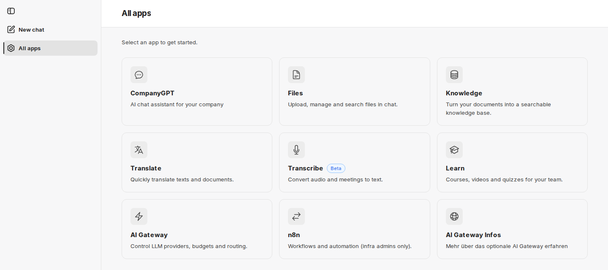
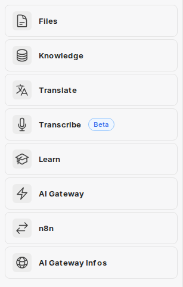

**All apps** (Všechny aplikace) je vstupním bodem ke všem aplikacím kolem CompanyGPT. Přehled zobrazuje formou dlaždic doplňky a odkazy, které jsou povoleny pro váš účet. O tom, které dlaždice uvidíte, rozhoduje vaše organizace.

## Otevření přehledu All apps

K přehledu se dostanete dvěma způsoby.

**Jako stránka.** V každém doplňku vás položka **All apps** v postranním panelu přenese do přehledu (viz [Společné rozhraní](/cs/company-gpt/addons/gemeinsame-oberflaeche/)). Adresa je `https://COMPANY.company-gpt.com/companygpt`. Stránka se jmenuje **All apps** a zobrazuje pokyn **Select an app to get started.** První dlaždicí je vždy **CompanyGPT**, která vás vrátí do chatu. Kliknutím na dlaždici se aplikace otevře ve stejné kartě.

**V chatu.** V postranním panelu chatu otevře položka **Apps** kompaktní seznam stejných aplikací, bez dlaždice CompanyGPT. Kliknutím na položku se aplikace otevře v nové kartě, takže chat zůstane otevřený.

:::note[Není k dispozici ve všech prostředích]
O tom, zda je tato funkce ve vašem prostředí k dispozici, rozhoduje vaše organizace. S dotazy se obraťte na svého administrátora.
:::

## Dlaždice

Každá dlaždice zobrazuje název aplikace a krátký popis. Mohou se zobrazit tyto dlaždice:

| Dlaždice | Text na dlaždici | Více informací |
|---|---|---|
| **CompanyGPT** | AI chat assistant for your company (AI asistent pro chat ve vaší firmě) | [Uživatelské rozhraní](/cs/company-gpt/user-interface/) |
| **Files** | Upload, manage and search files in chat. (Nahrávání, správa a vyhledávání souborů v chatu.) | [companyFILES](/cs/company-gpt/addons/companyfiles/) |
| **Knowledge** | Turn your documents into a searchable knowledge base. (Proměňte své dokumenty v prohledávatelnou znalostní bázi.) | [companyRAG](/cs/company-gpt/addons/companyrag/) |
| **Translate** | Quickly translate texts and documents. (Rychlý překlad textů a dokumentů.) | [companyTRANSLATE](/cs/company-gpt/addons/company-translate/) |
| **Transcribe** | Convert audio and meetings to text. (Převod zvukových záznamů a schůzek na text.) | [companyTRANSCRIBE](/cs/company-gpt/addons/company-transcribe/) |
| **Learn** | Courses, videos and quizzes for your team. (Kurzy, videa a kvízy pro váš tým.) | [companyLEARN](/cs/company-gpt/addons/companylearn/) |
| **Admin** | Manage users, groups and settings. (Správa uživatelů, skupin a nastavení.) | [companyADMIN](/cs/company-gpt/addons/companyadmin/) |
| **Insights** | Usage and costs of companyGPT. (Využití a náklady companyGPT.) | [Insights](/cs/company-gpt/addons/companyadmin/insights/) |
| **AI Gateway** | Control LLM providers, budgets and routing. (Řízení poskytovatelů LLM, rozpočtů a směrování.) | [AI Gateway](/cs/company-gpt/addons/ai-gateway/) |
| **n8n** | Workflows and automation (infra admins only). (Workflow a automatizace, pouze pro administrátory infrastruktury.) | – |

Dlaždice **Knowledge** otevírá companyRAG, nikoli [companyKNOWLEDGE](/cs/company-gpt/addons/companyknowledge/).

V některých prostředích je ještě dlaždice **Dashboard** bývalého companyDASHBOARD. Nyní vede na [Insights](/cs/company-gpt/addons/companyadmin/insights/) v companyADMIN, kde analyzujete využití a náklady.

Vaše organizace může přidat další oblasti znalostí jako **Custom tiles** (vlastní dlaždice).

### Alpha a Beta

Některé dlaždice nesou označení **Alpha** nebo **Beta**. Označuje aplikace, které ještě nejsou ve finální podobě: **Alpha** pro ranou fázi, **Beta** pro pokročilejší. Funkce těchto aplikací se mohou ještě změnit.

### Vlastní odkazy vaší organizace

Kromě doplňků může **All apps** zobrazovat odkazy, které přidala vaše organizace, například na intranet. Zobrazují se za dlaždicemi doplňků. Taková dlaždice je pouze odkaz: zda cíl můžete používat, rozhoduje samotný cíl.

## Když se nezobrazí žádné aplikace

- Během načítání dlaždic se na jejich místě zobrazují šedé zástupné prvky.
- Pokud pro váš účet není povolena žádná aplikace, seznam v chatu zobrazí: **No apps are currently available for your account. Contact your administrator.** Stránka **All apps** v tomto případě zobrazí pouze dlaždici **CompanyGPT**.
- Pokud již nejste přihlášeni, zobrazí se **Sign-in required** s tlačítkem **Sign in**. Z oblasti **Apps** v chatu se přihlášení otevře v hlavním okně.

## Pro administrátory

### Kdo vidí které dlaždice

V závislosti na prostředí pocházejí dlaždice z companyADMIN nebo z konfigurace, kterou pro vaše prostředí spravuje innFactory.

- **Z companyADMIN:** Dlaždice doplňku se zobrazí osobám, které mají odpovídající oprávnění (výjimky: n8n a AI Gateway, viz níže). V části **Configuration → [Tools](/cs/company-gpt/addons/companyadmin/tools/)** spravujete **Extension tiles** a pomocí **Add tile** vytváříte **Custom tiles**: s polem **Name**, **Address**, volitelně **Description** a **Icon** a s nastavením **Visibility** (**Every signed-in user**, **Specific roles** nebo **Specific groups**). Stránka také ukazuje, zda All apps ve vašem prostředí načítá dlaždice z companyADMIN.
- **Z konfigurace:** Jinak viditelnost řídí innFactory prostřednictvím skupin ve vašem adresáři. O změny požádejte innFactory.

Označení **Alpha** a **Beta** nastavuje innFactory na vyžádání. Vlastní odkazy přidáváte přes **Custom tiles** v companyADMIN.

Změny dlaždic se projeví nejpozději po opětovném načtení All apps.

### Dlaždice není oprávnění

:::caution
Dlaždice je pouze odkaz. Zda někdo smí doplněk používat, kontroluje samotný doplněk na základě jeho oprávnění. Kdo dlaždici vidí, ale oprávnění nemá, dostane při otevření stránku **No access**. Naopak skrytí dlaždice samo o sobě žádné oprávnění neodebírá.
:::

Oprávnění pro doplňky udělujete v companyADMIN, viz [Rozšíření](/cs/company-gpt/addons/companyadmin/erweiterungen/). Výjimkou je přepínač rozšíření v části **Configuration → Tools**: u doplňků, jejichž oprávnění spravuje companyADMIN, přepíná dlaždici i oprávnění společně (**Active (tile and rights)**). U aplikací, které si přístup spravují samy, jako n8n a AI Gateway, se přepínač jmenuje **Show in companyTOOLS** a pouze zobrazuje nebo skrývá dlaždici – stejně pro všechny přihlášené uživatele, včetně administrátorů.
