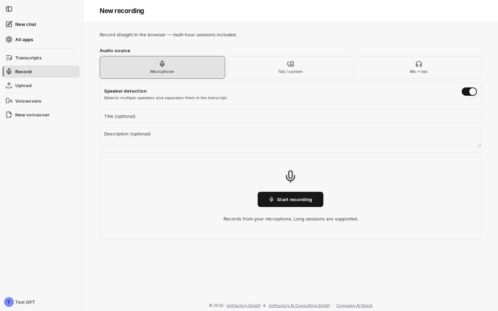
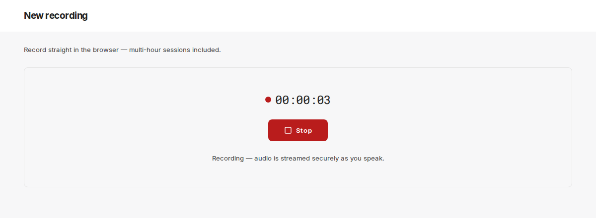
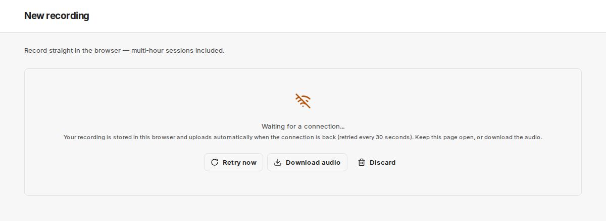

V companyTRANSCRIBE máte dvě možnosti, jak získat přepis: nahrát existující soubor, nebo nahrávat přímo v prohlížeči. K oběma se dostanete přes položky nabídky **Record** a **Upload** nebo přes stejnojmenná tlačítka v záhlaví přehledu **Transcripts**.

## Příprava nahrávání v prohlížeči

Stránka **New recording** obsahuje poznámku „Record straight in the browser — multi-hour sessions included.“ (nahrávání přímo v prohlížeči, i vícehodinové relace). Před spuštěním nastavíte následující možnosti.

### Zdroj zvuku

| Možnost | Nahrává |
|---|---|
| **Microphone** | Pouze mikrofon zařízení |
| **Tab / system** | Pouze zvuk karty prohlížeče nebo systému |
| **Mic + tab** | Mikrofon a systémový zvuk současně |

Předvolena je možnost **Microphone**. **Tab / system** a **Mic + tab** se hodí pro online schůzky, kde se mají zaznamenat i ostatní účastníci.

:::note
U možností **Tab / system** a **Mic + tab** se prohlížeč zeptá na zdroj. Ve výběru zvolte kartu nebo okno a zapněte „Share audio“ (sdílet zvuk). Funguje to v Chrome a Edge; v macOS lze zaznamenat pouze zvuk z karet prohlížeče, nikoli z jiných aplikací.
:::

### Rozpoznávání mluvčích

Přepínač **Speaker detection** určuje, zda se přepis rozdělí podle mluvčích. Ve výchozím nastavení je zapnutý. Aplikace sama popisuje oba stavy:

| Stav | Poznámka v rozhraní | Vhodné pro |
|---|---|---|
| Vypnuto | „Continuous text with no speaker labels — right for your own dictation.“ (souvislý text bez označení mluvčích) | Vlastní diktáty a delší nahrávky přepisované pro vlastní potřebu |
| Zapnuto | „Detects multiple speakers and separates them in the transcript.“ (rozpozná více mluvčích a oddělí je v přepisu) | Schůzky s více účastníky, osobně i online |

:::note
Rozpoznávání mluvčích lze nastavit pouze před spuštěním nahrávání. Zda bylo aktivní, se později zobrazí v metadatech přepisu u položky **Speaker detection** (`On` nebo `Off`).
:::

### Název a popis

**Title (optional)** a **Description (optional)** můžete zadat před nahráváním; obě pole lze později změnit v detailním zobrazení přepisu. Bez názvu aplikace uloží záznam pod výchozím názvem.

## Spuštění a ukončení nahrávání

Kliknutím na **Start recording** zahájíte záznam – poznámka pod tlačítkem zní „Records from your microphone. Long sessions are supported.“ (nahrává z mikrofonu, podporovány jsou i dlouhé relace).

Během nahrávání aplikace zobrazuje běžící časovač a tlačítko **Stop**. Poznámka „Recording — audio is streamed securely as you speak.“ znamená, že se zvuk přenáší do úložiště tenantu průběžně, zatímco mluvíte, a ne až na konci relace. Navíc každá část zvuku zůstává v prohlížeči, dokud není nahrávka uložena. Během nahrávání companyTRANSCRIBE brání přechodu obrazovky do režimu spánku, pokud to prohlížeč umožňuje.

Po kliknutí na **Stop** aplikace nahrávku dokončí („Finalizing recording...“), nahraje zbývající zvuk („Uploading the remaining audio“) a na pozadí spustí přepis. Jakmile se objeví „Recording saved — transcription started“, companyTRANSCRIBE otevře nový přepis.

**Nechte stránku otevřenou, dokud se nezobrazí „Recording saved — transcription started“.** Dokud je zobrazeno „Finalizing recording...“, „Uploading the remaining audio“ nebo „Waiting for a connection...“, nahrávka ještě není kompletně uložena. Poté můžete stránku zavřít; přepis pokračuje.

:::note[Jak dlouhá může nahrávka být?]
Aplikace sama délku nahrávky neomezuje. Při aktivním rozpoznávání mluvčích však lze na jednu nahrávku přepsat nejvýše **240 minut (4 hodiny)**. Delší nahrávky se uloží, ale jejich přepis selže. Velmi dlouhé relace rozdělte do několika nahrávek.
:::

## Ochrana probíhajícího nahrávání

companyTRANSCRIBE brání nechtěné ztrátě probíhající nahrávky:

- **Opuštění stránky:** pokud během nahrávání zvolíte jinou položku nabídky, **New chat**, **All apps**, jiný jazyk nebo **Log out**, aplikace se zeptá: „A recording is in progress. Stop and save it before leaving?“ (probíhá nahrávání – zastavit a uložit před odchodem?). Pokud potvrdíte, nahrávka se zastaví a uloží a teprve poté proběhne přechod. Pokud ji nelze právě uložit, zůstanete na stránce nahrávání a nahrávání na server se dál opakuje.
- **Zavření nebo opětovné načtení karty:** prohlížeč před opuštěním stránky zobrazí varování.
- **Vypršené přihlášení:** pokud vaše relace CompanyGPT během nahrávání vyprší, companyTRANSCRIBE pokračuje v nahrávání a nahrávku uloží. Poznámka zní „Your sign-in session expired — the recording continues and will be saved. You may need to sign in again afterwards.“
- **Změna účtu v chatu:** pokud se do CompanyGPT přihlásíte jiným účtem, companyTRANSCRIBE stránku znovu načte až po skončení nahrávání.

## Výpadky připojení

Pokud během nahrávání vypadne internetové připojení, nahrávání pokračuje. Zvuk zůstane v prohlížeči a po obnovení připojení se automaticky nahraje. Mezitím se zobrazí poznámka „No connection — … of audio is waiting to upload. The recording continues and uploads automatically once you're back online.“

Pokud nahrávání zastavíte bez připojení, companyTRANSCRIBE zobrazí **Waiting for a connection...** a každých 30 sekund se pokusí o opětovné nahrání. K dispozici jsou tři tlačítka:

| Tlačítko | Účinek |
|---|---|
| **Retry now** | Okamžitě znovu spustí nahrávání na server |
| **Download audio** | Uloží nahrávku jako zvukový soubor do vašeho zařízení |
| **Discard** | Po potvrzení smaže zvuk uložený v prohlížeči |

V tomto stavu nechte stránku otevřenou, nebo si zvuk stáhněte.

Pokud server nahrání odmítne, nahrávání v prohlížeči pokračuje, ale nelze jej uložit. Po zastavení si zvuk stáhněte pomocí **Download audio** a soubor poté nahrajte přes [**Upload**](#nahrání-souboru).

### Dosud neuložené nahrávky

Pokud byla během nahrávání zavřena nebo znovu načtena karta, prohlížeč spadl nebo nahrávku nebylo možné uložit, zvuk zůstane zachován v prohlížeči. Až v tomtéž prohlížeči příště otevřete **Record**, companyTRANSCRIBE takové nahrávky zobrazí v bloku **Recordings not yet saved** – s názvem, časem a velikostí:

- **Upload** – nahraje nahrávku na server a spustí přepis
- **Download audio** – uloží zvuk jako soubor
- Koš (**Discard**) – smaže zvuk uložený v prohlížeči

Pokud server nahrávku již nezná, u záznamu je uvedeno „no longer exists on the server — download the audio and upload the file instead“ (na serveru již neexistuje – stáhněte zvuk a nahrajte místo toho soubor).

## Nahrání souboru

Pomocí **Upload** přepíšete nahrávku, kterou už máte – například schůzku zaznamenanou mikrofonem v místnosti, diktafonem nebo telefonem. Stránka **Upload audio** obsahuje poznámku „Upload an existing audio or video file and have it transcribed.“

Nejprve zadejte volitelné údaje **Title (optional)** a **Description (optional)**. Poté soubor přetáhněte do oblasti **Drop an audio file to transcribe** nebo jej vyberte kliknutím; nahrávání začne okamžitě. Oblast pro přetažení uvádí „MP3, WAV, M4A, WebM up to 200 MB and 240 minutes“; přijímány jsou všechny běžné zvukové a video soubory do **200 MB** a o délce nejvýše **240 minut**. Delší soubory jsou okamžitě odmítnuty. U video souborů se zvuková stopa extrahuje automaticky.

Nahrané soubory se vždy přepisují s rozpoznáváním mluvčích; při nahrávání souboru pro to není přepínač. Po nahrání companyTRANSCRIBE ohlásí „Upload complete — transcription started“ a otevře nový přepis.

## Co dál?

Jakmile je přepis hotový, uvidíte text v detailním zobrazení. Stránka [Úprava přepisů](/cs/company-gpt/addons/company-transcribe/transkripte/) popisuje, jak opravit text, pojmenovat mluvčí a exportovat výsledek.
