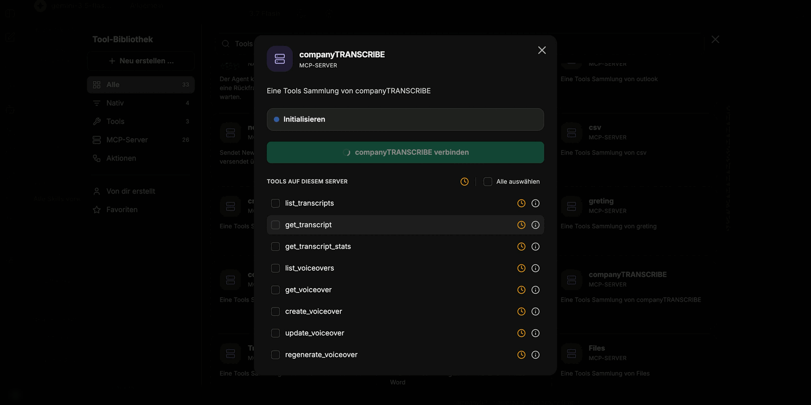
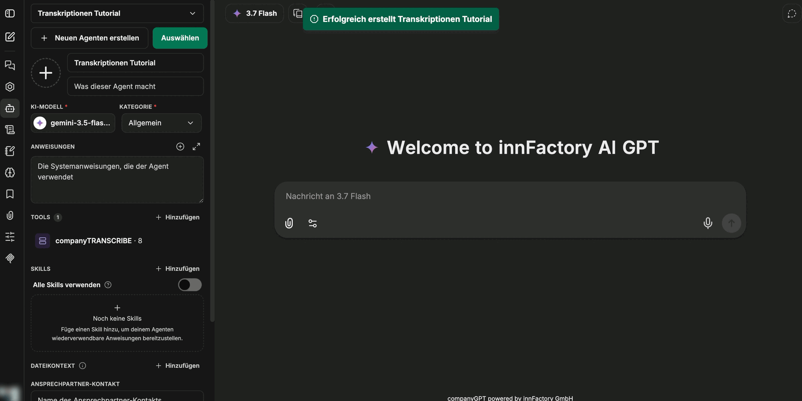

Přepisy nemusíte zpracovávat ručně. Prostřednictvím MCP serveru **companyTRANSCRIBE** získá agent v CompanyGPT přístup k vašim vlastním přepisům a hlasovým výstupům — vypíše je, načte jejich obsah, shrne je a na požádání vytvoří nové hlasové výstupy.

## Nastavení agenta

1. V CompanyGPT vytvořte agenta přes **Create New Agent** a pojmenujte ho.
2. Zvolte model AI a kategorii. Pro vypisování a shrnování stačí malý, rychlý model; rozsáhlé instrukce nejsou nutné.
3. V části **Tools** klikněte na **Add** a v **Tool Library** vyberte v části **MCP Servers** položku **companyTRANSCRIBE**.
4. V dialogu klikněte na **Connect companyTRANSCRIBE**. Po připojení rozhraní ohlásí „MCP server 'companyTRANSCRIBE' initialized successfully“.
5. Agenta uložte.

V dialogu můžete nástroje serveru povolit jednotlivě nebo je převzít všechny najednou přes **Select all**. Po uložení se server zobrazí v seznamu nástrojů agenta spolu s počtem obsažených nástrojů.

:::tip[Poznámka]
Protože server přináší jen několik nástrojů, můžete u tohoto agenta vypnout odložené načítání nástrojů („lazy loading“). Všechny nástroje pak má agent k dispozici okamžitě.
:::

## Dostupné nástroje

Server poskytuje osm nástrojů — tři pro přepisy a pět pro hlasové výstupy:

| Nástroj | Účel |
|---|---|
| `list_transcripts` | Vypsání existujících přepisů |
| `get_transcript` | Načtení úplného obsahu přepisu |
| `get_transcript_stats` | Načtení metrik přepisu |
| `list_voiceovers` | Vypsání existujících hlasových výstupů |
| `get_voiceover` | Načtení jednoho hlasového výstupu |
| `create_voiceover` | Vytvoření nového hlasového výstupu |
| `update_voiceover` | Aktualizace existujícího hlasového výstupu |
| `regenerate_voiceover` | Opětovné vygenerování zvuku hlasového výstupu |

## Typické použití

Jakmile je agent připojen, stačí v chatu jediný pokyn:

- **Vypsání** — agent uvede dostupné přepisy spolu s počtem rozpoznaných mluvčích.
- **Shrnutí** — na pokyn jako „Shrň nahrávku *&lt;název&gt;*“ agent načte přepis a shrne celý jeho obsah.
- **Vytvoření zápisu** — ze surového přepisu vznikne strukturovaný zápis z porady, shrnutí nebo seznam úkolů v libovolném formátu, který si vyžádáte.
- **Vytvoření hlasového výstupu** — agent vytvoří nový hlasový výstup pomocí `create_voiceover` a vrátí odkaz, ze kterého lze zvukový soubor stáhnout. Podle délky trvá generování chvíli; hlasový výstup se pak objeví i v přehledu **Voiceovers**.

:::note
Přístup je vázán na uživatele: prostřednictvím MCP serveru vidí agent vždy jen přepisy a hlasové výstupy přihlášeného uživatele.
:::

## Co dál?

Stránky [Nahrávání a přepis](/cs/company-gpt/addons/company-transcribe/aufnehmen/) a [Úprava přepisů](/cs/company-gpt/addons/company-transcribe/transkripte/) popisují, jak přepisy vznikají a jak je před analýzou opravit. Obecné informace o MCP serverech v CompanyGPT najdete na stránce [MCP Server](/cs/company-gpt/integrationen/mcp-server/).
