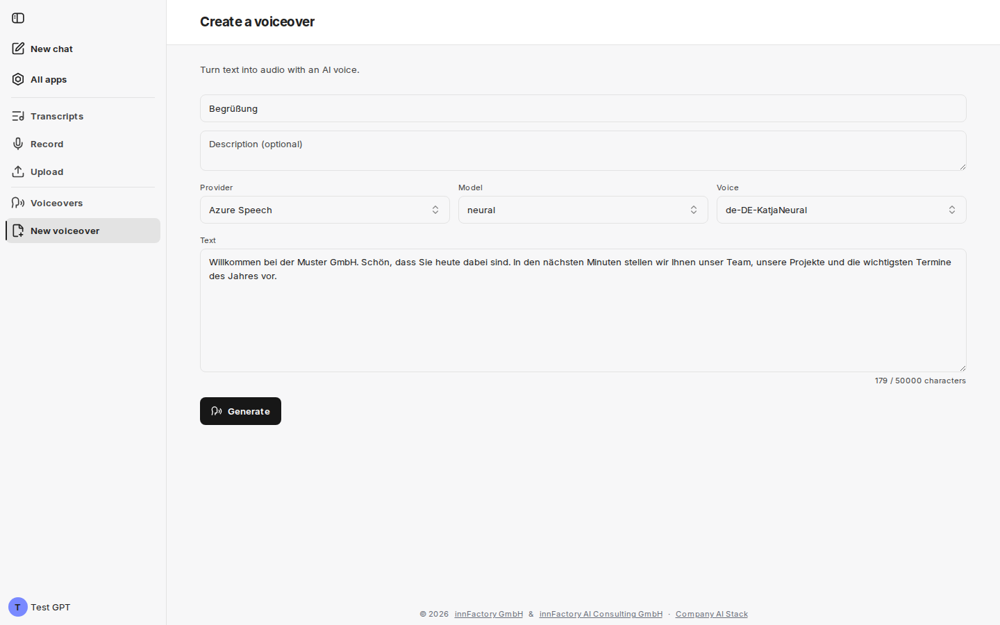
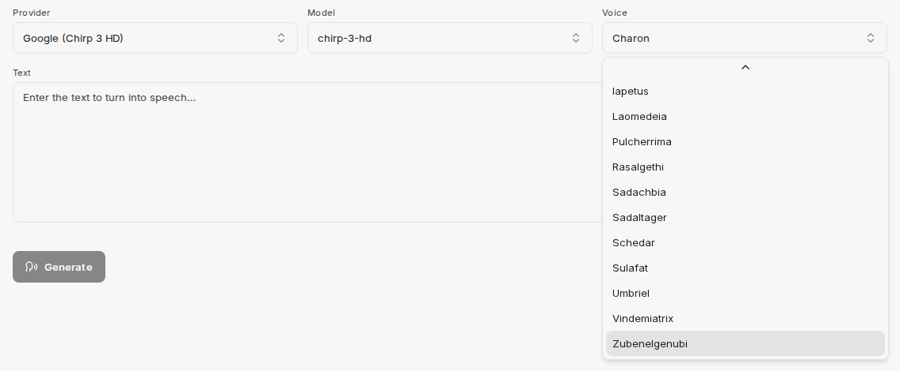
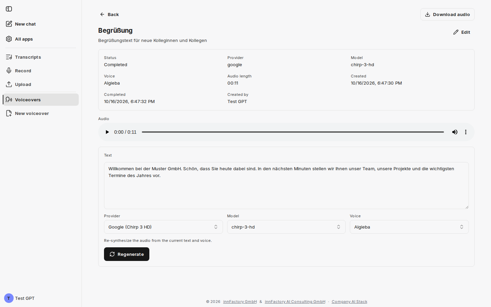

companyTRANSCRIBE funguje i opačným směrem: kromě převodu zvuku na text generuje také zvuk z textu. Tato oblast tvoří v postranním panelu vlastní skupinu nabídky: **Voiceovers** obsahuje všechny vygenerované zvukové soubory („Every voiceover you have generated.“) a **New voiceover** otevře formulář pro vytvoření nového – stejně jako stejnojmenné tlačítko v záhlaví stránky s přehledem.

Každý řádek přehledu zobrazuje název, případný popis, čas vytvoření, délku zvukového záznamu, hlas a vlastníka. Kliknutím na řádek hlasový výstup otevřete; ikona koše jej po potvrzení trvale smaže.

## Vytvoření hlasového výstupu

Formulář **Create a voiceover** nese podnadpis „Turn text into audio with an AI voice.“

| Pole | Význam |
|---|---|
| **Title (optional)** | Název hlasového výstupu v přehledu |
| **Description (optional)** | Volný text pro kontext |
| **Provider** | Služba, která hlas generuje |
| **Model** | Hlasový model zvoleného poskytovatele |
| **Voice** | Konkrétní hlas zvoleného modelu |
| **Text** | Text, který má být přečten |

Textové pole obsahuje zástupný text „Enter the text to turn into speech…“ a pod ním počítadlo znaků s horním limitem, ve výchozím stavu **50 000 znaků** (tuto hodnotu může změnit Váš administrátor). Kliknutím na **Generate** spustíte generování a otevře se nový hlasový výstup; tlačítko zůstává neaktivní, dokud nezadáte text.

## Poskytovatelé, modely a hlasy

V závislosti na konfiguraci jsou k dispozici až tři poskytovatelé, každý s vlastními modely a seznamem hlasů. Které z nich jsou ve Vašem prostředí viditelné, rozhoduje Váš administrátor. Text se ke generování odesílá zvolenému poskytovateli.

| Poskytovatel | Model | Příklad hlasu |
|---|---|---|
| **Azure Speech** | `neural`, `hd` | `de-DE-KatjaNeural` |
| **Azure OpenAI** | `gpt-4o-mini-tts` | `alloy` |
| **Google (Chirp 3 HD)** | `chirp-3-hd` | `Charon`, `Algieba` |

Hlasy Azure Speech se řídí vzorem `<language>-<region>-<name>…`, takže jazyk hlasu lze vyčíst z jeho názvu. Hlasy Google Chirp 3 HD naopak nesou vlastní jména bez označení jazyka.

Seznam pro Google Chirp 3 HD obsahuje mimo jiné `Iapetus`, `Laomedeia`, `Pulcherrima`, `Rasalgethi`, `Sadachbia`, `Sadaltager`, `Schedar`, `Sulafat`, `Umbriel`, `Vindemiatrix` a `Zubenelgenubi`.

:::note
Seznam hlasů se posouvá uvnitř výběru; výše uvedená jména jsou viditelnou částí a nemusí jít o úplný výčet. U Google Chirp 3 HD označují jména charakter hlasu, nikoli jazyk: všechny hlasy Google mluví jazykem, který nastavil Váš administrátor, ve výchozím stavu němčinou.
:::

## Kontrola a opětovné generování

Hotový hlasový výstup zobrazuje ve svém záhlaví stav, poskytovatele, model, hlas, délku zvukového záznamu a čas vytvoření a dokončení.

Pod přehrávačem zvuku zůstává použitý text upravitelný, následují opět výběry **Provider**, **Model** a **Voice**. Poznámka „Re-synthesize the audio from the current text and voice.“ popisuje, co dělá **Regenerate**: změníte text nebo hlas a vytvoříte z nich novou verzi, aniž byste museli hlasový výstup vytvářet znovu.

Výsledek lze přehrát přímo v přehrávači zvuku; **Download audio** vpravo nahoře jej uloží jako zvukový soubor.

:::tip[Poznámka]
Dřívější verze zůstávají po **Regenerate** zachovány v části **Previous versions** a lze je tam stále přehrát — nová verze starou nezahodí.
:::

## Co dál?

Hlasové výstupy lze vytvářet i bez rozhraní: agent v chatu CompanyGPT je může prostřednictvím MCP serveru vytvářet, načítat a znovu generovat. Viz [Přístup z CompanyGPT](/cs/company-gpt/addons/company-transcribe/mcp-integration/).
