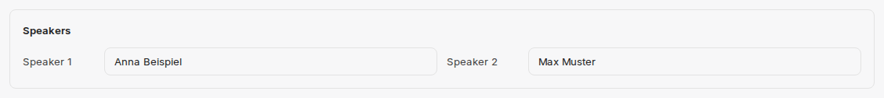

Kliknutím na řádek v přehledu **Transcripts** otevřete detailní zobrazení; po nahrávání nebo nahrání souboru je companyTRANSCRIBE otevře automaticky. Zde vidíte metadata nahrávky, můžete přehrát zvuk, opravit rozpoznaný text, pojmenovat mluvčí a exportovat výsledek. Tlačítkem **Back** se vrátíte do přehledu.

## Metadata nahrávky

V záhlaví detailního zobrazení jsou uvedeny technické údaje o přepisu.

| Pole | Obsah |
|---|---|
| **Status** | `Pending`, dokud přepis nezačne, `Processing` během přepisu, poté `Completed` – nebo `Failed`, pokud přepis nebyl možný |
| **Created** | Kdy byla nahrávka vytvořena |
| **Completed** | Kdy byl přepis dokončen |
| **Processing time** | Doba trvání přepisu |
| **Audio length** | Délka nahrávky |
| **Created by** | Uživatel, kterému přepis patří |
| **Language** | zůstává prázdné (`—`), protože přepis probíhá vždy v němčině |
| **Speaker detection** | `On` nebo `Off` podle nastavení použitého při nahrávání |

Během přepisu se místo textu zobrazí upozornění „Transcribing... This can take a few minutes depending on the recording length.“ (přepis probíhá a podle délky nahrávky může trvat několik minut). Pokud přepis selhal, zobrazí se „Transcription failed“, pokud možno i s důvodem. Pokud nahrávka neobsahuje žádnou rozpoznatelnou řeč, detailní zobrazení oznámí „No speech was detected in this recording.“

Tlačítkem **Edit** vedle názvu změníte název a popis záznamu; tlačítkem **Save** změnu uložíte.

:::note
Pole **Language** zobrazuje pomlčku. Nejde o chybu: companyTRANSCRIBE přepisuje vždy v němčině; pro nahrávky ani nahrané soubory neexistuje výběr jazyka.
:::

## Přehrávání zvuku

V sekci **Audio** se nachází přehrávač, takže nahrávku můžete kdykoli znovu přehrát — to se hodí ke kontrole nejasné pasáže přepisu oproti originálu. Kliknutím na časovou značku v přepisu přeskočíte přímo na příslušné místo ve zvukovém záznamu.

## Oprava textu

Sekce **Transcript** nabízí dvě akce:

- **Edit** — přepne text do upravitelných polí, jedno pro každý příspěvek. companyTRANSCRIBE ukládá změny průběžně během psaní; akce se změní na **Done**, čímž úpravy ukončíte.
- **Resync** — Během přehrávání se přepis automaticky posouvá. Pokud se posunete jinam sami, zobrazí se **Resync**, které automatické posouvání znovu zapne.

Zde typicky opravujete vlastní jména a odborné výrazy, které rozpoznávání špatně zachytilo — například „App“, které má znít „API“. Oprava se promítne i do exportu.

## Pojmenování mluvčích

Pokud byla nahrávka pořízena se zapnutým rozpoznáváním mluvčích, zobrazí se nad textem blok **Speakers** s jedním vstupním polem pro každý rozpoznaný hlas (`Speaker 1`, `Speaker 2`, `Speaker 3`, …).

Zadejte sem skutečná jména. Přiřazení se pak promítne do celého přepisu: každý příspěvek je uvozen zadaným jménem a časovou značkou. Z anonymního číslování se tak stane čitelný záznam rozhovoru — a jména se objeví i v exportovaném souboru. Mluvčí bez jména se v textu i v exportu zobrazují jako „Speaker 1“, „Speaker 2“ atd.

:::tip[Poznámka]
Rozpoznávání mluvčích rozliší až 35 hlasů na jednu nahrávku. Mluvčí pojmenujte jednou centrálně v tomto bloku, místo abyste přepisovali jednotlivé úseky v textu.
:::

## Export do formátu Markdown

Tlačítko **Download .md** vpravo nahoře uloží celý přepis jako soubor Markdown; zobrazí se, jakmile je přepis dokončen. Soubor začíná názvem a datem vytvoření; při zapnutém rozpoznávání mluvčích začíná každý příspěvek tučně zvýrazněným přiřazeným jménem a časovou značkou. Soubor tak můžete ihned dále zpracovat — například jako podklad pro zápis z jednání nebo k uložení do znalostní sbírky.

## Co dál?

Místo ručního zpracování můžete nechat přepis analyzovat přímo v chatu: [Přístup z CompanyGPT](/cs/company-gpt/addons/company-transcribe/mcp-integration/).
