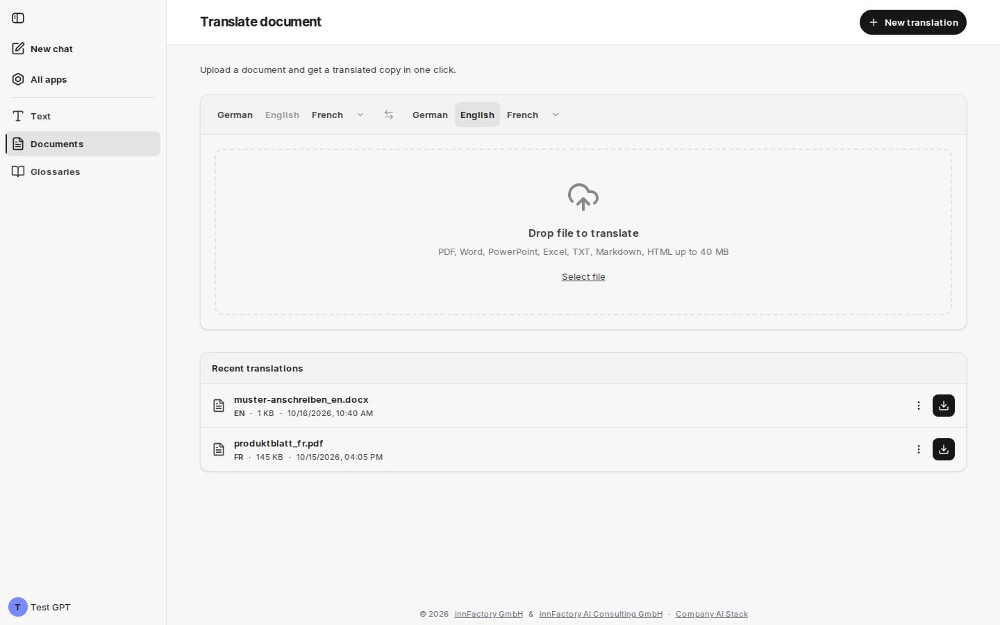
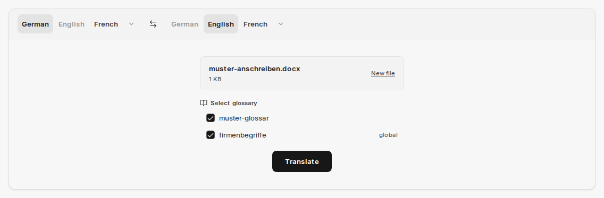

Oblast **Documents** překládá celé soubory a vrací je v původním formátu. Stránka nese název **Translate document** a poznámku „Upload a document and get a translated copy in one click.“ (Nahrajte dokument a jedním kliknutím získejte přeloženou kopii.)

## Podporované formáty

Oblast **Drop file to translate** uvádí povolené formáty: **PDF, Word, PowerPoint, Excel, TXT, Markdown, HTML up to 40 MB**. Soubor přidáte přetažením nebo jej vyberete pomocí **Select file**.

| Formát | Přípona souboru |
|---|---|
| PDF | `.pdf` |
| Word | `.docx` |
| PowerPoint | `.pptx` |
| Excel | `.xlsx` |
| Text | `.txt` |
| Markdown | `.md` |
| HTML | `.html` |

companyTRANSLATE kontroluje formát, velikost a obsah každého souboru. Pokud něco nevyhovuje, oblast pro přetažení zůstane zobrazena a uvede důvod, například „File is too large (max 40 MB)“ nebo „The file content does not match its file type.“ Textové soubory (TXT, Markdown, HTML) musí být v kódování UTF-8.

:::note
Na rozdíl od [překladu textu](/cs/company-gpt/addons/company-translate/text-uebersetzen/) zde není k dispozici automatické rozpoznání jazyka. Před překladem vyberte zdrojový jazyk; bez něj zůstane tlačítko **Translate** neaktivní a companyTRANSLATE na to upozorní hláškou „Please select source language (auto-detect not available for files)“.
:::

## Volba jazyků a glosáře

Po výběru zobrazí companyTRANSLATE soubor s jeho názvem a velikostí. Pomocí **New file** vyberete jiný soubor. Pod ním se zobrazí stav glosáře pro zvolenou jazykovou dvojici: buď **No glossary available for this language pair**, nebo seznam **Select glossary** se všemi odpovídajícími glosáři jako zaškrtávacími políčky.

Všechny odpovídající glosáře jsou zpočátku vybrány; globální glosáře nesou příponu **global**. Zrušte zaškrtnutí glosářů, které se nemají použít. Při překladu dokumentů fungují glosáře v každém prostředí, i bez Google.

Tlačítkem **Translate** spustíte proces. companyTRANSLATE nejprve zobrazí **Uploading...** a poté **Translating...**.

## Stažení výsledku

Po dokončení companyTRANSLATE ohlásí **Translation complete** a nabídne **Download translation**. Pomocí **New file** nebo **New translation** v záhlaví stránky oblast připravíte pro další úlohu.

Přeložená kopie zachovává strukturu a formátování zdrojového souboru: nadpisy, odstavce, zvýraznění a zalomení stránek zůstávají zachovány, takže zdrojový a cílový dokument lze porovnat vedle sebe.

Pokud překlad selže, zobrazí se **Translation failed**, pokud možno s uvedením důvodu, například „Translation limit reached“.

## Nedávné překlady

Pod oblastí pro přetažení zobrazuje **Recent translations** vaše dřívější překlady dokumentů, od nejnovějších. Seznam obsahuje také překlady, které pro vás vytvořil agent v [chatu](/cs/company-gpt/addons/company-translate/im-chat/). Každá položka zobrazuje název souboru, cílový jazyk, velikost souboru a čas.

| Označení | Význam |
|---|---|
| **Processing** | Překlad stále probíhá; stažení zatím není k dispozici. |
| **Failed** | Překlad selhal. |
| bez označení | Překlad je hotový; tlačítko vpravo jej stáhne. |

Nabídka položky obsahuje:

- **Download original** – nahraný zdrojový soubor
- **Retry translation** – spustí překlad znovu se stejným zdrojovým souborem, zdrojovým jazykem a glosáři. Výsledek se zobrazí jako nová položka; předchozí zůstane zachována.
- **Delete** – po potvrzení („Really delete?“) odstraní překlad i zdrojový soubor

Pokud glosář použitý v původním překladu již neexistuje, **Retry translation** skončí hláškou „The selected glossary was not found.“

:::tip[Poznámka]
Větší dokumenty chvíli trvají. Stránku nemusíte nechávat otevřenou: probíhající překlad najdete později v **Recent translations**.
:::

Překlady od verze 2.0 se uchovávají 30 dní. Poté ze seznamu zmizí; pozdější pokus ohlásí „This translation has expired and is no longer available“.

## Související témata

- [Glosáře](/cs/company-gpt/addons/company-translate/glossare/) – jednotná terminologie pro překlady dokumentů
- [Překlad textu](/cs/company-gpt/addons/company-translate/text-uebersetzen/) – překlad krátkých textů přímo v rozhraní
- [Překlad v chatu](/cs/company-gpt/addons/company-translate/im-chat/) – překlad souborů z chatu pomocí agenta
