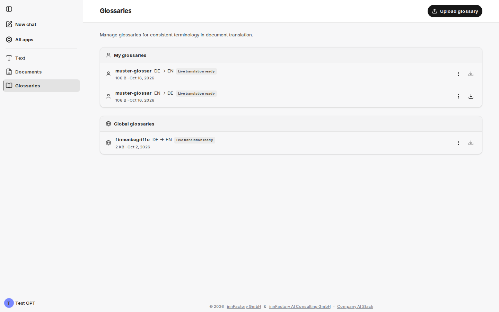

Glosáře určují, jak se mají překládat jednotlivé výrazy. Zajišťují závaznou terminologii — názvy produktů, označení rolí nebo ustálená spojení —, která by se jinak překládala různě podle kontextu. Glosáře se uplatňují při [překladu dokumentů](/cs/company-gpt/addons/company-translate/dokument-uebersetzen/), při [překladu v chatu](/cs/company-gpt/addons/company-translate/im-chat/) a — pokud je ve vašem prostředí povolen Google Cloud Translation — také při [překladu textu](/cs/company-gpt/addons/company-translate/text-uebersetzen/).

Glosáře spravujete v oblasti **Glossaries** („Manage glossaries for consistent terminology in document translation.“). Tato oblast není k dispozici na chytrých telefonech.

## Moje glosáře a globální glosáře

Přehled rozlišuje dvě úrovně:

- **My glossaries** – vaše vlastní glosáře. Každý, kdo smí používat companyTRANSLATE, si může vytvářet vlastní glosáře: pomocí **Upload glossary** vpravo v záhlaví stránky.
- **Global glossaries** – celofiremní glosáře dostupné všem. Vytvářet, nahrazovat a mazat je mohou pouze administrátoři – v companyADMIN to jsou osoby s oprávněním **Manage glossaries** (viz [Přístup a oprávnění](/cs/company-gpt/addons/company-translate/#přístup-a-oprávnění)). Pouze ony navíc vidí v záhlaví stránky **Upload global glossary**.

Pokud zatím neexistují žádné globální glosáře, zobrazí se **No global glossaries available**; uživatelé, kteří nejsou administrátory, pod tím vidí „Only administrators can manage global glossaries.“

Každá položka zobrazuje název, směr překladu (například `DE → EN`), u glosářů TSV a XLIFF formát, případně [živý stav](#živý-stav-u-googlu), velikost souboru a datum. Tlačítko vpravo glosář stáhne. Nabídka položky obsahuje:

- **Upload new version** – otevře dialog pro nahrání s názvem a jazyky glosáře; nový soubor nahradí předchozí glosář
- **Delete** – po potvrzení glosář odstraní

Globální glosáře mohou nahrazovat nebo mazat pouze administrátoři.

## Živý stav u Googlu

Pokud je ve vašem prostředí povolen Google Cloud Translation, companyTRANSLATE ukládá nahrané glosáře také u Googlu, aby se uplatňovaly při překladu textu („živý překlad“). Stav se zobrazuje u položky:

| Stav | Význam |
|---|---|
| **Live translation ready** | Glosář se uplatňuje při překladu textu. |
| **Live translation being prepared** | Google glosář ještě připravuje; obvykle to trvá několik minut. Do té doby je při překladu textu zobrazen šedě. |
| **Not yet registered for live translation** | Glosář zatím není u Googlu uložen. **Upload new version** jej zaregistruje znovu. |
| **Not usable for live translation** | Google nemůže glosář použít, například proto, že jde o soubor XLIFF. |

Pro překlad dokumentů je živý stav nepodstatný: tam lze použít jakýkoli glosář. Bez Googlu přehled žádný živý stav nezobrazuje.

## Struktura souboru glosáře

Soubor CSV nebo TSV obsahuje dva sloupce — zdroj a cíl. Každý řádek tvoří dvojici výrazů:

| de | en |
|---|---|
| Umsatz | Money Explosion |
| Geschäftsjahr | Year of the Potato |
| Vorstand | Council of Wizards |
| Besprechung | Nap Time |

:::note
Ukázkové hodnoty pocházejí ze školicího glosáře a jsou záměrně přehnané, aby byl účinek glosáře v překladu okamžitě patrný.
:::

Při nahrávání platí:

- **Oddělovač:** čárka, středník nebo tabulátor. companyTRANSLATE rozpozná oddělovač sám, takže fungují i exporty z tabulkových procesorů se středníky.
- **Řádek záhlaví:** nepovinný. První řádek se považuje za záhlaví, pokud uvádí oba jazyky – jako kódy (`de;en`), jako názvy (`Deutsch;Englisch` nebo `German;English`) nebo jako název s kódem (`Deutsch;Englisch (en)`) – nebo obsahuje obecná označení jako `source,target` či `Quelle;Ziel`. Jakýkoli jiný první řádek se bere jako dvojice výrazů.
- **Prázdná pole:** řádky, ve kterých chybí výraz, se přeskočí. Pokud soubor neobsahuje vůbec žádnou dvojici výrazů, companyTRANSLATE jej odmítne („No term pairs found – expected two columns (source, target) separated by comma, semicolon or tab.“).

Tlačítko **Download example CSV** v dialogu pro nahrání nabízí šablonu.

## Nahrání glosáře

**Upload glossary** v záhlaví stránky otevře dialog se všemi údaji pro nový glosář.

| Pole | Význam |
|---|---|
| **Glossary name** | Název, pod kterým se glosář nabízí k výběru. Povolena jsou pouze malá písmena, číslice a pomlčky, 1–40 znaků. Pole během psaní převádí velká písmena na malá a mezery a podtržítka na pomlčky; ostatní znaky vypouští. |
| **Source language** | Jazyk levého sloupce |
| **Target language** | Jazyk pravého sloupce; musí se lišit od zdrojového jazyka |
| **Also create the reverse direction** | Ze stejného souboru vytvoří druhý glosář pro opačný směr. Pole se zobrazí pouze tehdy, je-li tato funkce ve vašem prostředí povolena; pro soubory XLIFF neplatí. |
| **Select file (CSV, TSV, XLIFF, TMX)** | Výběr souboru glosáře |

Povoleny jsou **soubory CSV, TSV (`.tsv`/`.tab`), XLIFF (`.xlf`) a TMX**. Soubory TMX se automaticky převedou na XLIFF. Tlačítkem **Upload** glosář uložíte.

Pokud znovu nahrajete glosář se stejným názvem a stejným směrem překladu, nahradí ten předchozí („Glossary replaced“).

:::note
Glosáře platí vždy pouze v jednom směru. Glosář němčina → angličtina se neuplatní při překladu angličtina → němčina. **Also create the reverse direction** vytvoří oba směry v jednom kroku; v přehledu se pak zobrazí jako dvě položky se stejným názvem a různým směrem překladu.
:::

Pokud je Google povolen, companyTRANSLATE po nahrání oznámí, když se glosář uplatní pouze u dokumentů – například „XLIFF glossaries apply to documents only. Upload CSV, TSV or TMX for live translation.“

### Omezení pro soubory TMX

Dialog upozorňuje na omezení velikosti: poskytovatelé překladů omezují glosáře na 10 MB. Soubory TMX, jejichž obsah se do tohoto limitu vejde, se při překladu dokumentů použijí celé. U větších souborů se automaticky extrahuje glosář výrazů — ponechají se pouze krátké, termínům podobné položky o nejvýše 5 slovech nebo 50 znacích, celé věty se zahodí a převezmou se nejčastější výrazy až do limitu 10 MB, maximálně 50 000 položek.

## Použití glosářů

Glosář je k dispozici, jakmile zvolená jazyková kombinace odpovídá jeho směru překladu:

- **Překlad textu** (pouze Google): pomocí vyhledávatelného výběru glosáře pod vstupním polem nebo automaticky pomocí **Auto-apply glossary**; na jeden překlad se uplatní jeden glosář. Viz [Překlad textu](/cs/company-gpt/addons/company-translate/text-uebersetzen/#použití-glosáře).
- **Překlad dokumentů:** pomocí **Select glossary** před spuštěním; všechny odpovídající glosáře jsou předvybrány. Viz [Překlad dokumentu](/cs/company-gpt/addons/company-translate/dokument-uebersetzen/#volba-jazyků-a-glosáře).
- **V chatu:** agent na požádání použije uložené glosáře a může ukládat nové. Viz [Překlad v chatu](/cs/company-gpt/addons/company-translate/im-chat/#glosáře-v-chatu).

Pokud jazykové kombinaci neodpovídá žádný glosář, rozhraní oznámí **No glossary for this language pair**. Použití glosáře je nepovinné: i když nějaký existuje, můžete překládat bez něj.

:::danger
Glosáře rozlišují velká a malá písmena. Položka se uplatní pouze při shodném zápisu. Výrazy, které mají platit v různých zápisech, musí být v glosáři uvedeny jako samostatné položky.
:::

## Související témata

- [Překlad textu](/cs/company-gpt/addons/company-translate/text-uebersetzen/) – glosáře při překladu v reálném čase
- [Překlad dokumentu](/cs/company-gpt/addons/company-translate/dokument-uebersetzen/) – glosáře pro překlady souborů
- [Překlad v chatu](/cs/company-gpt/addons/company-translate/im-chat/) – používání a ukládání glosářů v chatu
