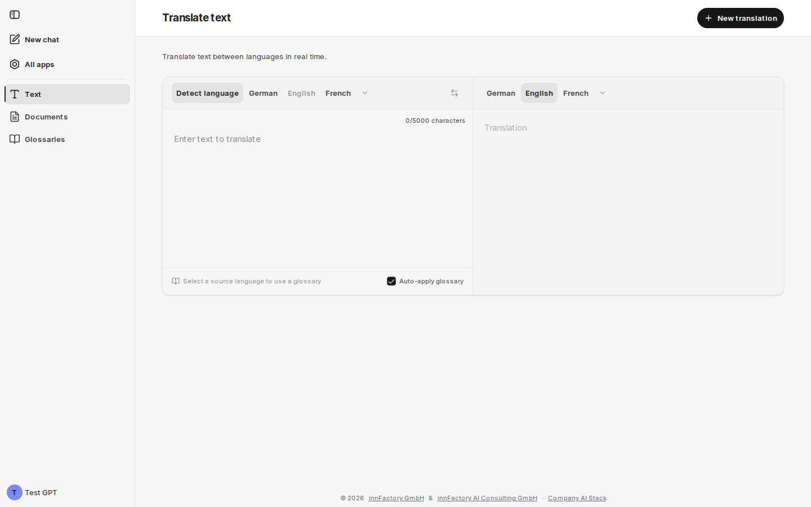
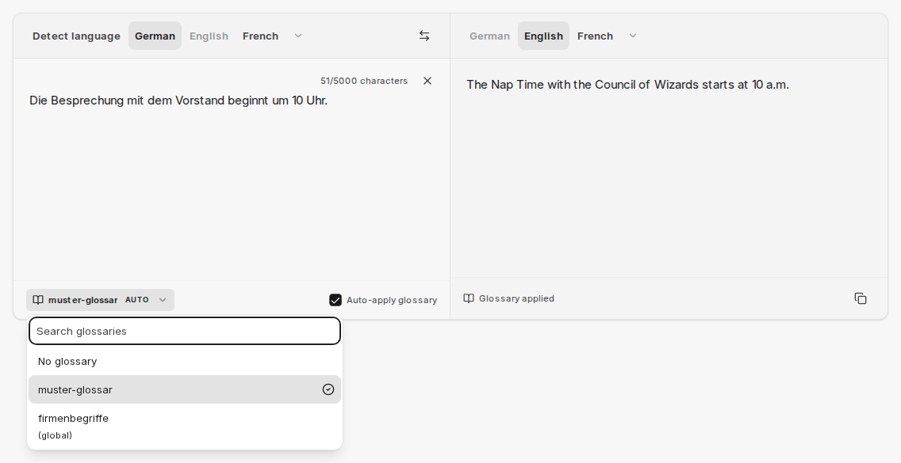

Oblast **Text** překládá zadaný text okamžitě mezi dvěma jazyky. Stránka má název **Translate text** a obsahuje poznámku „Translate text between languages in real time.“ Zdrojový a cílový text jsou vedle sebe a překlad se aktualizuje během psaní.

## Výběr jazyků

Nad vstupním polem jsou dvě jazykové lišty: vlevo zdrojový jazyk, vpravo cílový jazyk. Obě přímo nabízejí němčinu, angličtinu a francouzštinu, pokud to místo dovolí. Názvy jazyků se zobrazují v jazyce rozhraní. Šipka za nabízenými jazyky (**More**) otevře všechny ostatní jazyky v prohledávatelném seznamu („Search language...“). Jazyk zvolený v seznamu se pak zobrazí v liště. Na smartphonu každá lišta zobrazuje pouze zvolený jazyk; klepnutím na něj otevřete seznam.

Levá lišta navíc nabízí **Detect language**. Je-li tato možnost aktivní, companyTRANSLATE určí zdrojový jazyk ze zadaného textu a zobrazí výsledek, například **Detected: German**. Tlačítko **Swap languages** prohodí zdrojový a cílový jazyk a dosavadní překlad převezme jako nový zdrojový text.

Zvolená jazyková dvojice zůstane zachována i při přechodu do oblasti **Documents**.

## Limit znaků a akce

Nad vstupním polem companyTRANSLATE počítá znaky, například `22/5000 characters`. Jeden překlad může mít až 5 000 znaků. Křížek vedle počítadla vymaže vstupní pole a **Copy** pod výsledkem zkopíruje překlad do schránky. **New translation** v záhlaví stránky vymaže vstupní pole a zachová zvolené jazyky.

:::note
Pro delší obsah použijte [Překlad dokumentu](/cs/company-gpt/addons/company-translate/dokument-uebersetzen/) se souborem do 40 MB nebo agenta v [chatu](/cs/company-gpt/addons/company-translate/im-chat/).
:::

## Překladová služba

Která služba text přeloží, závisí na vašem prostředí (viz [Překladové služby a tok dat](/cs/company-gpt/addons/company-translate/#překladové-služby-a-tok-dat)):

- **Azure AI Translator** (výchozí): u krátkých vstupů, například jednotlivých výrazů, companyTRANSLATE pod výsledkem navíc zobrazí **Alternatives**, pokud pro danou jazykovou dvojici existují. Glosáře nejsou při překladu textu k dispozici.
- **Google Cloud Translation** (je-li ve vašem prostředí povolen): překlad textu může používat glosáře, jak je popsáno v následující části.

## Použití glosáře

Je-li povolen Google, companyTRANSLATE na spodním okraji vstupního pole zobrazuje, který [glosář](/cs/company-gpt/addons/company-translate/glossare/) platí pro aktuální jazykovou dvojici:

| Zobrazení | Význam |
|---|---|
| **Select a source language to use a glossary** | Zdrojový jazyk zatím není známý. Při aktivním rozpoznávání jazyka je znám po prvním překladu. |
| **No glossary for this language pair** | Pro tuto kombinaci žádný glosář neexistuje. |
| **No glossary** | Vhodné glosáře existují, ale žádný není vybrán. |
| Název glosáře, případně se značkou **AUTO** | Glosář se používá; **AUTO** ukazuje, že jej companyTRANSLATE vybral automaticky. |

Kliknutím na zobrazení otevřete výběr glosáře. Seznam je prohledávatelný („Search glossaries“); globální glosáře jsou označeny **(global)**. Glosáře, které Google ještě připravuje, jsou zobrazeny šedě s poznámkou „preparing for live translation“. Pro každý překlad platí právě jeden glosář.

Zaškrtávací políčko **Auto-apply glossary** je zpočátku aktivní. companyTRANSLATE pak vhodný glosář vybere sám, přičemž vaše vlastní glosáře mají přednost před globálními. Výběr, který provedete sami, se nikdy automaticky nepřepíše. Váš prohlížeč si toto nastavení pamatuje.

Pokud byl glosář použit, zobrazí se pod výsledkem poznámka **Glossary applied**.

V příkladu companyTRANSLATE přeloží „Besprechung“ pomocí položky glosáře **Nap Time** místo jinak obvyklého „Meeting“.

## Související témata

- [Glosáře](/cs/company-gpt/addons/company-translate/glossare/) – vytváření, nahrávání a používání glosářů
- [Překlad dokumentu](/cs/company-gpt/addons/company-translate/dokument-uebersetzen/) – překlad celých souborů se zachováním formátování
- [Překlad v chatu](/cs/company-gpt/addons/company-translate/im-chat/) – překlad textu a souborů pomocí agenta
