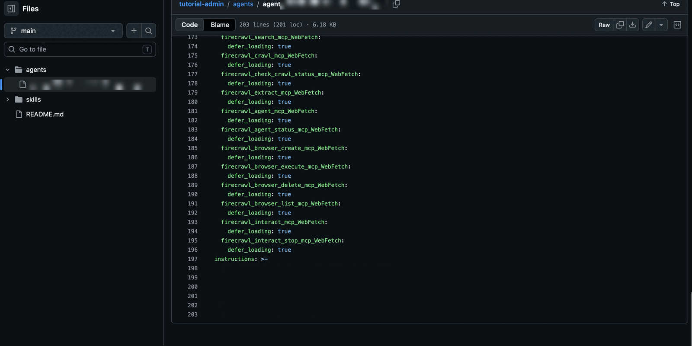

**Library Sync** propojuje CompanyGPT s repozitáři Git a načítá odtud **skills, agenty a prompty** do CompanyGPT. Knihovnu obsahu tak můžete verzovat, kontrolovat v týmu a přenášet mezi prostředími. U repozitářů, které vlastníte, companyADMIN také zapisuje změny zpět do Gitu.

Najdete ji v části **Content** → **Library Sync**. Podporovány jsou GitHub a vlastní (self-hosted) Git servery (GitLab, Gitea nebo čistý Git).

## Repozitáře

Seznam zobrazuje všechny připojené repozitáře:

| Sloupec | Obsah |
|---|---|
| **Repository** | Repozitář a větev |
| **Detected** | Počet rozpoznaných skills, agentů a promptů |
| **Last synced** | Kdy (relativně), s jakým commitem a kým |
| **Status** | **OK**, **Error** nebo **Never**; navíc **Up to date**, **Update available** nebo **Update status unknown** a případně počet chyb |

Pomocí **Search repository** repozitář vyhledáte. **Sync all** synchronizuje všechny repozitáře jeden po druhém. Kliknutím na řádek otevřete stránku s podrobnostmi.

## Přidání repozitáře

**Add repository** otevře stránku se čtyřmi kroky: **Clone** → **Select paths** → **Configure** → **Save & sync**.

1. **Clone**: zvolte **Git server** (**GitHub** nebo **Self-hosted (GitLab, Gitea, plain git)**) a zadejte repozitář. U GitHubu můžete vložit i celou URL; automaticky se rozdělí na repozitář, větev a cestu. V části **Authentication** zvolíte:
   - **PAT** – osobní přístupový token (personal access token). U veřejných repozitářů ponechte pole prázdné.
   - **SSH deploy key** – companyADMIN vygeneruje pár klíčů (**Generate SSH key**). Přidejte **Public key** do repozitáře jako deploy key s právem zápisu (na GitHubu: „Allow write access“).

   U vlastního serveru zadejte také **HTTPS base URL** (pro PAT) nebo **SSH host** a **SSH port** (pro SSH).
2. **Select paths**: zvolte složky nejvyšší úrovně, které se mají synchronizovat. Stahovány, prohledávány a synchronizovány jsou pouze tyto složky. Výběr nelze později změnit; chcete-li jej změnit, repozitář odeberte a připojte znovu.
3. **Configure**:
   - **Analyze with AI** – zobrazí se pouze tehdy, je-li pro vaše prostředí nastaven analytický model. Jazykový model (**Analysis model**) na základě stromu souborů navrhne, které složky obsahují skills, agenty a prompty. Návrh pouze předvyplní strukturu; nic se tím nesynchronizuje.
   - **Detected content** – počet rozpoznaných skills, agentů a promptů.
   - **Structure (sources)** – pro každou položku jeden **Kind** a jedna **Path**, například `agents` nebo `library/agents`. Pomocí **Add source** přidáte další cesty.
   - **Visibility** – výchozí viditelnost importovaného obsahu: **Owner / system (default)**, **Public (all users)** nebo **Specific groups**. Při **Owner / system (default)** importovaný obsah nevidí žádný uživatel, dokud nezvolíte **Public** nebo skupiny.
   - **We own this repo (allow write-back/up-sync)** – umožňuje companyADMIN zapisovat změny z CompanyGPT zpět do repozitáře. U PAT potřebuje token právo zápisu (na GitHubu scope `repo`); u SSH zapisuje zpět deploy key.
4. **Save & sync**: tlačítko **Save** vytvoří připojení. Zatím se nic nesynchronizuje; repozitář poté zobrazuje **Never**. První synchronizaci s náhledem spustíte na stránce s podrobnostmi tlačítkem **Sync**.

## Synchronizace

**Sync** na stránce s podrobnostmi nejprve zobrazí náhled (**Review & apply changes**): co bude vytvořeno, aktualizováno, smazáno nebo zůstane beze změny. Nic se nezapíše, dokud nekliknete na **Confirm & apply**. Poté **Sync result** ukáže, co se skutečně stalo, a **Notes** uvádějí, co bylo přeskočeno, například nástroje, které vaše prostředí blokuje, nedostupné servery MCP nebo názvy skills, které nelze dohledat.

:::caution[Mazání a změny provedené v CompanyGPT]
- Náhled obsahuje i mazání: obsah odstraněný z repozitáře zmizí při synchronizaci i z CompanyGPT. Pokud synchronizace nenajde vůbec žádný obsah, ačkoli dříve nějaký byl, companyADMIN nic nesmaže a nejprve se zeptá, protože obvykle je chybná větev nebo cesta.
- Pokud zmizí soubor položky, její zdroj nebo její složka, synchronizace položku smaže, i když byla v CompanyGPT změněna, a to i s **We own this repo**. Změna je pak ztracena.
- Pokud byla synchronizovaná položka upravena v CompanyGPT a **We own this repo** není nastaveno, **synchronizace tuto změnu přepíše**. Náhled to zobrazuje jako **Edited in companyGPT — will be overwritten**. Chcete-li změnu zachovat, akci zrušte a nejprve ji přeneste do repozitáře.
- U repozitářů s **We own this repo** jsou agenti a skills změnění v CompanyGPT při synchronizaci zachováni, dokud je jejich soubor v repozitáři. Náhled je zobrazuje jako **Edited in companyGPT — kept, write back to git first (Detect changes)**. Zapište je zpět pomocí **Write back (up-sync)** (viz [Porovnání s gitem](#porovnání-s-gitem)).
- companyADMIN nikdy nezapisuje zpět prompty. Synchronizace vždy přepíše změnu synchronizovaného promptu provedenou v CompanyGPT, a to i s **We own this repo**. Synchronizované prompty proto měňte v repozitáři.
:::

Starší verze promptů a sdílení, která lidé vytvořili v CompanyGPT, zůstávají při synchronizaci zachovány. Avatar agenta, úvodní podněty konverzace a nahrané soubory se zachovají pouze tehdy, pokud YAML soubor v repozitáři dané pole sám nenastavuje. Exportovaní agenti (viz [Export stávajícího obsahu](#export-stávajícího-obsahu)) mají tato pole ve svém YAML souboru.

### Složky skills

U skills prohledává Library Sync zadanou cestu **v libovolné hloubce**: každá složka, která obsahuje `SKILL.md`, se stane jedním skillem. Ostatní textové soubory ve stejné složce (např. `references/` nebo `scripts/`) se importují spolu se skillem; binární soubory se přeskakují. Skill je identifikován hodnotou `name` v `SKILL.md` – vyskytuje-li se název dvakrát, importuje se pouze první výskyt.

### Přidání hotových skills od innFactory

[Hotové skills](/cs/tutorials/skills/) jsou ve veřejném repozitáři [innFactory-AI/company-ai-stack-skills](https://github.com/innFactory-AI/company-ai-stack-skills) a lze je připojit přímo – bez tokenu:

| Pole | Hodnota |
|---|---|
| Repository | `innFactory-AI/company-ai-stack-skills`, větev `main` |
| Structure (sources) | typ `skill`, cesta `de/skills` (německé skills) **nebo** `en/skills` (anglické skills) |
| We own this repo | vypnuto |

Připojte pouze **jeden** jazyk: německá a anglická verze používají stejný název skillu. Jako repozitář můžete také vložit `https://github.com/innFactory-AI/company-ai-stack-skills/tree/main/en/skills`; větev a cesta se vyplní automaticky. **Sync** načte nové a změněné skills; automatický plán neexistuje.

:::note
Synchronizované skills jsou agentům k dispozici okamžitě. Ve výběru skills v chatu (`$`) se nejprve zobrazují jako neaktivní, dokud je uživatelé nezapnou.
:::

## Kontrola změn

## Stránka s podrobnostmi repozitáře

Stránka s podrobnostmi má karty **Overview**, **Content**, **Runs**, **Exclude** a **Settings** a navíc nebezpečnou zónu (danger zone).

### Overview

**Status**, **Source**, **Branch**, **Selection** (načtené složky), **Last run**, zda je k dispozici **New version in the repository**, a množství obsahu (**Content**). Chyby posledního běhu se zobrazují přímo na stránce; verze, které již jsou v CompanyGPT, zůstávají beze změny.

### Content

Každá položka repozitáře s údaji **Name**, **Type**, **Path** a **Status**:

| Stav | Význam |
|---|---|
| **Synced** | Shodné s repozitářem |
| **Changed in companyGPT** | Od poslední synchronizace upraveno v CompanyGPT |
| **Conflict** | Změněno jak v CompanyGPT, tak v repozitáři. S **We own this repo** zpětný zápis takové položky přeskakuje, viz [Porovnání s gitem](#porovnání-s-gitem) |
| **Error** | Nebylo možné použít |
| **Excluded** | Již se nesynchronizuje |
| **Deleted in companyGPT** | Smazáno v CompanyGPT, v repozitáři stále existuje. Příští synchronizace položku vytvoří znovu, bez jejích dřívějších sdílení a oblíbených. Chcete-li ji odstranit natrvalo, použijte **Exclude** nebo ji odstraňte v repozitáři |

Následuje **Orphaned (N)**: obsah označený tímto repozitářem, který synchronizace již nesleduje. Nikdy se nemaže automaticky.

#### Porovnání s gitem

**Compare with git** zkontroluje, co se liší mezi repozitářem a CompanyGPT, a nic nemění. **Detect changes (DB ↔ Git)** výsledek shrnuje:

- **repo newer** – změněno v repozitáři; příští synchronizace změnu převezme
- **changed in the app** – změněno v CompanyGPT
- **in sync** – synchronizováno
- **file(s) do not parse** – soubory, které nelze přečíst; verze v CompanyGPT zůstává zachována

U repozitářů s **We own this repo** zapíšete agenty a skills změněné v CompanyGPT do Gitu pomocí **Write back (up-sync)**: companyADMIN nejprve zobrazí náhled souborů a **Commit & push** je zapíše. companyADMIN vytvoří commit s popisnou zprávou a vypíše zapsané soubory. Pokud mezitím přibyly ve větvi repozitáře nové commity, nejprve synchronizujte a pak to zkuste znovu. companyADMIN nezapisuje zpět prompty.

Zpětný zápis přeskakuje položky ve stavu **Conflict**; pokud s nimi nic neuděláte, v tomto stavu zůstanou. Chcete-li takovou položku vyřešit, zaškrtněte před **Write back (up-sync)** volbu **Include conflicting units (overwrites the git-side change)**. Změna v repozitáři se pak nahradí verzí z CompanyGPT.

#### Export stávajícího obsahu

U repozitářů s **We own this repo** zapíše **Export existing content** do repozitáře poprvé agenty a skills, které byly vytvořeny v CompanyGPT a nikdy nebyly synchronizovány s žádným repozitářem. Vyberte jednotlivé položky nebo **Select all**, zkontrolujte soubory pomocí **Preview** a zapište je pomocí **Commit & push**.

:::caution[Exportovaný obsah poté patří repozitáři]
Po exportu jsou položky synchronizovaným obsahem tohoto repozitáře. To má své důsledky:

- Pokud je soubor v repozitáři smazán nebo přejmenován, příští synchronizace položku v CompanyGPT smaže.
- Exportovaný skill okamžitě přechází na systémový účet a je aktivní pro všechny, kdo jej smějí vidět.
- Exportovaný agent přechází na systémový účet s první aktualizací z repozitáře.
- Viditelnost zůstává **Individually managed**; výchozí viditelnost repozitáře se na tyto položky nevztahuje.
:::

V repozitáři pak každý agent existuje jako jeden YAML soubor, včetně svých instrukcí, nástrojů a nastavení, v nakonfigurovaných složkách.

### Runs

Každá synchronizace s údaji **Started**, **Result**, **Changes**, **By** a **Commit**, včetně přerušených. Běh zobrazuje výsledek pro každou položku.

### Exclude

Zde vyřadíte jednotlivé položky ze synchronizace, aniž byste měnili repozitář:

1. Vyberte položky.
2. Rozhodněte, co se stane v CompanyGPT: **Keep in companyGPT (release as normal content)** nebo **Delete from companyGPT on the next sync**.
3. Zkontrolujte **Preview** a klikněte na **Save exclusions**. Vyloučení se projeví při příští synchronizaci.

**Include again** vrátí položku zpět do synchronizace. Pokud od vyloučení již proběhla synchronizace, nejde o prosté vrácení zpět:

- Po **Keep in companyGPT (release as normal content)** příští synchronizace položku opět převezme a přepíše změny z CompanyGPT, aniž by je předtím zobrazila jako **Edited in companyGPT**.
- Po **Delete from companyGPT on the next sync** příští synchronizace vytvoří novou položku.

### Settings

Zde měníte větev, token, zdroje, viditelnost a **We own this repo**. Samotný repozitář a výběr složek z **Select paths** změnit nelze; místo toho repozitář odeberte a připojte znovu. Změny zdrojů a viditelnosti se projeví až při příští synchronizaci; po uložení companyADMIN nabídne okamžitou synchronizaci.

### Odebrání repozitáře

**Remove repository …** v nebezpečné zóně nejprve ukáže, co se stane s jednotlivými položkami v CompanyGPT:

- **Keep** – všechny položky zůstanou v CompanyGPT jako běžný, volně upravitelný obsah. Poté se považují za ručně vytvořené; jejich viditelnost mohou následně měnit pouze superadministrátoři.
- **Delete the content** – vybrané položky se smažou. Položky změněné v CompanyGPT, sdílené nebo používané jinými agenty nejsou předvybrány; agenti, které lidé označili jako oblíbené, předvybráni jsou. Položky, které se nesmažou, zůstanou a budou označeny jako osiřelé (orphaned).

Pro potvrzení zadejte název repozitáře. Pokud právě probíhá synchronizace, je odebrání možné až po jejím dokončení.

## Součinnost s viditelností

Synchronizovaný obsah nese v části [Obsah a viditelnost](/cs/company-gpt/addons/companyadmin/inhalte/) štítek **synced** a po změně v CompanyGPT navíc **modified in LibreChat**. Viditelnost vychází z výchozího nastavení repozitáře. Pokud ji změníte u jednotlivé položky, companyADMIN tuto položku spravuje individuálně, dokud ji neresetujete na výchozí nastavení repozitáře.

:::note[Potřebná práva]
Bez práva **Manage skills** chybí karty **Exclude** a **Settings**, tlačítka **Sync**, **Sync all** a **Add repository** i nebezpečná zóna. Synchronizace, přidávání, vylučování a odebírání navíc vyžadují právo správy pro každý typ obsahu v repozitáři (**Manage agents**, **Manage prompts** nebo **Manage skills**).
:::
