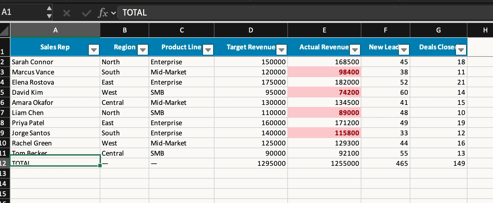
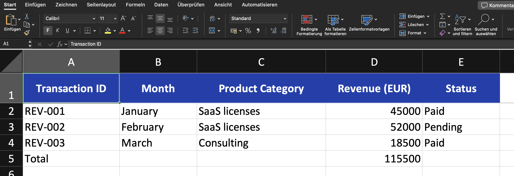
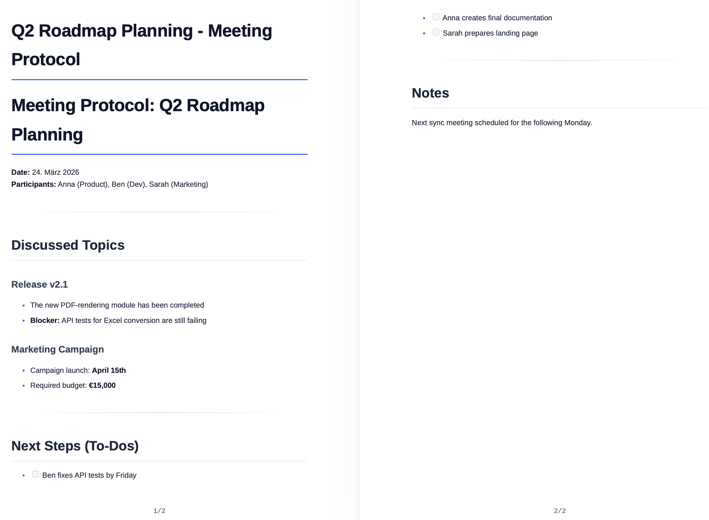

Dokumenty se vytvářejí v chatu. Popíšete, co potřebujete, v případě potřeby přiložíte soubor – companyFILES vytvoří dokument a zpřístupní jej v chatu. Stejný soubor pak najdete v [rozhraní](/cs/company-gpt/addons/companyfiles/oberflaeche/) v části **Documents**.

## Komplexní tvorba dokumentů

Lze vytvářet nativní soubory Word (`.docx`), Excel (`.xlsx`), PowerPoint (`.pptx`), OpenDocument (`.odt`) a PDF.

- **Excel:** tabulky lze generovat z CSV, JSON a polí nebo lze použít pokročilé šablony včetně vzorců.
- **Word:** Markdown, HTML, JSON nebo šablony se plynule převádějí na hotové dokumenty.
- **PowerPoint:** prezentace lze vytvářet přímo z textů v Markdownu nebo ze šablon – viz [Úprava prezentací](/cs/company-gpt/addons/companyfiles/praesentationen/).
- **PDF:** soubory PDF lze generovat přímo z Markdownu nebo HTML.

## Příklad: CSV na naformátovanou tabulku Excel

Prompt uvádí soubor a požadovaný výsledek, nikoli cestu k němu:

> *„Převeď tento soubor CSV na naformátovanou tabulku Excel, na konec přidej řádky se součty a barevně zvýrazni všechny hodnoty, které jsou pod cílem.“*

Soubor CSV je přiložen ke zprávě. Agent si načte `excel-skill`, zkontroluje dostupné nástroje a vytvoří soubor; ten se v chatu zobrazí ke stažení.

Výsledek obsahuje víc než jen čísla:

- naformátovaný řádek záhlaví s **automatickým filtrem** přes všechny sloupce,
- **řádek se součty**, který není zadán napevno, ale nastaven jako vzorec,
- **podmíněné formátování**, které barevně označí hodnoty pod cílem,
- další statistiky, rovněž vypočítané.

## Příklad: JSON na Excel

Ke zprávě je přiložen soubor JSON s nezpracovanými daty spolu s požadavkem:

> *„Vezmi tato nezpracovaná data JSON s tržbami za 1. čtvrtletí a udělej z nich přehlednou tabulku Excel. Řádek záhlaví udělej modrý a dole přidej řádek se součty.“*

Výsledek:

## Zpracování dat a export kódu

Strukturovaná data jako JSON nebo CSV lze přímo převést na přehledné tabulky Excel nebo dokumenty Word. Kromě toho lze vytvářet libovolné textové soubory a skripty (např. SQL, JSON, YAML, XML, HTML, Python nebo JS).

## Příklad: text na PDF

PDF nemusí vycházet ze souboru. Obsah lze stejně dobře nejprve vypracovat v chatu – v příkladu popis schvalovacího procesu cestovních výdajů – a poté jedinou větou převést na dokument: *„Udělej z toho PDF.“* Agent text naformátuje a vrátí PDF; výsledek lze znovu přiložit a dále zpracovat, například z něj vytvořit [vývojový diagram](/cs/company-gpt/addons/companyfiles/visualisierungen/).

**Příklad: zápis ze schůzky jako dokument PDF**

Je přiložen zápis ze schůzky jako soubor Markdown spolu s požadavkem *„Převeď můj zápis ze schůzky z Markdownu na profesionální PDF.“*

Výsledek:

## Dokumenty v chatu

Vygenerovaný dokument se v chatu zobrazí jako odkaz ke stažení. V závislosti na prostředí ukládá companyFILES vygenerované dokumenty také jako soubory v chatu CompanyGPT; chat je pak navíc zobrazuje jako **kartu přílohy**, dokumenty Office s náhledem. V rozhraní takové soubory nesou odznak **CompanyGPT**. Obrázky, archivy ZIP a verze grafů ve formátu PNG se zobrazují pouze jako odkaz.

Doba uchovávání companyFILES platí i pro tyto dokumenty: po jejím uplynutí se dokument smaže spolu se souborem v chatu – viz [Vypršení platnosti a uchovávání](/cs/company-gpt/addons/companyfiles/oberflaeche/#vypršení-a-doba-uchování).

### Úprava přiložených souborů

Pokud agenta požádáte o změnu souboru přiloženého v chatu – například o přidání řádků do tabulky Excel, nahrazení textu v dokumentu Word nebo přepracování snímků prezentace – companyFILES obvykle zapíše změny přímo zpět do tohoto souboru. Kde to není možné, vytvoří se upravená kopie jako nový dokument. Odpověď agenta uvádí, co se stalo.

:::caution[K dispozici je pouze textový výtah]
Pokud chat obsahuje místo originálu pouze textový výtah přiloženého souboru, companyFILES jej nemůže zpracovat jako soubor Word, Excel, PowerPoint nebo PDF. companyFILES pak oznámí, že v LibreChat existuje pouze textový výtah souboru, a požádá vás o opětovné nahrání originálního souboru (*„Von dieser Datei liegt bei LibreChat nur ein Textauszug vor – bitte die Originaldatei erneut hochladen.“*). V takovém případě soubor přiložte znovu.
:::

## Převod souborů a extrakce dat

- **Převod:** jsou možné následující převody. Které cesty jsou v daném případě k dispozici, zjistí agent pomocí `get_supported_conversions`.

  | Z | Do |
  |---|---|
  | Excel | CSV, JSON, Markdown, HTML |
  | CSV | Excel, JSON, Markdown, HTML |
  | JSON | Excel, CSV, Markdown |
  | Markdown | Word, PDF, HTML, text, ODT |
  | HTML | Word, PDF, Markdown, text, ODT |
  | Word | text, Markdown, HTML, PDF |
  | PDF | text |

  Soubor PDF proto nelze převést zpět na dokument Word, lze jej pouze přečíst jako text.
- **Extrakce:** data a texty lze číst z existujících souborů Excel, Word a PDF. Další formáty, jako jsou e-maily, archivy ZIP a starší soubory Office, čte companyFILES pomocí rozšíření – viz [Čtení e-mailů, archivů a starších formátů](#čtení-e-mailů-archivů-a-starších-formátů).
- **Formuláře PDF:** pokud v chatu přiložíte PDF s vyplnitelnými poli formuláře, agent přečte pole (název, typ, aktuální hodnotu, možnosti) a vyplní je vašimi údaji. companyFILES uloží výsledek jako nové PDF a prázdný formulář zachová; na požádání se hodnoty zploští, takže je již nelze měnit. Pole pro podpis a tlačítka se neberou v úvahu a soubory PDF bez polí formuláře – například skeny – tímto způsobem vyplnit nelze. Ukládání formulářů PDF jako šablon v současnosti není možné: rozhraní při nahrávání šablon nepřijímá soubory PDF.

:::note
companyFILES nenabízí úpravy obrázků (např. změnu velikosti nebo převod grafických formátů). Agent si však může uložený obrázek prohlédnout: pomocí nástroje `view_image` čte soubory PNG, JPEG, WebP a GIF a může je popsat nebo analyzovat – například nahranou fotografii nebo exportovaný graf.
:::

## Čtení e-mailů, archivů a starších formátů

:::note[Není k dispozici ve všech prostředích]
O tom, zda je tato funkce ve vašem prostředí k dispozici, rozhoduje vaše organizace. S dotazy se obraťte na svého administrátora.
:::

S rozšířením pro čtení dalších formátů otevírá companyFILES i soubory, které běžné nástroje pro čtení nepokrývají, a převádí je na čitelný text (Markdown):

| Formát | Příklady |
|---|---|
| E-maily | zprávy aplikace Outlook (`.msg`) a `.eml` – se záhlavím, tělem a přílohami |
| Archivy | archivy ZIP se všemi položkami |
| Starší formáty Office | `.doc`, `.xls`, `.ppt` a binární sešity Excel (`.xlsb`) |
| Další formáty dokumentů | RTF, OpenDocument (`.odt`, `.ods`, `.odp`), EPUB, HTML, notebooky Jupyter (`.ipynb`) |
| Obrázky a skeny | rozpoznávání textu (OCR, němčina a angličtina) pro obrázky, TIFF a naskenovaná PDF |

U souborů Word, Excel a PDF zůstávají první volbou běžné nástroje pro čtení.

Soubor se skládá z **částí**: samotného souboru a jeho příloh nebo položek archivu – včetně příloh přiloženého e-mailu. Agent pracuje se třemi nástroji:

| Nástroj | Účinek |
|---|---|
| `read_file` | čte soubor nebo jednu část po stránkách jako text, spolu se seznamem všech částí, záhlavím e-mailu a poznámkami z převodu |
| `save_file_part` | uloží přílohu nebo položku archivu beze změny jako samostatný dokument – ten lze pak zpracovat jako jakýkoli jiný soubor, například analyzovat přiloženou tabulku Excel |
| `convert_to_markdown` | uloží celý soubor – nebo jednu část s jejím obsahem – jako jediný dokument Markdown (`.md`) s jednou sekcí na každou část; původní soubor zůstane beze změny |

Příklad promptu: *„Shrň tento e-mail a přiloženou tabulku Excel ulož jako samostatný dokument.“*

Rozsáhlé převody, jako je rozpoznávání textu, mohou chvíli trvat. Agent pak oznámí, že se soubor ještě převádí, a krátce nato se zeptá znovu.

**Limit pro binární sešity Excel:** companyFILES čte soubory `.xlsb` přibližně do 60 000 řádků × 8 sloupců. U větších sešitů se převod zastaví s poznámkou *„Speichergrenze erreicht – Datei zu komplex“* (dosažen limit paměti – soubor je příliš složitý). V takovém případě uložte soubor v Excelu jako `.xlsx` – takové soubory čte companyFILES postupně, takže fungují i větší sešity.

V rozhraní přijímá **Upload Files** i tyto formáty. Zda lze soubory `.msg` a `.eml` přikládat přímo v chatu, závisí na vašem prostředí; jinak je nahrajte přes rozhraní.

**Preview** v části **Documents** zobrazuje takové soubory jako čitelný text:

- Volič **Part** přepíná mezi e-mailem nebo dokumentem a jeho přílohami či položkami.
- U e-mailů se nahoře zobrazují **From**, **To**, **Cc**, **Date** a **Subject**.
- Odznak **OCR** označuje text z rozpoznávání textu (jsou možné chyby rozpoznání), odznak **Shortened** část, která nebyla převedena celá. **Notes from the conversion** uvádí další zprávy.
- Dlouhé texty se stránkují pomocí **Previous page** a **Next page**; náhled ukazuje, na které znaky se díváte (*„Characters x–y of z“*).
- **Save as document** uloží přílohu nebo položku jako samostatný dokument v části **Documents**.

Během převodu náhled zobrazuje: *„The file is still being converted (e.g. text recognition). This may take a minute.“*

## Označování AI

Ve výchozím nastavení companyFILES označuje nově vytvořené dokumenty jako vygenerované AI (EU AI Act, čl. 50). Označení je uloženo strojově čitelně v metadatech souboru a nemění obsah:

| Formát | Označení |
|---|---|
| Word, Excel, PowerPoint | vlastnosti `AIGenerated` a `AIGenerator`, navíc klíčové slovo `AI-generated` a popis – v Office viditelné v části **File → Info → Properties** |
| OpenDocument | uživatelsky definovaná metadata |
| PDF | klíčová slova a předmět ve vlastnostech dokumentu |
| Obrázky (PNG, JPEG, WebP) | popis obrázku a software v datech EXIF |

To platí i pro dokumenty vytvořené ze šablon a pro exportované grafy a diagramy. Označeny nejsou nahrané soubory, změny existujících souborů, čisté převody formátu, textové soubory jako CSV, TXT nebo Markdown a archivy ZIP.

## Správa souborů

- **Přenos dat:** soubory lze přímo nahrávat a vygenerované dokumenty stahovat.
- **Seskupení:** několik dokumentů lze spojit do archivu ZIP pro jediné stažení – 1 až 50 dokumentů na archiv, včetně souborů z chatu. Archivy ZIP jsou určeny pouze ke stažení: nezobrazují se v části **Documents** a po krátké době se opět smažou.
- **Správa:** agent může vypsat a prohledat váš vlastní fond souborů a přečíst uložená [nastavení](/cs/company-gpt/addons/companyfiles/einstellungen/), aby správně použil barvy a rozvržení.

:::tip[Poznámka]
Požadavek *„Zobraz mi moje dokumenty“* funguje přímo z chatu – agent vypíše fond souborů, aniž byste museli přepínat do rozhraní.
:::

## Omezení

- Obrázky, které se mají vložit do PDF nebo prezentace, načítá companyFILES pouze z veřejně dostupných adres. Obrázky z intranetu raději přiložte v chatu nebo je nahrajte do companyFILES.
- Archiv ZIP obsahuje nejvýše 50 dokumentů.

Další: [Vizualizace](/cs/company-gpt/addons/companyfiles/visualisierungen/).
