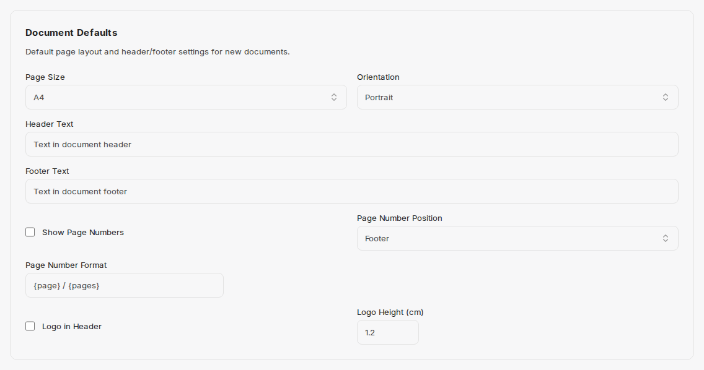

Nastavení určují, jak vygenerované dokumenty vypadají, když se **nepoužije žádná šablona**. Nastavíte je jednou a použijí se u každého nově vytvořeného dokumentu, grafu a prezentace.

Oblast je rozdělena na dvě části, které ukazují karty nad dlaždicemi:

| Karta | Účinek |
|---|---|
| **My Settings** | osobní přepsání barev, typografie, výchozích nastavení dokumentu a loga; prázdná pole přebírají výchozí nastavení organizace |
| **Organization** | výchozí nastavení pro všechny uživatele; upravovat je lze pouze s právy administrátora |

Jazyk rozhraní se nenastavuje zde, ale v nabídce účtu ve spodní části postranního panelu – viz [Rozhraní](/cs/company-gpt/addons/companyfiles/oberflaeche/#postranní-panel-a-nabídka-účtu).

## Organizace

Na kartě **Organization** upravují administrátoři tyto oddíly:

- **Organization Info** s poli **Company Name** a **Company URL**. Nápověda zní: *„Edit your organization details. Changes affect all users.“* (změny se týkají všech uživatelů)
- **Organization Colors** se třemi základními barvami **Primary**, **Secondary** a **Accent** – každá pomocí výběru barvy nebo jako hexadecimální hodnota. Tyto barvy se pak projeví nejen v dokumentech, ale také v grafech vytvořených v chatu.
- **Extended Colors**, **[Typography](#typografie)** a **[Document Defaults](#výchozí-nastavení-dokumentu)** jako výchozí hodnoty pro všechny uživatele.
- **Organization Logo** s tlačítky **Upload Logo** nebo **Replace Logo** a **Delete Logo** – obrázek použitý ve vygenerovaných dokumentech.

Ukládá se tlačítkem **Save Organization Settings**. Pod ním rozhraní ukazuje, kdy a kdo stav naposledy změnil.

Uživatelé bez práv administrátora vidí na kartě **Organization** pouze to, co platí: *„These settings are managed by your administrator.“* (tato nastavení spravuje váš administrátor)

## Moje nastavení

Na kartě **My Settings** přepisujete výchozí nastavení organizace pro své vlastní dokumenty. Obsahuje tyto oddíly:

| Oddíl | Obsah |
|---|---|
| **Color Overrides** | stejné tři barvy **Primary**, **Secondary** a **Accent**: *„Override the organization colors for your documents. Leave empty to use the organization default.“* Pokud barvu nastavíte sami, zobrazí se pod ní pro srovnání **Org default**; **Reset to organization default** pole opět vymaže. |
| **Extended Colors** | **Heading Color**, **Body Text Color**, **Link Color**, **Table Header Background**, **Table Header Text** a **Code Background** |
| **[Typography](#typografie)** | vlastní písma a velikosti písma |
| **[Document Defaults](#výchozí-nastavení-dokumentu)** | vlastní rozvržení stránky, záhlaví a zápatí |
| **Logo** | *„Upload a personal logo to override the organization logo in your documents.“* – pomocí **Upload Logo**; **Remove My Logo** obnoví logo organizace |
| **Preview** | ukazuje, jak výsledné barvy vypadají společně |

U barev a loga ukazuje označení vedle názvu pole, odkud aktuální hodnota pochází: **org** z výchozího nastavení organizace, **user** z vašeho vlastního nastavení. Ukládá se tlačítkem **Save Settings**.

## Typografie

Oddíl **Typography** existuje na obou kartách: na kartě **Organization** jako výchozí nastavení, na kartě **My Settings** jako osobní přepsání.

*„Configure fonts and font sizes for generated documents.“* (nastavení písem a velikostí písma pro vygenerované dokumenty)

| Pole | Zástupný text v poli |
|---|---|
| Heading Font | e.g. Segoe UI |
| Body Font | e.g. Segoe UI |
| Code Font | e.g. Consolas |
| Body Size (pt) | 11 |
| H1 Size (pt) | 24 |
| H2 Size (pt) | 18 |
| H3 Size (pt) | 14 |
| H4 Size (pt) | 12 |
| Code Size (pt) | 10 |

## Výchozí nastavení dokumentu

Oddíl **Document Defaults** rovněž existuje na obou kartách.

*„Default page layout and header/footer settings for new documents.“* (výchozí rozvržení stránky a nastavení záhlaví a zápatí pro nové dokumenty)

| Pole | Význam |
|---|---|
| Page Size | formát papíru, například A4 |
| Orientation | **Portrait** (na výšku) nebo **Landscape** (na šířku) |
| Header Text | text v záhlaví dokumentu |
| Footer Text | text v zápatí dokumentu |
| Show Page Numbers | zapne číslování stránek |
| Page Number Position | **Header** nebo **Footer** |
| Page Number Format | vzor čísla stránky, například `{page} / {pages}` |
| Logo in Header | umístí logo do záhlaví |
| Logo Height (cm) | výška loga, například 1,2 |

:::tip[Poznámka]
Barvy se vyplatí nastavit jako první: jakmile je nastavena primární barva, grafy vytvořené v chatu se zobrazí ve firemních barvách – aniž byste to museli uvádět v promptu.
:::

Dále: [Nastavení agenta](/cs/company-gpt/addons/companyfiles/agent/).
