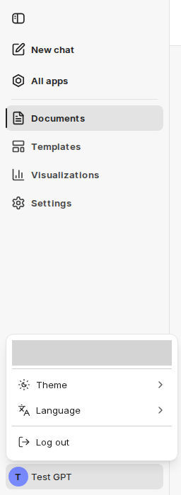
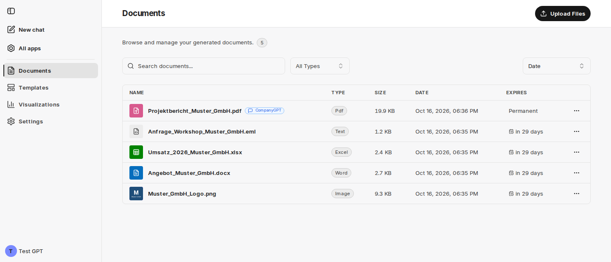
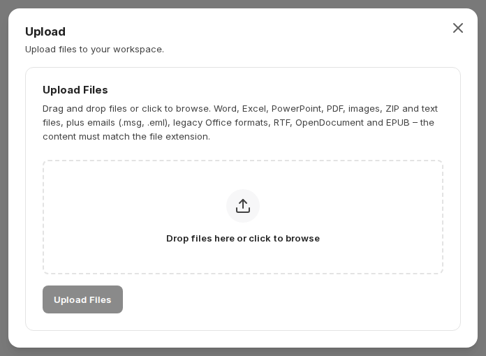
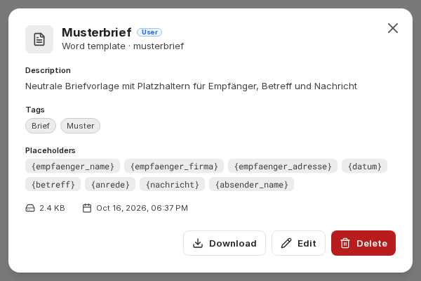
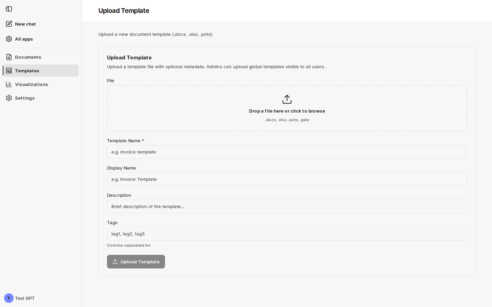
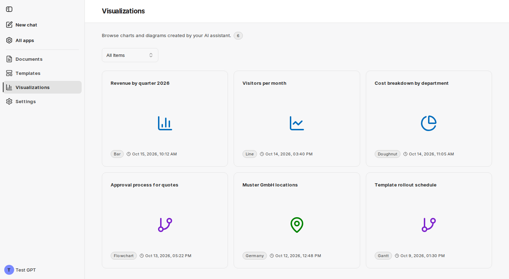

K rozhraní companyFILES se v CompanyGPT dostanete přes **Apps → Files** nebo přes stránku [Všechny aplikace](/cs/company-gpt/addons/alle-apps/). Používá [společné rozhraní](/cs/company-gpt/addons/gemeinsame-oberflaeche/) všech doplňků CompanyGPT: přihlášení probíhá přes vaši relaci chatu a rozvržení i vzhled odpovídají chatu.

## Postranní panel a nabídka účtu

Postranní panel lze rozbalit a sbalit. Shora dolů obsahuje:

| Položka | Funkce |
|---|---|
| **New chat** | otevře nový chat v CompanyGPT |
| **All apps** | vede na přehled všech aplikací ve vašem prostředí |
| **[Documents](#dokumenty)** | všechny vygenerované a nahrané soubory; zároveň úvodní stránka companyFILES |
| **[Templates](#šablony)** | všechny dostupné šablony |
| **[Visualizations](#vizualizace)** | všechny grafy, diagramy a mapy vytvořené v chatu |
| **Settings** | výchozí nastavení pro generované dokumenty – viz [Nastavení](/cs/company-gpt/addons/companyfiles/einstellungen/) |

Váš účet je úplně dole. **Nabídka účtu** zobrazuje vaši e-mailovou adresu a obsahuje:

- **Theme** – **System**, **Dark**, **Light**, **High contrast light** nebo **High contrast dark**,
- **Language** – Deutsch nebo English,
- **Log out**.

Na telefonu je navigace v záhlaví s rozbalovací nabídkou. Pokud váš účet není pro companyFILES povolen, zobrazí rozhraní místo obsahu stránku **No access**. Více o navigaci, nabídce účtu a stavových stránkách najdete v části [Společné rozhraní](/cs/company-gpt/addons/gemeinsame-oberflaeche/).

Nahrávání již neprobíhá přes samostatné položky nabídky, ale přes **akce stránky** vpravo nahoře na příslušné stránce: **Upload Files** na stránce Documents a **Template Upload** na stránce Templates.

## Dokumenty

Zde jsou na jednom místě všechny vygenerované a nahrané soubory – včetně souborů, které jste připojili v chatu.

Pomocí vyhledávání **Search documents...**, filtru **All Types** (Word, Excel, PowerPoint, PDF, Text, Image, Archive) a **Sort by** (Date, Name, Size, Type) soubory rychle najdete. Tabulka zobrazuje **Name**, **Type**, **Size**, **Date** a **Expires**. Malé obrázky (do 1 MB) se zobrazují jako náhled vedle názvu; všechny ostatní soubory ukazují ikonu svého typu.

Štítek **CompanyGPT** vedle názvu souboru znamená: soubor existuje jako soubor v chatu CompanyGPT – buď proto, že jste jej nahráli v chatu, nebo proto, že tam companyFILES uložil vygenerovaný dokument.

Kliknutím na řádek otevřete náhled (**Preview**). **Nabídka se třemi tečkami** (⋯) umožňuje soubor stáhnout, otevřít náhled, upravit datum vypršení nebo soubor smazat. V zobrazení vloženém do chatu nabízí nabídka místo **Download** položku **Copy link**.

### Náhled

Náhled zobrazuje obsah souborů PDF, obrázků a textových souborů přímo v prohlížeči; u souborů Word, Excel a PowerPoint zobrazí zástupný symbol s typem a názvem souboru. U ostatních typů souborů nabízí **Download instead**. Je-li ve vašem prostředí aktivní rozšíření pro čtení dalších formátů, zobrazuje e-maily, archivy ZIP a starší formáty Office jako čitelný text – viz [Reading e-mails, archives and older formats](/cs/company-gpt/addons/companyfiles/dokumente-erstellen/#čtení-e-mailů-archivů-a-starších-formátů).

Kliknutím na obrázek jej otevřete na celou obrazovku. Tam jej přiblížíte kolečkem myši, gestem sevření nebo klávesami `+`/`−`, posunete tažením nebo šipkami, přizpůsobíte obrazovce klávesou `0` a zavřete klávesou `Esc`. **Open in new tab** zobrazí obrázek ve vlastní kartě prohlížeče.

### Vypršení a doba uchování

Vygenerované dokumenty a dokumenty nahrané v companyFILES mají dobu uchování, jejíž délku určuje vaše prostředí. Sloupec **Expires** ukazuje zbývající čas; kliknutím na něj nebo pomocí **Edit Expiry** v nabídce datum změníte. Po uplynutí doby companyFILES dokument automaticky smaže – pokud existuje i jako soubor v chatu CompanyGPT, smaže se i tento soubor.

**Permanent** se zobrazuje pouze u souborů, které jste nahráli přímo v chatu. Doba uchování companyFILES se na ně nevztahuje.

### Nahrávání souborů

Akce stránky **Upload Files** otevře dialog **Upload**. Přetáhněte jeden nebo více souborů do oblasti pro nahrávání nebo klikněte pro procházení a poté spusťte nahrávání tlačítkem **Upload Files** (u více souborů: **Upload n files**). Po nahrání dialog zobrazí výsledek pro každý soubor; **Upload More** pokračuje dalšími soubory.

Přijímány jsou:

- dokumenty Office (`.docx`, `.xlsx`, `.pptx`, `.potx`),
- PDF,
- obrázky (PNG, JPG, GIF, WebP, BMP, SVG, HEIC),
- archivy ZIP,
- textové formáty jako TXT, Markdown, CSV, JSON, XML, HTML, YAML, CSS, JS a TS.

Je-li aktivní rozšíření pro čtení dalších formátů, přibudou mimo jiné e-maily (`.msg`, `.eml`), starší formáty Office (`.doc`, `.xls`, `.ppt`), binární sešity Excel (`.xlsb`), RTF, OpenDocument, EPUB a TIFF.

Oblast pro nahrávání tyto typy souborů stručně shrnuje. Během nahrávání companyFILES kontroluje, zda obsah souboru odpovídá jeho příponě. Přejmenované soubory – například archiv ZIP s příponou `.docx` – a soubory, jejichž obsah nelze určit, jsou odmítnuty.

## Šablony

Zde vidíte všechny dostupné šablony pro generování dokumentů.

Pomocí vyhledávání **Search templates...** a filtrů **All Types**, **All Scopes** a **All Tags** seznam zúžíte. Tabulka zobrazuje název, typ, rozsah, štítky, velikost a datum nahrání. Viditelnost určuje **rozsah** (scope):

| Rozsah | Význam |
|---|---|
| **User** | použitelné pouze vámi |
| **Global** | použitelné každým uživatelem v organizaci |

Kliknutím na šablonu otevřete její detail s popisem, štítky a rozpoznanými zástupnými symboly (**Placeholders**) – v zápisu, který daný typ šablony očekává. Můžete tak zkontrolovat, zda je šablona správně připravena.

V dolní části detailu jsou akce:

| Akce | K dispozici |
|---|---|
| **Download** | u každé šablony |
| **Edit** (zobrazovaný název, popis, štítky) a **Delete** | u vašich vlastních šablon; u globálních šablon pouze pro administrátory |
| **Promote to Global** | pro administrátory u jejich vlastních šablon Word, Excel a PowerPoint |
| **Demote to Local** | pro administrátory u globálních šablon Word, Excel a PowerPoint |
| **Use Template** | pouze v zobrazení vloženém do chatu: zapíše do chatu požadavek na vyplnění šablony včetně jejích zástupných symbolů |

Jak se šablony připravují a používají v chatu, je popsáno v části [Šablony](/cs/company-gpt/addons/companyfiles/vorlagen/).

### Nahrání šablony

Akce stránky **Template Upload** na stránce Templates otevře formulář pro nahrání.

Přetáhněte soubor šablony (`.docx`, `.xlsx`, `.potx`, `.pptx`) do oblasti pro nahrávání. Vyplňte **Template Name** – je povinný a smí obsahovat pouze písmena, číslice, pomlčky a podtržítka – a volitelně **Display Name**, **Description** a **Tags** (oddělené čárkami). Administrátoři vidí také pole **Scope**: **Global** (k dispozici všem uživatelům, předvybráno) nebo **User** (viditelné pouze pro ně samotné). Kliknutím na **Upload Template** nahrávání dokončíte.

## Vizualizace

Zde vidíte všechny grafy, diagramy a mapy vytvořené v CompanyGPT.

Filtr **All Items** zúží zobrazení na **Charts**, **Diagrams** nebo **Maps**. Každá karta zobrazuje název, ikonu, typ a datum vytvoření. Kliknutím na graf nebo diagram otevřete jeho detail; mapy se otevírají v nové kartě prohlížeče.

Jak vizualizace vznikají, je popsáno v části [Vizualizace](/cs/company-gpt/addons/companyfiles/visualisierungen/).

Dále: [Nastavení](/cs/company-gpt/addons/companyfiles/einstellungen/).
