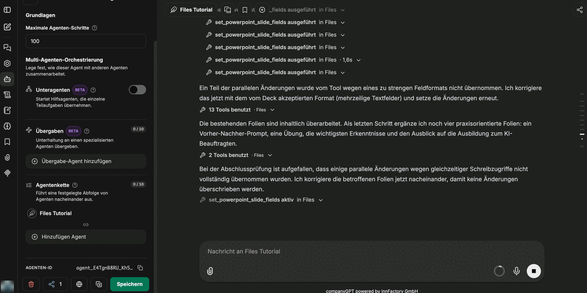

Prezentace lze nejen vytvářet od začátku, ale také **přepracovat z existující prezentace**. Soubor `.pptx` připojíte v chatu, agent načte snímky včetně jejich rozvržení a změní přesně to, co uvedete. Design, písmo a logo originálu zůstanou zachovány.

## Postup

1. **Nahrajte prezentaci.** Soubor se připojí ke zprávě; nahrávání probíhá na pozadí.
2. **Požádejte o posouzení.** Dobrým začátkem je spíše otázka než pokyn, například *„Odpovídá agenda obsahu?“*. Agent prezentaci přečte a odpoví hodnocením.
3. **Schvalte změnu.** Teprve pak přijde pokyn – například *„Uprav agendu.“* Agent změny obvykle zapíše přímo zpět do připojené prezentace; kde to není možné, vytvoří upravenou kopii jako nový dokument. Odpověď uvádí, co se stalo.
4. **Požádejte o vylepšení obsahu.** Na otázku, jak by se dal obsah vylepšit, agent odpoví seznamem návrhů, které můžete převzít jednotlivě nebo jako celek.

V příkladu se tímto způsobem školicí prezentace rozroste z agendy se čtyřmi body na prezentaci o **22 snímcích**, rozšířenou o „Prompt engineering: před a po“, praktické cvičení, klíčové poznatky a výhled.

Agent umisťuje nové snímky na rozvržení předlohy snímků prezentace. Převezmou tak písma, barvy, logo a uspořádání původního souboru – i když prezentace neobsahuje žádné zástupné symboly. Zástupné symboly obrázků v rozvržení může vyplnit připojeným obrázkem nebo obrázkem uloženým v companyFILES; obrázek se ořízne na míru, místo aby byl zdeformován.

## Před většími změnami: zvyšte limit kroků

Přestavba celé prezentace se skládá z mnoha jednotlivých volání nástrojů – načíst snímek, nastavit pole, připojit snímky, zkontrolovat výsledek. Výchozí hodnota pro **maximální počet kroků agenta** na to nestačí.

:::note
Výchozích 150 kroků agenta obvykle stačí. Hodnota v části **Advanced → maximum agent steps** je nahradí – nastavte tam proto hodnotu nad 150 pouze tehdy, pokud agent u velmi rozsáhlých prezentací narazí na limit. Pokud agent na limit narazí, zastaví se uprostřed a prezentace zůstane napůl hotová. Viz [Nastavení agenta](/cs/company-gpt/addons/companyfiles/agent/#maximální-počet-kroků-agenta).
:::

## Co agent opraví sám

Během rozsáhlých přestaveb agent kontroluje odpovědi nástrojů a sám si všimne, když změna nebyla provedena. Pokud nástroj část změn odmítne například **kvůli příliš přísnému formátu pole**, agent je zopakuje v akceptovaném formátu (například u víceřádkových textových polí).

Děje se to bez zásahu, ale prodlužuje to běh – další důvod nastavit limit kroků předem velkoryse. companyFILES provádí více změn téže prezentace postupně, takže současně spuštěná volání se navzájem nepřepisují.

## Omezení

:::caution
Textová pole, pod kterými se nachází **obrázek**, companyFILES zpracovat nedokáže. Takové snímky je nutné po úpravě dokončit ručně.
:::

- companyFILES načítá obrázky pro snímky pouze z veřejně dostupných adres. Obrázky z vašeho intranetu místo toho připojte v chatu.
- Pokud chat obsahuje pouze textový výtah z připojené prezentace, companyFILES ji upravit nemůže a požádá vás o opětovné nahrání původního souboru – viz [Úprava připojených souborů](/cs/company-gpt/addons/companyfiles/dokumente-erstellen/#úprava-přiložených-souborů).

Jinak platí totéž co jinde: výsledkem je velmi pokročilý koncept, nikoli hotová prezentace. Jednotlivé snímky je poté ještě nutné doladit po stránce formulací a uspořádání. Hodnota spočívá v přípravné práci – struktura, obsah a design jsou hotové, jednotně v designu původního souboru.

## Šablony jako výchozí bod

Místo nahraného souboru může jako výchozí bod sloužit uložená šablona PowerPoint. Ta je pak trvale uložena v companyFILES a není nutné ji pokaždé připojovat. Funguje to se zástupnými symboly i s prostou předlohou snímků bez zástupných symbolů – viz [Šablony](/cs/company-gpt/addons/companyfiles/vorlagen/#šablony-powerpoint-bez-zástupných-symbolů).

Pro změny, které nástroje companyFILES nepokrývají, může agent připojit kopii šablony do chatu a upravit ji pomocí interpretu kódu. Šablona `.potx` dorazí jako `.pptx` – viz [Předání šablony interpretu kódu](/cs/company-gpt/addons/companyfiles/vorlagen/#předání-šablony-interpretu-kódu).

Dále: [Šablony](/cs/company-gpt/addons/companyfiles/vorlagen/).
