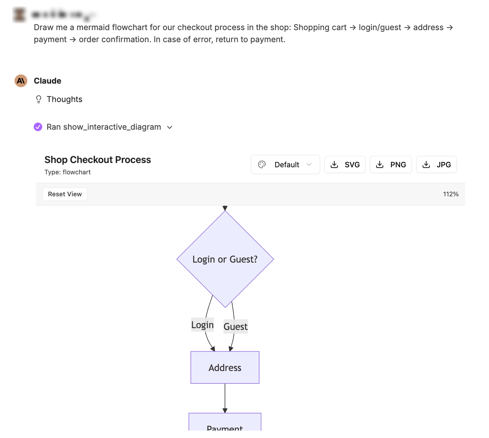
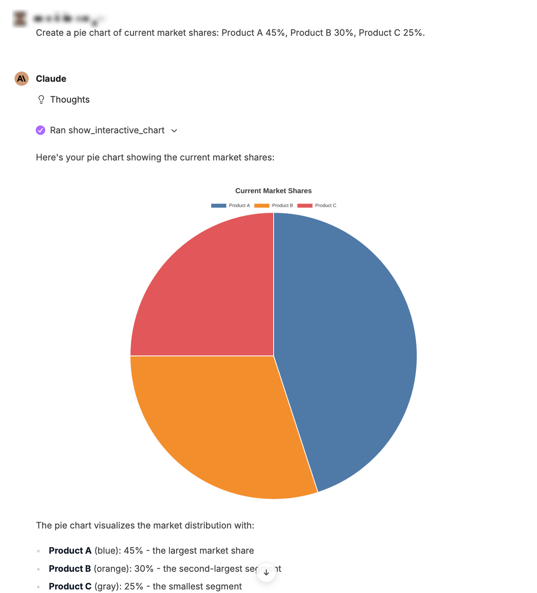
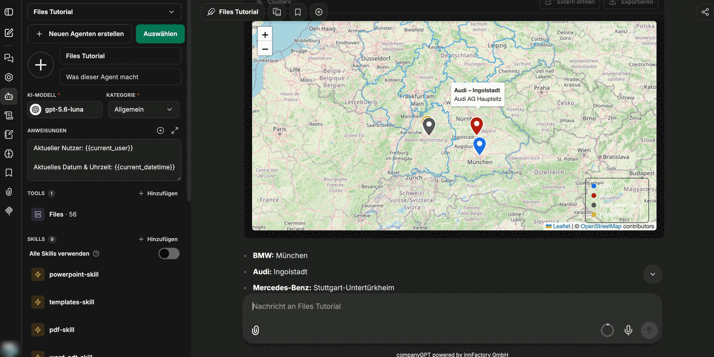

Surová čísla lze přímo vizualizovat jako výstižnou grafiku. companyFILES zná tři zobrazení, která jsou v chatu interaktivní: **grafy** pro číselné řady, **diagramy** pro procesy a struktury a **mapy** pro lokality. Vše, co takto vznikne, se v rozhraní shromažďuje v části [Vizualizace](/cs/company-gpt/addons/companyfiles/oberflaeche/#vizualizace).

:::note
Snímky obrazovky na této stránce zobrazují německé rozhraní, protože v tomto jazyce byl pořízen záznam, ze kterého pocházejí. Rozhraní produktu je lokalizované – v anglické relaci se popisky zobrazují anglicky.
:::

## Interaktivní grafy

Grafy lze vytvářet z dat v chatu – například přímo z dříve vytvořené tabulky: *„Zobraz mi tržby jako graf.“* K dispozici jsou:

- sloupcové grafy, i skládané nebo vodorovné,
- spojnicové a plošné grafy,
- výsečové a prstencové grafy a také polární plošné grafy,
- paprskové, bodové a bublinové grafy,
- vodopádové a trychtýřové grafy.

Panel nástrojů nad grafem řídí jeho zobrazení:

| Ovládací prvek | Účinek |
|---|---|
| typ grafu (např. **Bar**) | přepíná formu zobrazení |
| **Reset** | obnoví výchozí zobrazení |
| **+/- zoom, Esc reset** | přiblížení rozsahu dat; `Esc` vrací zpět |
| **Table** | přepíná mezi grafem a podkladovou tabulkou |
| **Config** | jemné doladění, jako je nadpis, popisky os, poloha legendy, **Color Theme**, **Grid Lines**, **Stacked** nebo **Fill Area**; **Apply Changes** změny použije |
| **Export** | **PNG (1x)**, **PNG (2x)**, **PNG (4x)**, **Copy CSV**, **Copy Image** |

companyFILES ukládá exportované obrázkové soubory také do **Documents**. Pod grafem agent navíc uvede odkaz na plné zobrazení a odkaz pro stažení grafu jako PNG.

:::tip[Poznámka]
Barvy grafu pocházejí z [nastavení](/cs/company-gpt/addons/companyfiles/einstellungen/). Jakmile je nastavena primární barva, zobrazují se nové grafy automaticky ve firemních barvách.
:::

## Diagramy Mermaid

Vývojové diagramy, sekvenční diagramy, diagramy tříd, stavové automaty, ER diagramy a další typy diagramů Mermaid lze vygenerovat pomocí promptu. Jako vstup stačí popsaný proces – i z dříve vytvořeného dokumentu: připojíte PDF a požádáte o vývojový diagram.

Zobrazení diagramu v chatu lze přibližovat a obnovit pomocí **Reset View**; aktuální zvětšení se zobrazuje vedle v procentech. Vpravo nahoře zvolíte barevný motiv diagramu (**Default**, **Dark**, **Forest** nebo **Neutral**) a exportujete ho přes **SVG**, **PNG** nebo **JPG**. Po exportu zobrazení ohlásí „Exported“ s názvem souboru; **Copy link** zkopíruje odkaz ke stažení souboru do schránky. Exportovaný soubor se pak zobrazí také v **Documents**. Pokud diagram vypršel nebo již neexistuje, zobrazení ukáže „Diagram Not Available“.

**Příklad: výsečový graf**

## Mapy

Lokality lze zobrazit na interaktivní mapě – jako mapu světa nebo mapu Německa s hranicemi spolkových zemí. Prompt jen uvádí místa nebo organizace – v příkladu: *„Zobraz na mapě hlavní sídla společností BMW, Audi, Mercedes-Benz a Porsche.“*

Každá značka nese popisek, legenda přiřazuje barvy k položkám a ovládací prvky řídí zobrazení:

| Ovládací prvek | Účinek |
|---|---|
| **Cluster** | seskupí značky, které leží blízko sebe |
| **Open externally** | otevře mapu jako samostatnou stránku |
| **Export** | uloží mapu jako obrázek (PNG nebo JPG) |

Pod mapou agent nalezené lokality ještě jednou vypíše jako text. V některých prostředích dokáže mapa navíc převádět adresy na body na mapě a zobrazovat trasy mezi místy, vzdálenosti a doby jízdy nebo oblast dosažitelnou z určitého bodu.

:::note
Pro lokality, které nejsou součástí promptu, potřebuje agent navíc **webové vyhledávání** – viz [Nastavení agenta](/cs/company-gpt/addons/companyfiles/agent/#kombinace-s-dalšími-nástroji). Teprve pak najde nejen město, ale skutečné místo označené jako sídlo společnosti.
:::

## Vkládání vizualizací do dokumentů

Graf nemusí stát vedle dokumentu jako obrázek. Požádáte-li o převzetí grafu do dokumentu Word, vznikne dokument, ve kterém stojí text a grafika pohromadě – nadpis, vysvětlení a vložený graf.

Dále: [Úprava prezentací](/cs/company-gpt/addons/companyfiles/praesentationen/).
