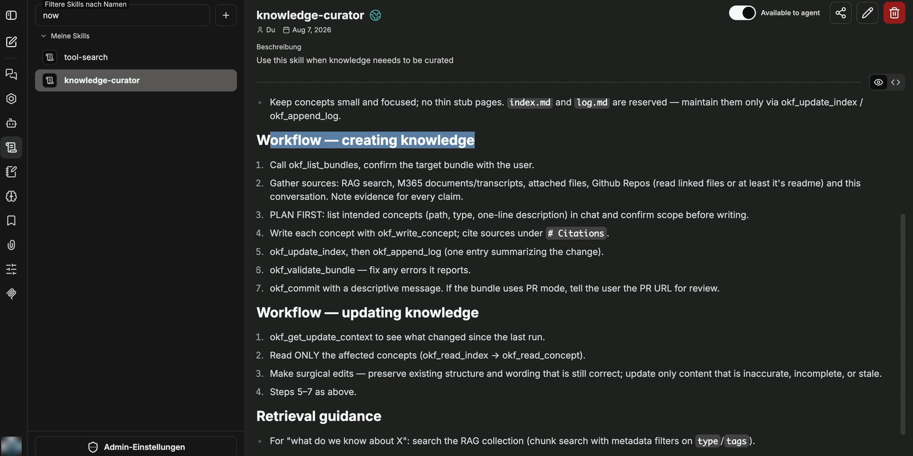

Bundle se nevyplňuje ručně, ale pomocí agenta. Agent k tomu potřebuje tři věci: přístup k vyhledávání, připojení Knowledge s právem zápisu a skill, který stanoví pravidla formátu. Vytváří se jako každý jiný agent v části **Agents → Create new agent**.

## Základní nastavení

| Pole | Doporučení |
|---|---|
| Název | výstižný název, například název bundlu |
| Model AI | postačí malý, rychlý model — práce spočívá převážně ve voláních nástrojů a formátování textu |
| Kategorie | `General`, pokud neexistuje vlastní kategorie |
| Instrukce | krátká systémová instrukce odkazující na skill a cílovou sbírku |

Instrukce udržujte stručné. Osvědčuje se pokyn vždy používat skill pro dokumentaci v kombinaci s uvedením cílové sbírky — v příkladu: *„K dokumentaci vždy používej skill. VŽDY proveď vyhledávání. Sbírka je VŽDY: tutorial_wiki.“*

Ikona plus vedle pole **Instructions** vkládá kontextové proměnné, které se vyplní v okamžiku volání:

| Proměnná | Účel |
|---|---|
| Aktuální datum | datum pro pole `timestamp` souboru konceptu |
| Aktuální uživatel | kdo změnu vyvolal |
| Datum/čas UTC ISO | časové razítko ve strojově čitelné podobě |

## Nástroje

Nástroje se přidávají v části **Tools → Add**:

- **ai-search**: sémantické vyhledávání napříč sbírkami spolu s nástroji pro čtení obsahu. Bez něj agent nemůže ověřit, co již bylo zdokumentováno.
- **Knowledge**: připojení k OKF bundlům — čtení **i** zápis. Tímto nástrojem se zapisují koncepty, index a protokol.
- **WebFetch**: volitelně, pro obsah zvenčí. Viz [Vytváření a údržba znalostí](/cs/company-gpt/addons/companyknowledge/wissen-erzeugen/).

Připojení Knowledge přináší deset nástrojů:

| Nástroj | Účel |
|---|---|
| `okf_list_bundles` | vypíše bundly, které smíte číst |
| `okf_read_index` | přečte index bundlu |
| `okf_read_concept` | přečte jednotlivý koncept |
| `okf_write_concept` | vytvoří nebo aktualizuje koncept |
| `okf_delete_concept` | smaže koncept; `index.md` a `log.md` jsou vyloučeny |
| `okf_update_index` | aktualizuje index |
| `okf_append_log` | přidá záznam do protokolu změn |
| `okf_validate_bundle` | zkontroluje bundle na chyby |
| `okf_commit` | dokončí změny: u bundlů na GitHubu v režimu commitu *pull request* otevře pull request. V režimu *direct commit* a u SharePointu jsou změny uloženy již při zápisu. |
| `okf_get_update_context` | zjistí, co se od posledního běhu změnilo |

## Osobní token GitHub (volitelné)

U bundlů na GitHubu může každá osoba uložit vlastní token GitHub. Připojení Knowledge má k tomu proměnnou **GitHub PAT** (personal access token). Hodnotu zadáte v chatu v části **MCP Settings** u serveru **Knowledge**. Do pole zadejte pouze samotný token.

Je-li token uložen, připojení Knowledge jej používá pro bundly na GitHubu. Čtení i zápis pak probíhají přes váš vlastní účet GitHub a jeho oprávnění. Aby agent mohl zapisovat koncepty, potřebuje token právo zápisu do repozitáře bundlu. Bez vlastního tokenu používá připojení přístup centrálně nastavený pro vaše prostředí, pokud existuje.

Bundly na SharePointu token nepotřebují. Tam platí oprávnění vašeho účtu Microsoft.

## Skill pro pravidla

Agent navíc dostává skill, který popisuje, **jak** s formátem zacházet. Skill neobsahuje žádný obsah, pouze pravidla a pracovní postupy. V příkladu se jmenuje `knowledge-curator`; byl vytvořen interně a není dodávanou součástí produktu.

Osvědčily se následující části:

**Pravidla.** Koncepty udržujte malé a zaměřené, žádné řídké útržkové stránky. `index.md` a `log.md` jsou vyhrazené a udržují se výhradně pomocí `okf_update_index` a `okf_append_log`.

**Pracovní postup pro vytváření znalostí.**

1. Zavolejte `okf_list_bundles` a nechte si od uživatele potvrdit cílový bundle.
2. Shromážděte zdroje — vyhledávání RAG, dokumenty a přepisy z M365, připojené soubory, repozitáře GitHub — a ke každému tvrzení si poznamenejte doklad.
3. Nejprve plánujte: vypište v chatu zamýšlené koncepty s cestou, typem a jednořádkovým popisem a nechte si rozsah potvrdit.
4. Každý koncept zapište pomocí `okf_write_concept` a v části s odkazy uveďte zdroje.
5. `okf_update_index`, poté `okf_append_log` s jedním záznamem shrnujícím změnu.
6. `okf_validate_bundle` — opravte všechny nahlášené chyby.
7. `okf_commit` s popisnou zprávou. Běží-li bundle v režimu commitu *pull request*, uveďte URL pull requestu ke kontrole.

**Pracovní postup pro aktualizaci znalostí.** `okf_get_update_context` zjistí, co se změnilo; čtou se **pouze** dotčené koncepty (`okf_read_index` → `okf_read_concept`). Úpravy jsou cílené: stávající struktura a formulace, které jsou stále správné, zůstávají a nahrazuje se pouze obsah, který je nepřesný, neúplný nebo zastaralý. Poté následují kroky 5 až 7 jako výše.

**Pokyny pro vyhledávání.** U otázek typu „Co víme o X?“ agent prohledává sbírku RAG s filtry metadat podle `type` a `tags`.

:::tip[Poznámka]
Pravidlo odsouhlasit plán v chatu před zápisem je nejúčinnější částí skillu: zabraňuje tomu, aby agent v jednom průchodu vytvořil dvacet napůl hotových konceptů, které pak musí někdo uklízet.
:::

## První kontrola

Zda nastavení funguje, ukáže jednoduchý dotaz v chatu na obsah bundlu. Agent přečte index a odpoví skutečným stavem — u nově vytvořeného bundlu to znamená upozornění, že je zatím prázdný, a výpis `index.md`, `README.md` a `log.md` spolu s datem záznamu v protokolu.

Dále: [Vytváření a údržba znalostí](/cs/company-gpt/addons/companyknowledge/wissen-erzeugen/).
