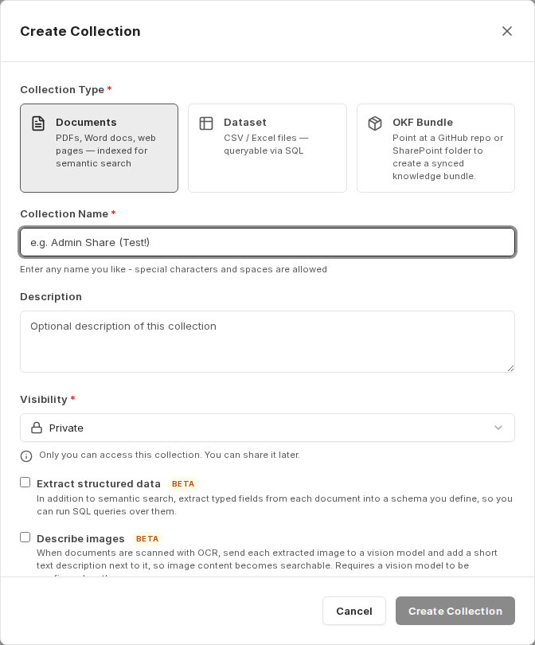
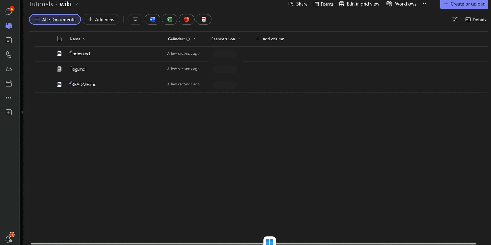

companyKNOWLEDGE popisuje, jak pracovat se znalostmi ve formátu **Open Knowledge Format (OKF)**: soubor znalostí není uložen v databázi, ale jako sada souborů Markdown v repozitáři GitHub nebo ve složce SharePoint. Každý soubor popisuje právě jeden koncept, malý blok front matter na začátku souboru udává typ, štítky a zdroj a dva vyhrazené soubory udržují aktuální obsah a protokol změn.

Praktický přínos spočívá v dělbě práce: údržbu znalostní báze — vytváření konceptů, aktualizaci indexu, zaznamenávání změn — obstarává agent v CompanyGPT, zatímco samotný obsah zůstává tam, kde jej lze verzovat a kontrolovat. Protože je bundle zároveň připojen jako sbírka v companyRAG, je vše, co agent zapíše, okamžitě prohledávatelné.

:::note
OKF bundly a související nástroje agenta jsou momentálně **experimentální**. Struktura, popisky a chování se ještě mohou změnit.
:::

## Struktura bundlu

Bundle je složka. Obsahuje soubory konceptů a dva vyhrazené soubory:

| Soubor | Role |
|---|---|
| `index.md` | index odkazující na existující koncepty |
| `log.md` | protokol změn; zaznamenává, co a kdy bylo zapsáno |
| `README.md` | přehled bundlu; při zakládání bundlu se vytvoří se zástupným textem |
| Soubory konceptů | jeden soubor Markdown na koncept, v podsložkách libovolné hloubky |

`index.md` a `log.md` se nikdy neupravují ručně; udržují se výhradně pomocí nástrojů připojení Knowledge. Podsložky jsou povoleny a každá dostává vlastní index.

## Struktura souboru konceptu

Každý soubor konceptu začíná blokem záhlaví (front matter), po němž následuje volný obsah v Markdownu:

| Pole | Obsah |
|---|---|
| `title` | název konceptu |
| `type` | druh konceptu, například `Produktübersicht` (přehled produktu) nebo `Architektur` (architektura) |
| `description` | jedna nebo dvě věty o tom, čeho se týká |
| `resource` | zdroj, na který se koncept odkazuje — URL nebo dokument z interního systému |
| `tags` | klíčová slova pro vyhledávání |
| `timestamp` | datum aktuálního stavu |

## Vytvoření bundlu

OKF bundle se vytváří ve znalostní oblasti jako sbírka: **companyRAG → Collections → Create collection**, přičemž jako typ sbírky (**collection type**) zvolíte **OKF bundle**.

Dialog tuto možnost popisuje takto: *„Point to a GitHub repository or a SharePoint folder to create a synchronised knowledge bundle.“* (Odkažte na repozitář GitHub nebo složku SharePoint a vytvořte synchronizovaný znalostní bundle.) Následující průvodce provede ve čtyřech krocích podrobnostmi, zdrojem, umístěním a potvrzením — tyto kroky jsou popsány v části [OKF bundly](/cs/company-gpt/addons/companyrag/okf-bundles/).

Se zdrojem **SharePoint** se umístění vybírá ve třech fázích: nejprve **website or team**, poté **library** a nakonec cílová složka pomocí **browse folders**. V posledním kroku průvodce zobrazí souhrn s názvem, viditelností, zdrojem, webem, knihovnou a cestou.

Možnost **create OKF scaffold if empty** je tam ve výchozím stavu zapnutá. V prázdném umístění vytvoří základní strukturu, aby bundle nezůstal prázdný:

Ihned po vytvoření se založí odpovídající sbírka a spustí se první synchronizace.

:::tip[Poznámka]
Pro OKF bundly se doporučuje strategie rozdělování (chunking) **Markdown-based**, protože obsah je strukturován nadpisy. Viz [strategie rozdělování](/cs/company-gpt/addons/companyrag/sammlungen/#strategie-dělení-na-bloky).
:::

## Co dál?

- [Nastavení agenta](/cs/company-gpt/addons/companyknowledge/agent/) – nástroje a skill, které agent potřebuje k zápisu do bundlu.
- [Vytváření a údržba znalostí](/cs/company-gpt/addons/companyknowledge/wissen-erzeugen/) – od zdroje k zapsanému konceptu, včetně indexování v companyRAG.
