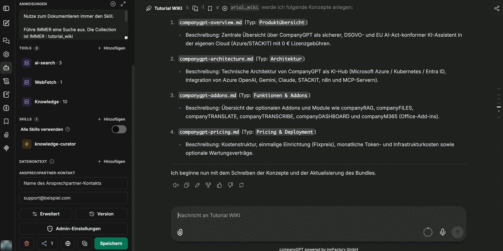
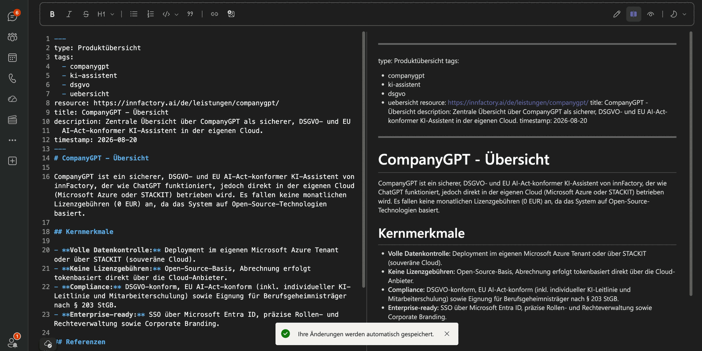
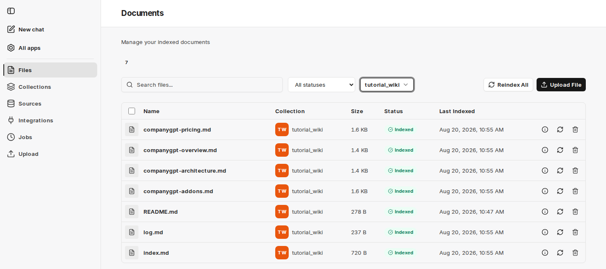

Jakmile balíček existuje a agent je nastaven, spočívá vlastní práce ve dvou větách v chatu: uveďte zdroj a schvalte plán. Vše ostatní — zápis souborů, aktualizaci indexu, doplnění protokolu, validaci a commit — obstará agent.

## Zdroje

Jako zdroj poslouží cokoli, k čemu má agent přístup: sbírky v companyRAG, dokumenty a přepisy z M365, připojené soubory, repozitáře GitHub. Pro obsah z webu se přidává nástroj **WebFetch**; v příkladu stačí uvést stránku produktu spolu s pokynem, aby z ní vznikla dokumentace. Stejně fungují i soubory PDF a další typy dokumentů.

:::note
WebFetch je MCP server. Jeho jednotlivé funkce nesou názvy podkladové služby (`firecrawl_scrape`, `firecrawl_map`, `firecrawl_search`, `firecrawl_crawl`, `firecrawl_check_crawl_status`, `firecrawl_extract`); pro prosté přečtení stránky stačí `firecrawl_scrape`.
:::

## Nejprve plán

Než se cokoli zapíše, odpoví agent seznamem zamýšlených konceptů — u každé položky název souboru, typ a jeden řádek popisu:

Tento mezikrok je správnou chvílí pro námitky: jeden koncept navíc, špatně zvolený typ, soubor, který patří do podsložky — zde stojí oprava jednu větu, po zápisu stojí úklidový průchod.

## Zápis, validace, commit

Po potvrzení agent plán zpracuje a jednotlivé kroky zobrazuje v chatu:

1. Zapíší se koncepty.
2. Aktualizuje se index.
3. Doplní se protokol změn.
4. Balíček se zvaliduje.
5. Změny se uloží: u SharePointu a v režimu *Direct commit* hned po zápisu, v režimu *Pull request* jako pull request ke kontrole.

U balíčku s režimem commitu *pull request* skončí běh návrhem změny ke kontrole namísto přímého commitu. Se znalostní bází se tak dá zacházet přesně jako se zdrojovým kódem: agent navrhuje, člověk schvaluje. Viz [Balíčky OKF](/cs/company-gpt/addons/companyrag/okf-bundles/).

## Výsledek

Každý vygenerovaný soubor má stejnou podobu: blok záhlaví s `type`, `tags`, `resource`, `title`, `description` a `timestamp`, pod ním obsah s nadpisy a na konci sekce s odkazy.

Obsah zůstává krátký a místo opakování odkazuje na související koncepty — díky tomu jsou soubory jednotlivě čitelné i jednotlivě aktualizovatelné.

## Automatická indexace

Protože je balíček v companyRAG připojen jako sbírka, objeví se nové soubory v části **Files** se stavem `Indexed` bez jakékoli další akce:

Jakmile je soubor zapsán, je zaindexován; když se změní, index se aktualizuje. Tím se kruh uzavírá: agent znalosti zapisuje a tytéž znalosti jsou okamžitě dohledatelné vyhledáváním — pro uživatele v CompanyGPT i pro další agenty prostřednictvím jejich nástrojů.

:::tip[Poznámka]
Indexují se také `index.md`, `log.md` a `README.md`. Chcete-li ve vyhledávání najít pouze vlastní koncepty, filtrujte podle metadat `type` a `tags`.
:::

## Co dál?

- [Soubory](/cs/company-gpt/addons/companyrag/dateien/) – kontrola stavu jednotlivých souborů a jejich opětovná indexace.
- [Použití v CompanyGPT](/cs/company-gpt/addons/companyrag/in-companygpt/) – využití sbírky v chatech a agentech.
