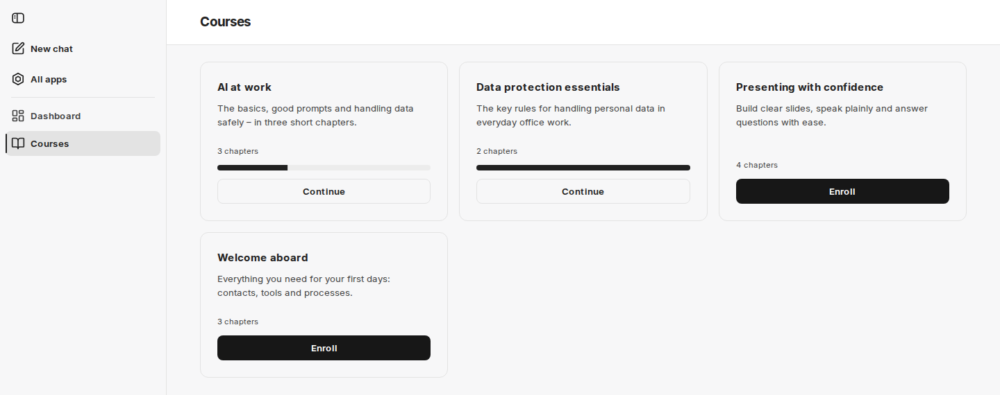
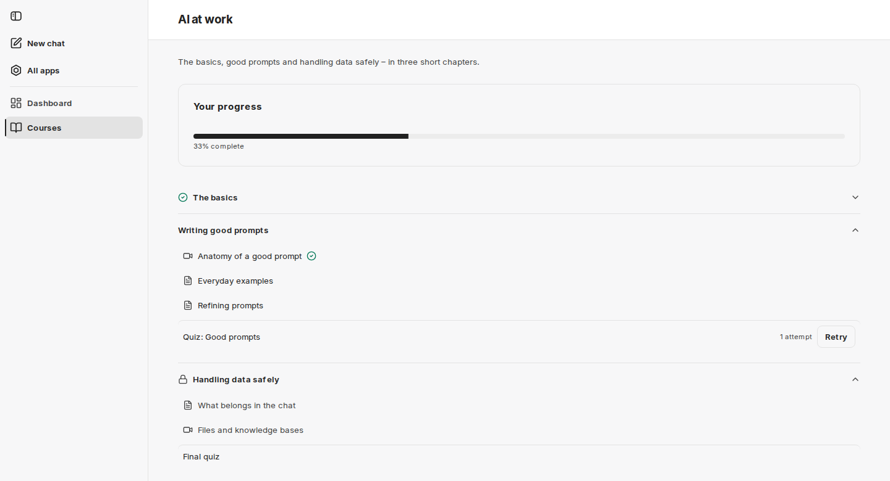
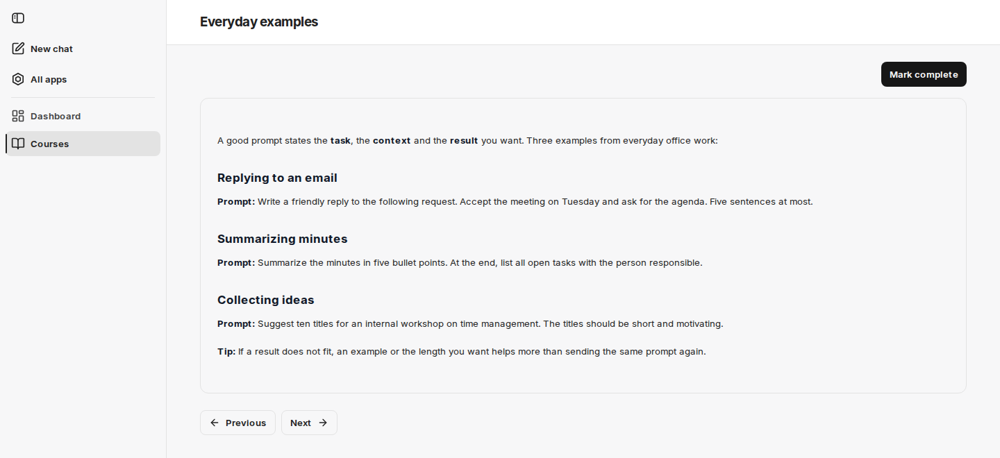
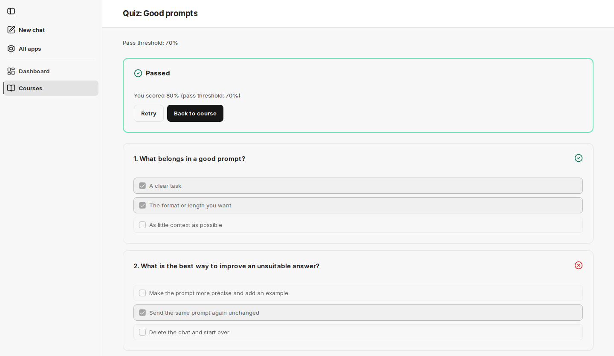
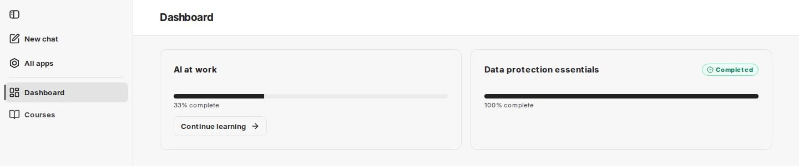

import { Steps } from '@astrojs/starlight/components';

Tato stránka popisuje cestu kurzem v rozhraní companyLEARN. Stejné kroky můžete provést i v chatu – viz [V chatu](/cs/company-gpt/addons/companylearn/im-chat/).

## Vyhledání kurzů

V sekci **Courses** vidíte všechny publikované kurzy jako karty. Každá karta zobrazuje název, popis a počet kapitol. U kurzů, do kterých jste zapsáni, přibude ukazatel průběhu a tlačítko **Continue**; tlačítko vás přenese na stránku kurzu.

Pokud zatím nejsou publikovány žádné kurzy, stránka zobrazí „No courses are available yet.“

## Zápis do kurzu

Klikněte na kartě kurzu na **Enroll**. Zápis platí okamžitě; kurz se pak zobrazí na **Dashboard** a karta ukazuje **Continue**.

Pokud otevřete kurz, do kterého nejste zapsáni – například přes odkaz nebo z chatu –, stránka kurzu zobrazí pod **Your progress** upozornění „Enroll to start the course.“ spolu s tlačítkem **Enroll**. Do té doby nelze lekce otevřít.

## Stránka kurzu

Stránka kurzu zobrazuje nahoře **Your progress** s ukazatelem a procentuální hodnotou. Pod ním jsou kapitoly jako rozbalovací seznam s jejich lekcemi – každá s ikonou videa nebo textu – a případně kvíz kapitoly.

| Indikátor | Význam |
|---|---|
| Zámek u kapitoly | Kapitola je uzamčena. Její upozornění zní „Complete the previous chapter first“. Její lekce nelze otevřít. |
| Zaškrtnutí u kapitoly | Kapitola je dokončena. |
| Zaškrtnutí u lekce | Lekce je hotová. |
| **Passed** u kvízu | Kvízem jste prošli. |
| „2 attempts“ u kvízu | Počet vašich dosavadních pokusů |
| **Start quiz** / **Retry** | Otevře kvíz – poprvé nebo po alespoň jednom pokusu |

## Lekce

Kliknutím na lekci ji otevřete.

- **Textové lekce** zobrazují formátovaný text. Až budete hotovi, klikněte na **Mark complete**.
- **Videolekce** přehrávají video v prohlížeči; můžete přeskakovat vpřed i vzad. Když se video přehraje až do konce, companyLEARN lekci automaticky označí jako hotovou. Dokončit ji můžete i dříve pomocí **Mark complete**.

Dokončené lekce zobrazují nahoře **Completed**. Tlačítka **Previous** a **Next** vás přenesou na předchozí nebo následující lekci kurzu, a to i přes hranice kapitol. U poslední lekce kapitoly, která má kvíz, se navíc zobrazí **Take quiz**.

Pokud **Next** vede do kapitoly, která je ještě uzamčena, zobrazí se „This chapter is locked. Complete the previous chapter first.“ a tlačítko **Back to course**.

## Kvíz

Kvíz otevřete pomocí **Start quiz** na stránce kurzu nebo **Take quiz** u poslední lekce kapitoly. Pod názvem je uvedena hranice úspěšnosti, například „Pass threshold: 70%“.

<Steps>

1. U každé otázky vyberte všechny správné odpovědi. Otázka může mít více než jednu správnou odpověď.

2. Jakmile má každá otázka odpověď, klikněte na **Submit answers**.

3. Výsledek se zobrazí nahoře: **Passed** nebo **Not passed** a k tomu řádek jako „You scored 80% (pass threshold: 70%)“. Ikona u každé otázky ukazuje, zda jste odpověděli správně, nebo nesprávně.

4. **Retry** spustí nový pokus; **Back to course** vás vrátí na stránku kurzu.

</Steps>

### Jak se kvízy hodnotí

- Otázka se počítá jako správná pouze tehdy, jsou-li vybrány přesně správné odpovědi – ani více, ani méně.
- Skóre je podíl správně zodpovězených otázek v procentech, zaokrouhlený na celá čísla.
- Pokud skóre dosáhne alespoň hranice úspěšnosti, kvíz je splněn.

Hranici úspěšnosti nastavuje pro každý kvíz administrátor kurzu; při vytvoření kvízu je předvyplněna na 70 %. companyLEARN nezobrazuje, které odpovědi by byly správné.

Počet pokusů není omezen. **Previous attempts** uvádí všechny vaše pokusy s časem, skóre a stavem. Jakmile kvízem projdete, zůstane splněn, i když pozdější pokus dosáhne nižšího skóre.

Kvíz odemčené kapitoly můžete absolvovat kdykoli, i před dokončením všech lekcí. Kapitola je však dokončena teprve tehdy, když je hotové obojí.

## Jak se kapitoly odemykají

Pokud má kurz zapnuté postupné odemykání kapitol:

- Po zápisu je otevřená první kapitola.
- Kapitola je dokončena, jakmile jsou hotové všechny její lekce a splněn její kvíz – pokud nějaký má.
- Otevřená je první dosud nedokončená kapitola; všechny kapitoly za ní zůstávají uzamčeny, dokud není dokončena.

Pokud administrátor kurzu postupné odemykání kapitol pro kurz vypnul, jsou po zápisu otevřené všechny kapitoly.

Pokud administrátor kurzu změní probíhající kurz – například přidá do kapitoly lekci –, může být kapitola, kterou jste již dokončili, znovu otevřená. Kapitoly za ní jsou pak uzamčeny, dokud ji znovu nedokončíte.

## Nástěnka

**Dashboard** je úvodní stránka companyLEARN. Pro každý kurz, do kterého jste zapsáni, zobrazuje kartu s ukazatelem průběhu a údajem jako „40% complete“. Procentuální hodnota je podíl dokončených kapitol.

- **Continue learning** vás přenese přímo k dalšímu kroku: k první dosud nehotové lekci nebo – jakmile jsou hotové všechny lekce aktuální kapitoly – k jejímu kvízu.
- Dokončené kurzy nesou označení **Completed**.
- Pokud správa kurzů zruší publikaci kurzu, zmizí kurz z nástěnky. Váš pokrok zůstane zachován.

Pokud zatím nejste zapsáni do žádného kurzu, nástěnka zobrazí „You're not enrolled in any courses yet.“ a tlačítko **Browse the catalog**.

Dále: [V chatu](/cs/company-gpt/addons/companylearn/im-chat/).
