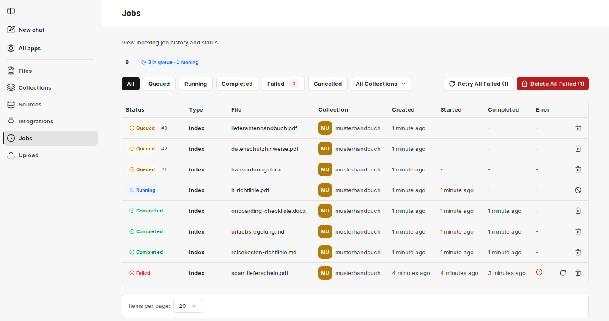

V části **Jobs** vidíte všechny operace indexování a synchronizace s jejich aktuálním stavem. Každé nahrání a každý běh synchronizace [zdroje](/cs/company-gpt/addons/companyrag/quellen/) vytváří úlohy – jednu úlohu na soubor.

Nahoře companyRAG ukazuje, kolik úloh je ve frontě a kolik jich běží. Číslo zahrnuje všechny sbírky – počítají se i úlohy před Vašimi. Úlohy ve frontě zobrazují svou pozici ve frontě (např. `#3`).

Seznam lze filtrovat podle stavu a podle sbírky. U každé úlohy se zobrazuje **Type** (např. `index`), **File**, **Collection** a časy **Created**, **Started** a **Completed**; u neúspěšných úloh je příčina uvedena ve sloupci **Error**.

Stav:

- **Queued**: Dokument bude brzy indexován
- **Running**: Dokument se právě indexuje
- **Completed**: Dokument byl indexován
- **Failed**: Dokument se nepodařilo indexovat. Další informace najdete ve sloupci **Error**.
- **Cancelled**: Úloha byla zrušena

Akce pro jednotlivé úlohy:

- **Retry job**: pro neúspěšné úlohy, například po odstranění chyby.
- **Cancel job**: pro běžící úlohy. Částečně nahraná data se vyčistí. Běžící úlohy nelze smazat, pouze zrušit.
- **Delete job**: Smaže úlohu z fronty nebo z historie. Stav **Completed** → indexovaný soubor zůstane. Stav **Queued** → soubor nebude indexován.

Pokud existují neúspěšné úlohy, zobrazí se také **Retry All Failed** a **Delete All Failed**.

:::tip[Poznámka]
Velké soubory a zapnutý [popis obrázků](/cs/company-gpt/addons/companyrag/sammlungen/#popis-obrázků) výrazně prodlužují dobu zpracování, protože každá stránka se navíc odesílá modelu pro zpracování obrazu. Čisté textové soubory se naopak indexují během několika sekund.
:::
