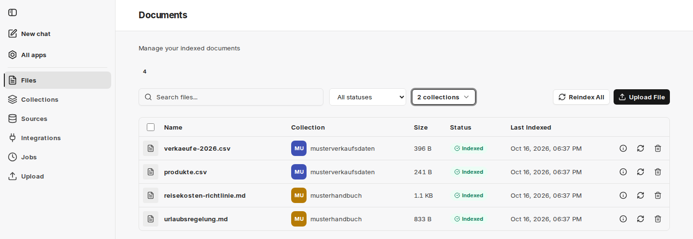

V části **Files** vidíte všechny soubory, které byly do služby přidány – bez ohledu na to, zda byly [nahrány ručně](/cs/company-gpt/addons/companyrag/hochladen/) nebo synchronizovány ze [zdroje](/cs/company-gpt/addons/companyrag/quellen/). Stránka má název **Documents**.

Přehled obsahuje:

- **Name**: Název dokumentu (částečně zkrácený – po najetí myší se zobrazí celý název)
- **Collection**: Sbírka, do které byl soubor zařazen
- **Size**: Velikost souboru
- **Status**:
  - **Pending**: Indexace teprve čeká na zpracování
  - **Indexed**: Dokument byl úspěšně zaindexován
  - **Indexed (warning)**: Dokument je zaindexován pro vyhledávání, ale navazující krok, například [extrakce strukturovaných dat](/cs/company-gpt/addons/companyrag/strukturierte-daten/), selhal
  - **Failed**: Indexace nebyla úspěšná; důvod se zobrazí po najetí myší na stav
- **Last Indexed**: Datum a čas poslední dokončené indexace
- **Actions**:
  - Ikona informací: zobrazí metadata souboru
  - **Reindex**: Vytvoří novou úlohu indexace
  - **Delete**: Smaže soubor ze služby včetně souvisejících úloh a zaindexované podoby

## Vyhledávání a filtrování

Nad seznamem můžete soubory prohledávat, filtrovat podle stavu a pomocí **Filter by Collection** vybrat jednu nebo více sbírek.

## Práce s více soubory

- **Delete selected**: Označte soubory zaškrtávacími políčky a smažte je společně.
- **Delete all**: Zobrazí se, jakmile je nastaven filtr stavu, a smaže všechny soubory odpovídající filtru, které máte oprávnění smazat. Pro potvrzení napište `delete`.
- **Reindex All**: Znovu zaindexuje všechny soubory ve sbírkách, ve kterých jste administrátorem nebo vlastníkem. Pro potvrzení napište `index`. Proces může trvat dlouho a po spuštění ho nelze zastavit.
- **Upload File**: Přepne na [Nahrání](/cs/company-gpt/addons/companyrag/hochladen/).

:::note
Pokud smažete soubor, který byl synchronizován ze zdroje, může být při dalším běhu synchronizace znovu vytvořen. Chcete-li obsah vyloučit trvale, upravte [zdroj](/cs/company-gpt/addons/companyrag/quellen/) – například pomocí vyloučených složek.
:::

Průběh probíhajících indexací najdete v části [Úlohy](/cs/company-gpt/addons/companyrag/auftraege/).
