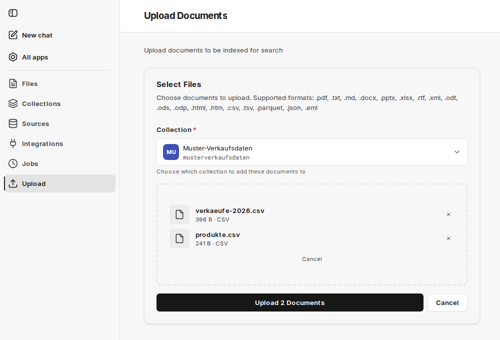

Sbírky datových sad neobsahují dokumenty, ale tabulky. Hodí se pro vše, co už má tabulkovou podobu – údaje o prodejích, objednávky, kmenová data – a odpovídají na otázky o součtech, množstvích a pořadích, na které sémantické vyhledávání odpovědět neumí.

Při [vytváření sbírky](/cs/company-gpt/addons/companyrag/sammlungen/#vytvoření-sbírky) zvolíte typ sbírky **Dataset** a poté **Dataset source** (zdroj datové sady):

- **Imported files**: Nahrajte soubory CSV, Excel nebo Parquet, na které se chcete dotazovat.
- **Live (defined schema)**: Definujte tabulky a odesílejte řádky přes endpoint pro příjem dat.

## Importované soubory

Data by vždy měla mít tabulkovou podobu. [Nahrávání](/cs/company-gpt/addons/companyrag/hochladen/) podporuje soubory CSV a TSV, sešity Excelu (`.xlsx`) a soubory Parquet; prostřednictvím zdroje jsou podporovány i sešity Excelu s makry (`.xlsm`). Možné jsou jednotlivé tabulky i více souvisejících tabulek; na související tabulky se lze dotazovat společně pomocí spojení (joinů).

U sešitů Excelu se každý list, který lze načíst, stane samostatnou tabulkou. Starší formát Excelu `.xls` není podporován; uložte takové soubory v Excelu jako sešit (`.xlsx`) a nahrajte je znovu.

Import je možný také jako [zdroj](/cs/company-gpt/addons/companyrag/quellen/), například ze složky SharePointu. Aktualizované soubory se pak načítají automaticky. U sbírek datových sad zdroj synchronizuje pouze tabulkové soubory.

Schéma importovaného souboru zobrazíte v části [Soubory](/cs/company-gpt/addons/companyrag/dateien/) pomocí informační ikony souboru.

## Živě definované schéma

Definujete tabulky a sloupce s datovými typy (`text`, `integer`, `numeric`, `boolean`, `timestamp`, `date`). Názvy musí obsahovat pouze malá písmena, číslice a podtržítka a musí začínat písmenem. Každý řádek automaticky dostane `_id` (UUID) a `_ingested_at` (časové razítko).

Volitelně můžete označit sloupec jako **klíč**, aby se při příjmu dat vynucovala jedinečnost, a propojit sloupec s klíčem jiné tabulky, aby se zaznamenal vztah. Tento vztah se v dotazech používá jako nápověda pro JOIN. Hodnoty cizích klíčů se ukládají přesně tak, jak je odešlete.

### Odesílání řádků

Po vytvoření je pro každou tabulku k dispozici jeden endpoint. Ikona **Ingestion instructions** u sbírky zobrazuje přesné adresy URL.

Volání očekává objekt s polem `rows`; každý objekt v něm odpovídá jednomu řádku. Na jedno volání je možné až 10 000 řádků, takže systém třetí strany může tabulku průběžně plnit. Odpověď se stavem `201` uvádí, kolik řádků bylo vloženo (`inserted`) a odmítnuto (`rejected`), spolu s případnými chybami (`errors`). `DELETE` na stejnou adresu URL tabulku vyprázdní.

Podrobnosti o cestách, parametrech a odpovědích najdete v [referenci API companyRAG](/cs/api/company-rag-api/).

Přístup vyžaduje [klíč API](/cs/company-gpt/addons/companyrag/api-schluessel/) osoby, která je administrátorem nebo vlastníkem sbírky.

:::danger
Klíč API vždy jedná jménem osoby, která ho vytvořila. Pokud je předán dál, může příjemce přes rozhraní přistupovat k obsahu, který by sám vidět nesměl. Každá osoba a každý systém by měly dostat vlastní klíč.
:::

## Dotazování

Na sbírky datových sad se nedotazuje pomocí vyhledávání v obsahu, ale pomocí nástrojů SQL MCP serveru `ai-search`. Agent s nimi může vypsat dostupné datové sady, přečíst schéma, popsat tabulky a spouštět dotazy napříč více tabulkami se spojeními.

Které nástroje povolit a který prompt se osvědčil, je popsáno v části [Použití companyRAG v CompanyGPT](/cs/company-gpt/addons/companyrag/in-companygpt/).
