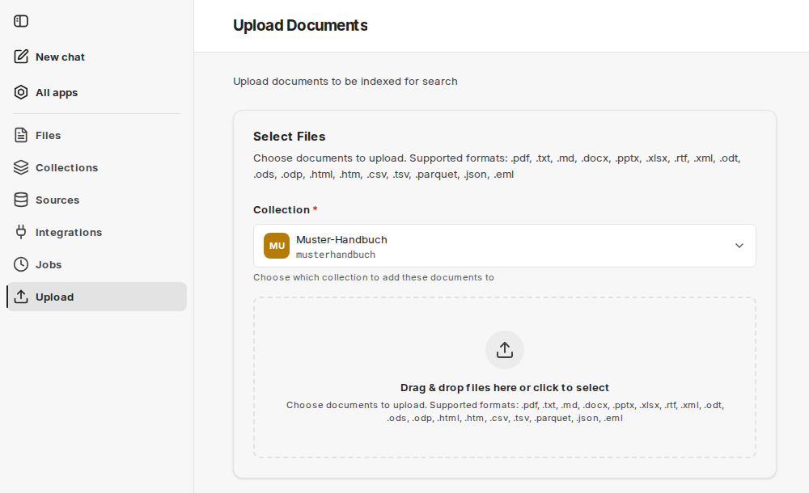

Pomocí **Upload** přidáte jeden nebo více souborů přímo do kolekce. Je to nejrychlejší způsob, jak otestovat sadu dokumentů nebo přidat jednorázové dokumenty. Pro opakující se obsah použijte místo toho [zdroj](/cs/company-gpt/addons/companyrag/quellen/).

Postup na stránce **Upload Documents**:

1. Vyberte **Collection**, do které se mají dokumenty přidat. Nabízejí se pouze kolekce, ve kterých jste vlastníkem nebo administrátorem. Pokud žádné nejsou, stránka zobrazí **No writable collections**.
2. Přetáhněte soubory do oblasti pro přetažení nebo je vyberte kliknutím.
3. Spusťte nahrávání tlačítkem **Upload Document** nebo **Upload … Documents**. Stránka zobrazuje průběh u každého souboru.
4. Každý soubor se vytvoří jako úloha a zaindexuje; stav uvidíte v části [Úlohy](/cs/company-gpt/addons/companyrag/auftraege/).

## Podporované formáty

`.pdf`, `.txt`, `.md`, `.docx`, `.pptx`, `.xlsx`, `.rtf`, `.xml`, `.odt`, `.ods`, `.odp`, `.html`, `.htm`, `.csv`, `.tsv`, `.parquet`, `.json`, `.eml`

Starší formát Excel `.xls` není podporován. Takové soubory uložte v Excelu jako sešit (`.xlsx`).

Rozhraní označí soubory větší než 50 MB upozorněním. Maximální velikost nahrávaného souboru určuje vaše prostředí.

:::note
Ručně nahrané dokumenty nemají odkaz na zdroj v původním systému ani oprávnění na úrovni souborů. Pokud mají vaši agenti ve svých odpovědích odkazovat na původní soubor, synchronizujte dokumenty místo toho prostřednictvím [zdroje](/cs/company-gpt/addons/companyrag/quellen/), například SharePointu.
:::

## Nahrávání tabulek

Pro tabulková data, která se mají dotazovat pomocí SQL, je správnou volbou [kolekce datových sad](/cs/company-gpt/addons/companyrag/datensaetze/). Pokud do kolekce dokumentů nahrajete soubory CSV, Excel nebo Parquet, companyRAG je uloží jako dotazovatelné datové sady, pokud je v ní povolena možnost [Tabulkové soubory jako datové sady](/cs/company-gpt/addons/companyrag/sammlungen/#tabulkové-soubory-jako-datové-sady).
