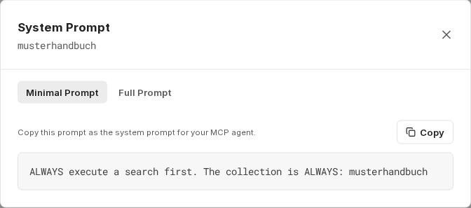
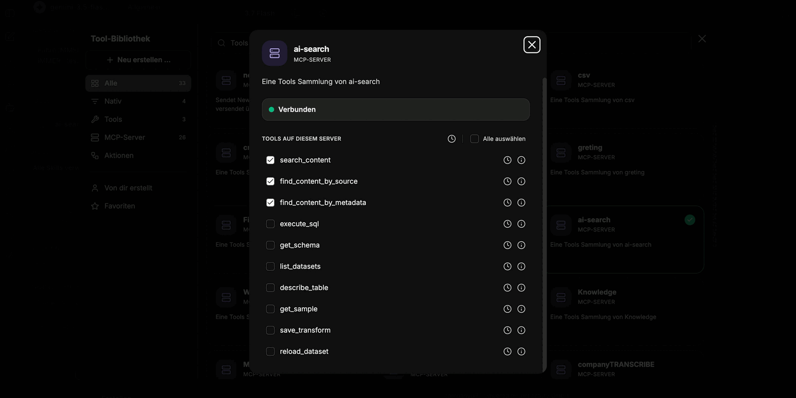

Prostřednictvím [serveru MCP](/cs/company-gpt/integrationen/mcp-server/) `ai-search` lze službu RAG připojit ke CompanyGPT a prohledávat indexované dokumenty ve všech sbírkách, které má uživatel k dispozici (viz [vyhledávání podobnosti](/cs/prompt-engineering/prompt-techniken/rag/#pracovní-postup-rag-při-zpracování-souborů)). Výsledky vždy respektují oprávnění dotazující se osoby – u zdrojů ze SharePointu také oprávnění na úrovni dokumentů.

Pro snadnější používání lze server MCP přidat k [agentovi](/cs/company-gpt/agenten/).

## Ukázkový prompt ze sbírky

Každá sbírka nabízí připravený **System Prompt**, ve kterém je již vyplněn technický název sbírky. Dostanete se k němu přes ikonu terminálu u sbírky a tlačítkem **Copy** jej můžete zkopírovat přímo do svého agenta. U sbírek datových sad je prompt přizpůsoben agentovi pro analýzu dat s nástroji SQL.

- **Minimal Prompt**: Krátký pokyn, který hlavně zajišťuje, aby agent vždy prohledával a používal správnou sbírku.
- **Full Prompt**: Rozsáhlá varianta, která navíc určuje formát odpovědi a odkazy na zdroje. Sjednocuje výstup a znatelně zlepšuje kvalitu odpovědí.

:::tip[Poznámka]
Začněte s úplným promptem. Bez určení formátu jsou odpovědi stručné a neobsahují zdroje.
:::

## Výběr nástrojů

Přidejte k agentovi server MCP `ai-search` a poté zapněte nástroje odpovídající typu sbírky.

Ve všech nástrojích znamená `collection` technický název sbírky. Uveďte jej v promptu, aby agent vždy dotazoval správnou sbírku. S výjimkou `list_datasets` companyRAG volání nástroje bez `collection` odmítne.

Pokud osoba v chatu nemá přístup k dotazované sbírce, agent obdrží zprávu „Kein Zugriff auf Collection '…' – bitte an eine Person mit Berechtigung wenden.“ (Žádný přístup ke sbírce '…' – obraťte se prosím na osobu s oprávněním) a pokus již neopakuje. Vlastník sbírky udělí přístup pomocí **Share collection** (viz [Sbírky](/cs/company-gpt/addons/companyrag/sammlungen/#sdílení-sbírky)).

### Nástroje pro vyhledávání obsahu ve sbírkách dokumentů

1. **search_content**:
   Vyhledávání pro obecné dotazy. Výchozí volba pro většinu otázek uživatelů.
   Povinné parametry: `query` (hledaný text), `collection` (technický název sbírky)
   Volitelné: `topK` (počet výsledků: výchozí 5, max. 20), `searchMode` (`similarity` = sémantické vyhledávání, výchozí; `keyword` = fulltextové vyhledávání; `hybrid` = kombinace obou), `filter` (filtr metadat, stejná struktura jako u `find_content_by_metadata`)

2. **find_content_by_source**:
   Načtení veškerého obsahu z konkrétního dokumentu. Použijte jej pro otázky k jednotlivým dokumentům (např. „Co je v Documentation.md?“).
   Povinné parametry: `source` (název dokumentu), `collection` (technický název sbírky)

3. **find_content_by_metadata**:
   Filtrování obsahu podle atributů metadat. Použijte jej pro filtrované výsledky (např. „Všechny naléhavé úkoly z roku 2026“).
   Povinné parametry: `filter` (objekt JSON s logickými operátory `$and`, `$or`, `$not`, porovnávacími operátory `$eq`, `$ne`, `$gt`, `$gte`, `$lt`, `$lte` nebo přímými dvojicemi klíč-hodnota), `collection` (technický název sbírky)

### Nástroje SQL pro datové sady a strukturovaná data

U [sbírek datových sad](/cs/company-gpt/addons/companyrag/datensaetze/) zapněte nástroje založené na SQL. U sbírek dokumentů se [strukturovanými daty z dokumentů](/cs/company-gpt/addons/companyrag/strukturierte-daten/) nebo s možností [Tabulkové soubory jako datové sady](/cs/company-gpt/addons/companyrag/sammlungen/#tabulkové-soubory-jako-datové-sady) zapněte nástroje SQL navíc k nástrojům pro vyhledávání obsahu. S výjimkou `list_datasets` je u všech nástrojů SQL povinný parametr `collection`; companyRAG jím ověřuje přístup.

| Nástroj | Povinné | Volitelné | Účel |
|---|---|---|---|
| **list_datasets** | – | – | Vypíše všechny sbírky datových sad, které máte k dispozici, s názvy jejich tabulek. U sešitů Excelu s více listy je uveden list a soubor. |
| **get_schema** | `collection` | `dataset` (název tabulky; vynecháno = všechny tabulky sbírky) | Načte schéma tabulky nebo vypíše tabulky sbírky. |
| **describe_table** | `collection`, `table` | `sample_rows` (výchozí 5, max. 50) | Schéma a ukázkové řádky tabulky. |
| **get_sample** | `collection`, `table` | `rows` (výchozí 10, max. 1000), `random` | Ukázkové řádky tabulky, volitelně vybrané náhodně. |
| **execute_sql** | `collection`, `sql` | `limit` (výchozí 100, max. 10000) | Spustí dotaz SQL pouze pro čtení nad tabulkami sbírky. |
| **save_transform** | `collection`, `table`, `query` | – | Uloží dotaz SELECT jako krok čištění tabulky. companyRAG z něj vytvoří pohled `<table>_clean`, který se automaticky použije při každém dalším načtení. |
| **reload_dataset** | `collection`, `table` | – | Znovu načte tabulku, například po opětovném nahrání souboru. |

`execute_sql` a `save_transform` povolují pouze jediný dotaz SELECT, volitelně s úvodními klauzulemi `WITH`. Zapisovací příkazy jako `INSERT`, `UPDATE`, `DELETE`, `DROP` nebo `CREATE` jsou odmítnuty. Řádky se vkládají pouze přes endpoint pro příjem dat (ingestion) sbírky datových sad.

Nástroje SQL jsou k dispozici pouze tehdy, pokud vaše prostředí poskytuje dotazy na datové sady; jinak `ai-search` zobrazuje pouze tři nástroje pro vyhledávání obsahu.

:::note[Není k dispozici ve všech prostředích]
O tom, zda je tato funkce ve vašem prostředí k dispozici, rozhoduje vaše organizace. S dotazy se obraťte na svého administrátora.
:::

Úplný popis každého nástroje zobrazíte pomocí ikony informací v knihovně nástrojů.

## Odpovědi se zdroji

Použité části (chunky) jsou viditelné v průběhu konverzace, takže zůstává dohledatelné, na čem je odpověď založena. Pokud prompt vyžaduje odkazy na zdroje, agent navíc na konci odpovědi uvede použité dokumenty.

:::note
Klikací odkaz na původní soubor se vytvoří pouze u dokumentů synchronizovaných přes [zdroj](/cs/company-gpt/addons/companyrag/quellen/) – například ze SharePointu. U ručně nahraných souborů je zdroj uveden, ale není propojen odkazem.
:::

U sbírek datových sad agent spustí dotaz a výsledek zobrazí jako tabulku – i napříč několika tabulkami se spojeními (join).

:::tip[Poznámka]
Ujistěte se, že je v promptu zadána správná sbírka. Pokud agent odkazuje na jinou sbírku, odpověď zůstane prázdná nebo mimo téma, přestože data existují.
:::

Podrobný návod k nastavení vyhledávacího agenta s vhodnými pokyny najdete v tutoriálu **[Použití companyRAG v CompanyGPT](/cs/tutorials/addons/companyrag-in-companygpt/).**
