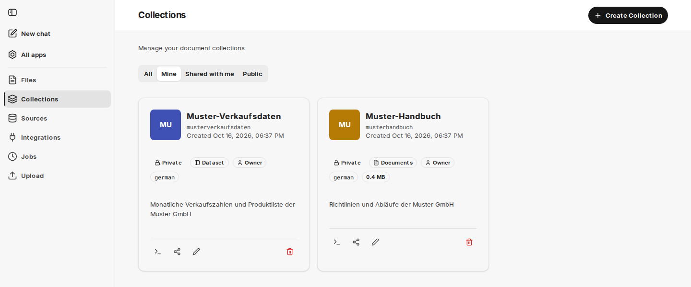

import seitenleiste from './rag-seitenleiste.png';

S doplňkem companyRAG můžete svým agentům zpřístupnit velké objemy dokumentů prostřednictvím rozhraní MCP. Dokumenty lze indexovat z různých zdrojů a integrovat pomocí metodiky [RAG – Retrieval Augmented Generation](/cs/prompt-engineering/prompt-techniken/rag/).

Indexování lze v závislosti na vašem případu použití realizovat jako jednorázový nebo opakovaný proces. Kromě klasického sémantického vyhledávání dokáže companyRAG ze stejných dokumentů také [extrahovat strukturovaná data](/cs/company-gpt/addons/companyrag/strukturierte-daten/) a zpřístupnit [tabulkové datové sady](/cs/company-gpt/addons/companyrag/datensaetze/) pro dotazy v SQL.

companyRAG z připojených systémů obsah pouze čte. Do SharePointu, Google Drive ani jiných zdrojových systémů se nic nezapisuje zpět. Jedinou výjimkou jsou [OKF bundly](/cs/company-gpt/addons/companyrag/okf-bundles/), jejichž soubory Markdown se udržují v repozitáři GitHub nebo ve složce SharePoint.

## Otevření companyRAG

companyRAG otevřete na stránce [Všechny aplikace](/cs/company-gpt/addons/alle-apps/) pomocí dlaždice **Knowledge** nebo přímo na adrese `https://COMPANY.company-gpt.com/companygpt/rag`. Obvykle jste přihlášeni prostřednictvím své stávající relace CompanyGPT; v některých prostředích se do companyRAG přihlašujete přímo pomocí **Sign in with Microsoft**. Pokud váš účet nemá přístup ke companyRAG, zobrazí se místo rozhraní upozornění **No access**. V takovém případě se obraťte na svého administrátora.

## Typy sbírek

Veškerý obsah v companyRAG je uložen ve sbírkách. Typ zvolíte v poli **Collection Type** při [vytváření sbírky](/cs/company-gpt/addons/companyrag/sammlungen/#vytvoření-sbírky). Určuje, jak se obsah ukládá a dotazuje, a v přehledu se zobrazuje jako štítek u každé sbírky.

| Typ | Obsah | Dotazování |
|---|---|---|
| **Documents** | Dokumenty z nahrání, SharePointu, Nextcloudu, Google Drive, GitHubu, WebDAV, FTP nebo z procházení webu | Sémantické a fulltextové vyhledávání; volitelně také [strukturovaná pole](/cs/company-gpt/addons/companyrag/strukturierte-daten/) |
| **Dataset** | Tabulky ze souborů CSV, Excel a Parquet nebo přes ingestion endpoint | Dotazy SQL napříč jednou nebo více tabulkami, včetně spojení (joins) |
| **OKF Bundle** | Znalostní sbírky v Markdownu ve formátu [Open Knowledge Format](/cs/company-gpt/addons/companyrag/okf-bundles/) na GitHubu nebo SharePointu | Stejně jako sbírka dokumentů |

## Uživatelské rozhraní companyRAG

companyRAG používá [společné rozhraní doplňků CompanyGPT](/cs/company-gpt/addons/gemeinsame-oberflaeche/): vlevo postranní panel s **New chat** a **All apps**, pod ním oblasti companyRAG a dole váš účet s motivem a jazykem. Rozhraní je k dispozici v němčině a angličtině.

Postranní panel companyRAG obsahuje tyto oblasti:

- [Files](/cs/company-gpt/addons/companyrag/dateien/) – všechny indexované soubory s jejich stavem
- [Collections](/cs/company-gpt/addons/companyrag/sammlungen/) – úložiště pro dokumenty a oprávnění
- [Sources](/cs/company-gpt/addons/companyrag/quellen/) – automatická synchronizace z připojených systémů
- [Integrations](/cs/company-gpt/addons/companyrag/integrationen/) – připojení k SharePointu, Nextcloudu, Google Drive, WebDAV, FTP, GitHubu a Webcrawl
- [Jobs](/cs/company-gpt/addons/companyrag/auftraege/) – úlohy indexování a jejich stav
- [Upload](/cs/company-gpt/addons/companyrag/hochladen/) – ruční indexování jednoho nebo více souborů

Pod oddělovačem následují oblasti správy:

- [API Keys](/cs/company-gpt/addons/companyrag/api-schluessel/) *(pouze administrátoři)*
- [Audit Logs](/cs/company-gpt/addons/companyrag/audit-protokoll/) *(pouze superadministrátoři)*

## Práva a role

Co smíte ve sbírce dělat, závisí na vaší roli v této sbírce (**Viewer**, **Admin** nebo **Owner**, viz [Sbírky](/cs/company-gpt/addons/companyrag/sammlungen/#sdílení-sbírky)). Navíc existují tři práva pro companyRAG jako celek:

| Právo | Význam |
|---|---|
| Používání | Otevřít companyRAG a prohledávat sbírky, ke kterým máte přístup. |
| Administrátor | Navíc vytvářet a odvolávat [API klíče](/cs/company-gpt/addons/companyrag/api-schluessel/). Obsah sbírek nadále spravujete prostřednictvím své role v jednotlivých sbírkách. |
| Superadministrátor | Navíc vidět a spravovat všechny sbírky organizace a zobrazovat [auditní protokoly](/cs/company-gpt/addons/companyrag/audit-protokoll/). Ani superadministrátor nemůže číst soubory ve sbírkách jiných osob. |

O tom, kdo dostane jaké právo, rozhoduje vaše organizace. Pokud vaše prostředí řídí přístup prostřednictvím companyADMIN, udělují administrátoři práva tam v části [Rozšíření](/cs/company-gpt/addons/companyadmin/erweiterungen/) jako **Use knowledge**, **Manage RAG settings** a **Superadmin**. Právo **Superadmin** se nikdy neuděluje automaticky, a to ani administrátorům.

## Další témata

- [Strukturovaná data z dokumentů](/cs/company-gpt/addons/companyrag/strukturierte-daten/) – extrakce typovaných polí z opakujících se typů dokumentů
- [Sbírky typu datová sada](/cs/company-gpt/addons/companyrag/datensaetze/) – import tabulek nebo jejich průběžné plnění přes endpoint
- [OKF bundly](/cs/company-gpt/addons/companyrag/okf-bundles/) – znalostní sbírky v Markdownu na GitHubu nebo SharePointu
- [Používání companyRAG v CompanyGPT](/cs/company-gpt/addons/companyrag/in-companygpt/) – MCP server `ai-search`, jeho nástroje a agenti
- [companyRAG API](/cs/api/company-rag-api/) – programový přístup k souborům, sbírkám, úlohám a zdrojům

## Ke stažení

- [companyRAG Windows Syncer 2.6.2](/downloads/companyRAG-syncer-windows-v2.6.2.zip)
