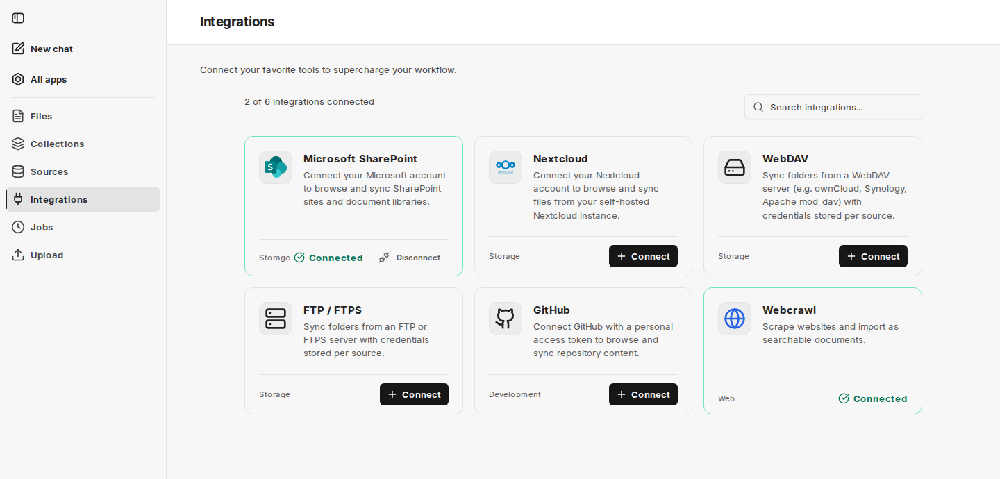

Integrace jsou připojení k systémům třetích stran, ze kterých může companyRAG načítat dokumenty. Integrace se připojí jednou a poté ji může používat libovolný počet [zdrojů](/cs/company-gpt/addons/companyrag/quellen/).

Prostřednictvím všech integrací companyRAG obsah pouze čte. Do připojených systémů nic nezapisuje – s výjimkou [balíčků OKF](/cs/company-gpt/addons/companyrag/okf-bundles/) v GitHubu nebo SharePointu.

U každé integrace přehled zobrazuje její název, kategorii (**Storage**, **Development**, **Web**) a stav připojení a nahoře počet připojených integrací. **Connect** vytvoří připojení, **Disconnect** ho opět odstraní.

## Dostupné integrace

| Integrace | Účel | Ověřování |
|---|---|---|
| **Microsoft SharePoint** | Procházení a synchronizace webů a knihoven dokumentů SharePointu | Přihlášení účtem Microsoft |
| **Nextcloud** | Synchronizace souborů z vlastní instance Nextcloud | Uživatelské jméno a heslo aplikace; adresa Nextcloudu je pro vaše prostředí přednastavena |
| **Google Drive** | Synchronizace souborů z „Můj disk“, sdílených disků a souborů sdílených s vámi | Přihlášení účtem Google |
| **WebDAV** | Synchronizace složek serveru WebDAV, např. ownCloud, Synology nebo Apache mod_dav | Přihlašovací údaje pro každý zdroj |
| **FTP / FTPS** | Synchronizace složek serveru FTP nebo FTPS | Přihlašovací údaje pro každý zdroj |
| **GitHub** | Procházení a synchronizace obsahu repozitáře | Osobní přístupový token (fine-grained) s přístupem pro čtení |
| **Webcrawl** | Stahování webových stránek a jejich import jako prohledávatelných dokumentů | Přihlášení není nutné |

**WebDAV** a **FTP / FTPS** nemají připojení na úrovni účtu: **Connect** přímo otevře dialog pro nový zdroj a karta se považuje za připojenou, jakmile existuje alespoň jeden zdroj tohoto typu. **Webcrawl** poskytuje vaše prostředí; nemusíte ho připojovat. GitHub může být rovněž již připojen vaším prostředím; v takovém případě nelze připojení odpojit.

:::note[Není k dispozici ve všech prostředích]
O tom, zda je tato funkce ve vašem prostředí k dispozici, rozhoduje vaše organizace. S dotazy se obraťte na svého administrátora.
:::

Integrace, které ve vašem prostředí nejsou nastaveny, companyRAG skrývá.

:::note
Pokud je integrace odpojena, již importované soubory zůstanou ve sbírkách, ale přestanou se automaticky aktualizovat. Pokud vyprší přihlášení, připojte integraci znovu, aby synchronizace pokračovala.
:::

Jakmile je integrace připojena, vytvoříte konkrétní složku, repozitář nebo sitemapu k synchronizaci v části [Zdroje](/cs/company-gpt/addons/companyrag/quellen/). GitHub a SharePoint slouží také jako úložiště pro [balíčky OKF](/cs/company-gpt/addons/companyrag/okf-bundles/).
