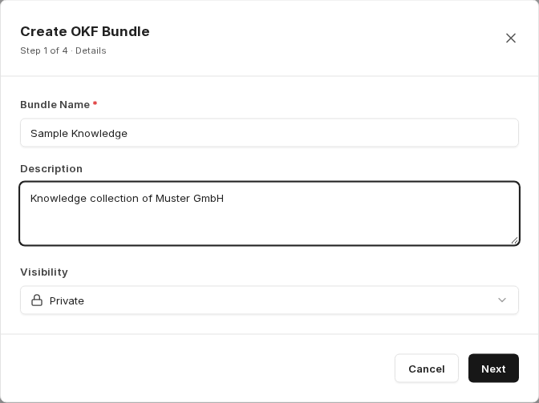
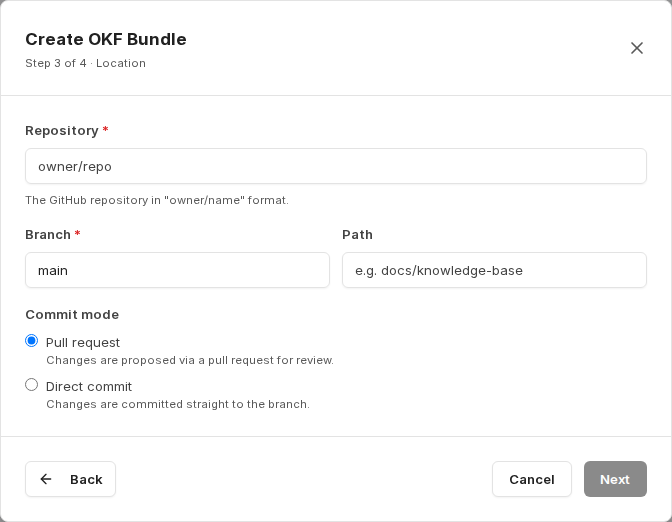

Balíčky OKF jsou znalostní sbírky ve formátu **Open Knowledge Format** – otevřeném, veřejně zdokumentovaném formátu, který popisuje znalosti jako soubory Markdown s definovanou strukturou složek. Znalosti tak zůstávají tam, kde je lze verzovat a revidovat: v repozitáři GitHub nebo ve složce SharePoint.

Protože je balíček připojen jako sbírka, je jeho obsah v companyRAG automaticky prohledávatelný.

:::note
Balíčky OKF jsou v současnosti experimentální. Struktura a ovládání se mohou ještě změnit.
:::

## Čtení a zápis

companyRAG zdroje jako SharePoint zpravidla pouze čte. Balíčky OKF jsou jediným případem, kdy se obsah zapisuje do úložiště: při vytvoření může companyRAG vytvořit kostru a agent může prostřednictvím [companyKNOWLEDGE](/cs/company-gpt/addons/companyknowledge/) vytvářet a aktualizovat soubory Markdown v balíčku. Do běžných zdrojů SharePoint se naopak nikdy nezapisuje.

## Vytvoření balíčku

Začnete v části [Sbírky](/cs/company-gpt/addons/companyrag/sammlungen/#vytvoření-sbírky) tlačítkem **Create Collection** a zvolíte typ sbírky **OKF Bundle**. Otevře se průvodce **Create OKF Bundle** se čtyřmi kroky.

**Krok 1 – Details:** **Bundle Name**, volitelně **Description** a **Visibility**.

**Krok 2 – Source:** Zvolte, kde jsou znalosti uloženy.

- **GitHub**: soubory Markdown v repozitáři GitHub, synchronizované z větve.
- **SharePoint**: soubory Markdown ve složce knihovny dokumentů SharePoint.

**Krok 3 – Location:** U GitHubu zadejte **Repository** ve formátu `owner/name`, **Branch** a volitelně **Path**.

**Commit mode** určuje, jak se změny zapisují zpět:

- **Pull request**: změny se navrhují prostřednictvím pull requestu ke kontrole.
- **Direct commit**: změny se commitují přímo do větve.

U SharePointu místo toho vyberete web, knihovnu a cílovou složku.

**Krok 4 – Review & Create:** Zkontrolujete souhrn. Je-li zapnuto **Seed OKF skeleton if empty** (výchozí), companyRAG vytvoří v umístění bez souborů OKF kostru se soubory `README.md`, `index.md` a `log.md`, aby balíček nebyl prázdný. Tlačítkem **Create Bundle** se ihned vytvoří sbírka a spustí se první synchronizace.

Balíčky OKF se automaticky vytvářejí se strategií rozdělování **Markdown-aware**, protože jejich obsah je strukturován nadpisy. Viz [Strategie rozdělování](/cs/company-gpt/addons/companyrag/sammlungen/#strategie-dělení-na-bloky).

## Údržba balíčků

V CompanyGPT může agent vytvářet a aktualizovat balíčky OKF a soubory Markdown, které obsahují. Ve spojení s režimem commitu *Pull request* tak vzniká kontrolovatelný pracovní postup: agent navrhuje změny znalostní báze a člověk je schvaluje.

Jak se takový agent nastavuje, které nástroje potřebuje a jak vypadá pracovní postup od vytvoření formátu až po indexování, je popsáno v části [companyKNOWLEDGE](/cs/company-gpt/addons/companyknowledge/).

Je vyžadována připojená [integrace GitHub nebo SharePoint](/cs/company-gpt/addons/companyrag/integrationen/).
