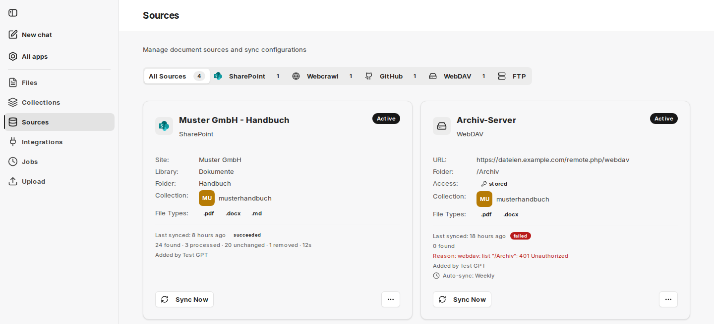
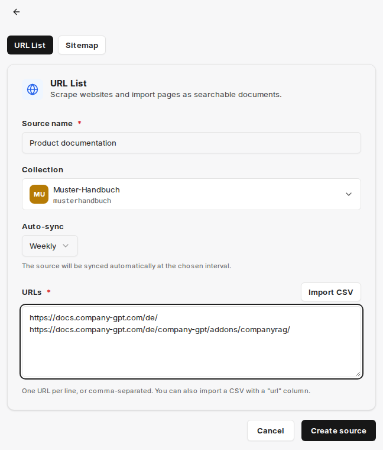
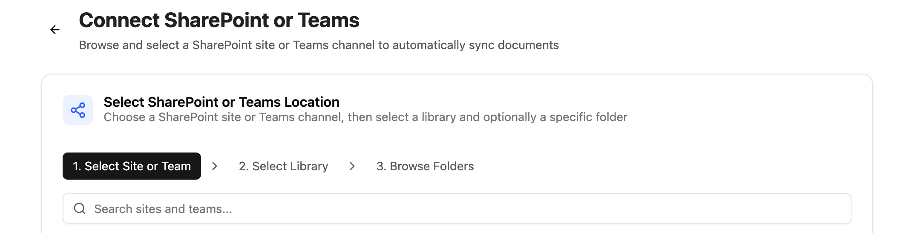
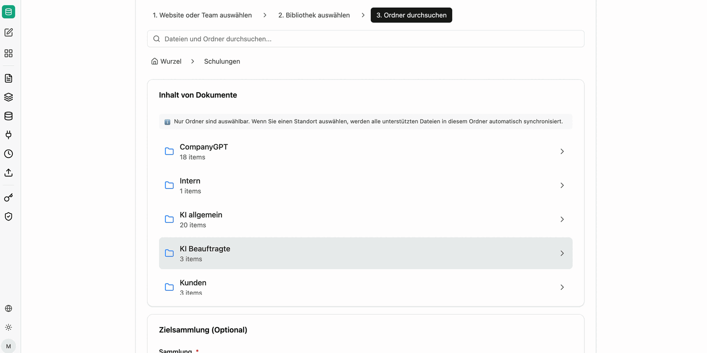
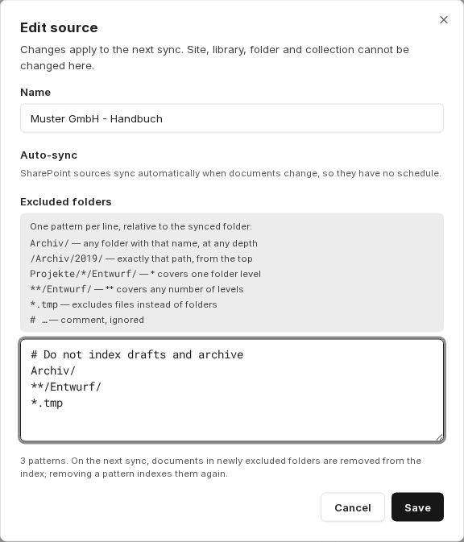

Zdroje trvale propojují companyRAG s externím systémem a synchronizují dokumenty do [sbírky](/cs/company-gpt/addons/companyrag/sammlungen/). Nové a změněné soubory se načtou, aniž byste je museli znovu nahrávat. U souborových zdrojů, jako jsou SharePoint, Google Drive, Nextcloud, GitHub, WebDAV a FTP, se při dalším běhu z indexu odstraní i soubory, které byly ve zdrojovém systému odstraněny.

companyRAG zdrojové systémy pouze čte. Nezapisuje soubory ani změny zpět do SharePointu, Google Drive ani jiného systému. Jedinou výjimkou jsou [balíčky OKF](/cs/company-gpt/addons/companyrag/okf-bundles/).

Je nutná připojená [integrace](/cs/company-gpt/addons/companyrag/integrationen/). Zdroje WebDAV a FTP mají vlastní přihlašovací údaje a předchozí připojení nepotřebují.

Přehled má kartu **All Sources** a samostatnou kartu pro každý dostupný systém. Každý zdroj zobrazuje svou konfiguraci, cílovou sbírku a svůj stav (**Active**, **Disabled** nebo **Syncing**). Pod tím vidíte čas poslední synchronizace, výsledek posledního běhu (**running**, **succeeded**, **partial** nebo **failed**) s údaji, jako jsou nalezené, zpracované, nezměněné a odstraněné soubory, v případě chyb **Reason** (důvod) a osobu, která zdroj přidala.

Zdroje mohou měnit vlastníci a administrátoři cílové sbírky. Všichni ostatní vidí zdroj s upozorněním **View only**.

## Kdy synchronizace probíhá

| Zdroj | První běh | Poté |
|---|---|---|
| **SharePoint** | spustí se automaticky ihned po připojení | automaticky při změně dokumentů; navíc companyRAG v pravidelných intervalech zdroj kompletně porovná. Plán neexistuje. |
| **Google Drive** | spustí se automaticky ihned po připojení | Změny se načítají automaticky; companyRAG k tomu zdroj pravidelně kontroluje. Plán neexistuje. |
| **Nextcloud, GitHub, procházení webu, WebDAV, FTP** | při zvoleném intervalu automaticky krátce po vytvoření; při **Manual only** pomocí **Sync Now** | ve zvoleném intervalu **Auto-sync**: **Hourly**, **Daily** nebo **Weekly** – nebo pouze ručně |

U souborových zdrojů přenáší každý běh pouze rozdíl – nezměněné dokumenty se znovu neindexují. K procházení webu viz níže. Pomocí **Sync Now** můžete kdykoli spustit další běh pro libovolný zdroj.

## Procházení webu

Procházet a indexovat lze jednotlivé webové stránky, seznamy (v souborech CSV) i celé mapy webu (sitemap). Jednotlivé stránky se při každém běhu načtou znovu a znovu se indexují pouze tehdy, pokud se jejich obsah změnil. U procházení podle mapy webu se zohledňuje pouze rozdíl vzhledem k poslednímu procházení a datu změny.

Na kartě **Webcrawl** otevře **Add Web Source** stránku **New Web Crawl Source**. Na kartě **URL List** zadáte **Source name**, **Collection**, **Auto-sync** a **URLs** – jednu URL na řádek nebo oddělené čárkami. **Import CSV** převezme soubor CSV se sloupcem `url`.

Pro celé weby přepněte na kartu **Sitemap** a zadejte **Sitemap URL**. **Path prefix filter (optional)** určuje, které stránky se indexují: například `/tutorials/` importuje pouze URL, jejichž cesta začíná na `/tutorials/`.

Po **Create source** spustíte první běh přímo pomocí **Sync now**, nebo při zvoleném intervalu počkáte na automatický běh.

## Připojení SharePointu

Na kartě **SharePoint** otevře **Connect SharePoint** stránku **Connect SharePoint or Teams**. V části **Content to Sync** nejprve zvolte **Files only**, **Pages & News only** nebo **Files + Pages & News**.

1. **Select Site or Team**: Zvolte web SharePoint nebo tým
2. **Select Library**: Knihovny vybraného webu/týmu
3. **Browse Folders**: Vyberte složku a v **Target Collection** sbírku, do které se soubory synchronizují; poté **Select This Folder**

V části **Sync Configuration** nastavíte **File Types to Sync** a dokončíte pomocí **Connect SharePoint** nebo **Connect Teams**. Při volbě **Pages & News only** není výběr knihovny a složky potřeba.

:::note
Vybrat lze pouze složky. Všechny podporované soubory v této složce a v úrovních pod ní (podsložkách) se synchronizují automaticky. U datových sbírek se synchronizují pouze tabulkové soubory.
:::

Po připojení se první synchronizace spustí automaticky. Od té doby companyRAG udržuje zdroj aktuální sám, když se dokumenty změní.

:::tip[Oprávnění]
Při synchronizaci ze SharePointu se přebírají oprávnění zdrojového systému. Uživatel tedy prostřednictvím companyRAG nikdy neuvidí více obsahu, než by viděl v rozhraní SharePointu.
:::

## Připojení Google Drive

Na kartě **Google Drive** otevře **Add Google Drive Source** výběr. Zvolíte **My Drive**, **Shared Drive** nebo **Shared with me**, volitelně složku, a **Target Collection**.

V části **Google Formats** rozhodnete, zda je aktivní **Export Google Docs & Sheets** (Docs jako text, Sheets jako CSV) a **Include Google Slides** (převod do PDF s OCR, pomalejší a dražší). Google neumí exportovat soubory Google větší než 10 MB; ty se přeskočí. První synchronizace se spustí ihned po připojení.

:::caution
Z Google Drive se nepřebírají žádná oprávnění. Přístup k synchronizovanému obsahu řídí výhradně sbírka: každý, kdo má přístup ke sbírce, může v dokumentech vyhledávat.
:::

## Nextcloud a GitHub

U **Nextcloud** vám **Create Source** umožní vybrat složku ve vašem Nextcloudu, pojmenovat zdroj a nastavit typy souborů, sbírku a **Auto-sync**.

U **GitHub** vám **Add GitHub Source** umožní vybrat repozitář a větev, volitelně **Subdirectory (optional)**, **File extensions** (`.md`, `.markdown`, `.mdx`, `.txt`), cílovou sbírku a **Auto-sync**. V části **Repository access** jsou tři možnosti:

- **Creator's token**: Zdroj používá token GitHub z vaší [integrace](/cs/company-gpt/addons/companyrag/integrationen/). Pokud vyprší nebo je odstraněn, synchronizace selže.
- **Dedicated personal access token**: Token s přístupem pro čtení, který je u tohoto zdroje uložen šifrovaně a už se nikdy nezobrazí.
- **SSH deploy key**: companyRAG vygeneruje pár klíčů. Veřejný klíč přidáte do repozitáře jako deploy key bez přístupu pro zápis; teprve poté první synchronizace uspěje.

## WebDAV a FTP

Servery WebDAV a FTP připojíte pomocí přihlašovacích údajů uložených u každého zdroje, například ownCloud, Synology nebo Apache mod_dav přes WebDAV. Přihlašovací údaje jsou u zdroje uloženy šifrovaně a už se nikdy nezobrazí.

- **Create WebDAV source**: úplná **WebDAV URL**, uživatelské jméno a heslo.
- **Create FTP source**: **Host**, **Port** a **Encryption** – **FTPS (explicit, AUTH TLS)**, **FTPS (implicit, port 990)** nebo **Unencrypted (FTP)**. Server povoluje nešifrovaná spojení pouze pro privátní hostitele.

Nejprve vyberte sbírku, poté ověřte spojení pomocí **Test connection and browse** a zvolte složku. Typy souborů a **Auto-sync** nastavíte stejně jako u ostatních zdrojů.

:::note[Není k dispozici ve všech prostředích]
O tom, zda je tato funkce ve vašem prostředí k dispozici, rozhoduje vaše organizace. S dotazy se obraťte na svého administrátora.
:::

## Typy souborů a vlastní přípony

U SharePointu, Google Drive, Nextcloudu, WebDAV a FTP volíte, které typy souborů se indexují. Navíc můžete v **Add a custom file extension** přidat další přípony (pouze písmena a číslice, 1 až 12 znaků). Takové soubory se čtou jako prostý text; používejte to pouze pro přípony bez vestavěné podpory.

Zdroje GitHub nabízejí pouze pevné přípony `.md`, `.markdown`, `.mdx` a `.txt`, bez vlastních přípon. Procházení webu výběr typů souborů nemá.

## Vyloučení složek

U zdrojů SharePoint, WebDAV a FTP můžete v **Edit** v poli **Excluded folders** vyloučit jednotlivé oblasti, například koncepty nebo archivy. Zadejte jeden vzor na řádek, relativně k synchronizované složce:

| Vzor | Účinek |
|---|---|
| `Archive/` | libovolná složka s tímto názvem, v libovolné hloubce |
| `/Archive/2019/` | přesně tato cesta, od nejvyšší úrovně |
| `Projects/*/Draft/` | `*` pokrývá jednu úroveň složek |
| `**/Draft/` | `**` pokrývá libovolný počet úrovní |
| `*.tmp` | vylučuje soubory místo složek |
| `# …` | komentář, ignoruje se |

Při další synchronizaci se dokumenty v nově vyloučených složkách z indexu odstraní; odstraněním vzoru se znovu zaindexují.

## Akce zdroje

- **Sync Now**: okamžitě spustí běh
- Prostřednictvím nabídky **…** zdroje:
  - **Pause** / **Resume**: deaktivuje nebo znovu aktivuje zdroj. Není k dispozici pro SharePoint, Nextcloud a Google Drive.
  - **Edit**: úprava **Name**, **Status** (ne pro SharePoint, Nextcloud a Google Drive), **Auto-sync** (ne pro SharePoint a Google Drive), **Credentials** (WebDAV, FTP), **Repository access** (GitHub) a **Excluded folders** (SharePoint, WebDAV, FTP). Web, knihovnu, složku a sbírku nelze změnit; změny se uplatní při další synchronizaci.
  - **Delete**: odstraní zdroj

:::danger
Odstraněním zdroje se trvale smažou všechny soubory, které tento zdroj vytvořil, včetně jejich embeddingů a uloženého obsahu. Zmizí z vyhledávání a nelze je obnovit.
:::

Průběh jednotlivých běhů můžete sledovat v části [Úlohy](/cs/company-gpt/addons/companyrag/auftraege/).
