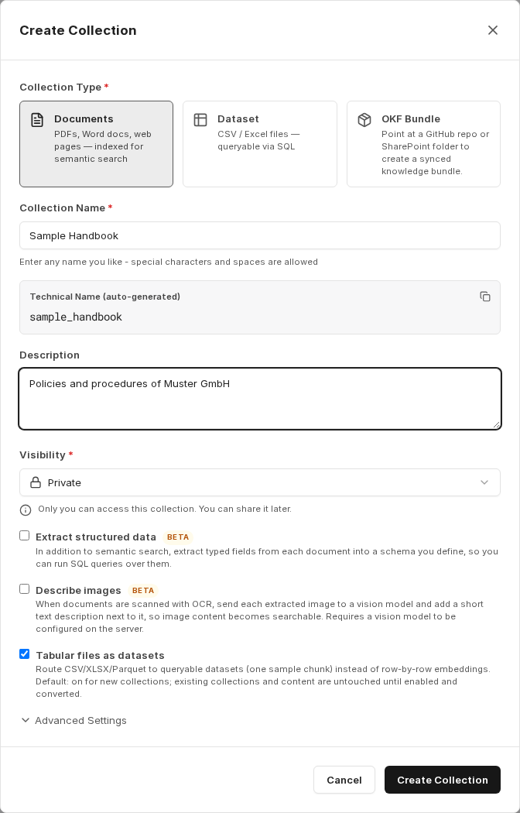
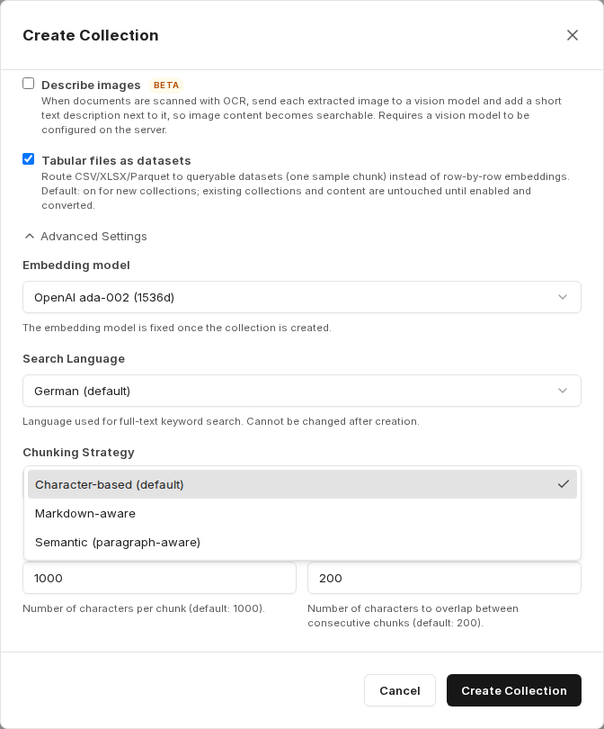
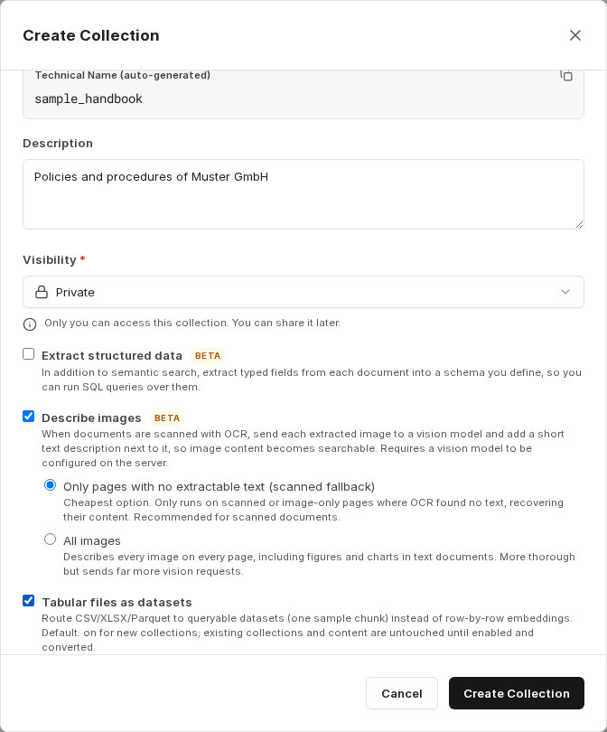
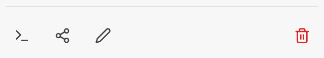

Sbírky jsou úložiště, která umožňují organizovat dokumenty a oprávnění. V každé sbírce lze vyhledávat samostatně a každé sdílení se uděluje na úrovni sbírky.

Přehled v části **Collections** je rozdělen na karty **All**, **Mine** (sbírky, které vlastníte), **Shared with me** (sbírky, které s vámi byly sdíleny) a **Public**. Každá sbírka zobrazuje štítky viditelnosti, typu a vaší role.

## Vytvoření sbírky

**Create Collection** otevře dialog. Nejprve zvolíte **Collection Type** (typ sbírky):

- **Documents**: soubory PDF, dokumenty Word, webové stránky a další soubory, které se indexují pro sémantické vyhledávání.
- **Dataset**: tabulky, na které se lze dotazovat pomocí SQL. Viz [Sbírky datových sad](/cs/company-gpt/addons/companyrag/datensaetze/).
- **OKF Bundle**: místo toho otevře průvodce pro [balíček OKF](/cs/company-gpt/addons/companyrag/okf-bundles/).

Poté zadáte **Collection Name**, **Description** a **Visibility**. **Technical Name** se automaticky vygeneruje z názvu – později se používá v promptech agentů a v nástrojích MCP jako `collection` a nelze ho změnit.

K dispozici jsou dvě možnosti viditelnosti:

- **Private**: K této sbírce a k dokumentům s ní propojeným máte přístup pouze vy. Sbírku můžete kdykoli později sdílet.
- **Public**: Všichni uživatelé ve vaší organizaci vidí sbírku a mohou si prohlížet soubory z ní – výhradně v rámci společnosti.

Pro sbírky typu **Documents** jsou k dispozici také tři možnosti zpracování:

- **Extract structured data** *(Beta)*: Kromě sémantického vyhledávání se z každého dokumentu extrahují typovaná pole do schématu, které definujete, a lze se na ně dotazovat pomocí SQL. Viz [Strukturovaná data z dokumentů](/cs/company-gpt/addons/companyrag/strukturierte-daten/).
- **Describe images** *(Beta)*: Obsah obrázků se pomocí vizuálního modelu převede na text (viz [níže](#popis-obrázků)).
- **Tabular files as datasets**: Soubory CSV, Excel a Parquet se ukládají jako datové sady, na které se lze dotazovat, místo aby se vkládaly (embedding) řádek po řádku (viz [níže](#tabulkové-soubory-jako-datové-sady)). U nových sbírek je tato možnost zapnutá.

## Pokročilá nastavení

Pro sbírky typu **Documents** otevřete v dialogu oddíl **Advanced Settings**.

| Nastavení | Význam |
|---|---|
| **Embedding model** | Model používaný k vektorizaci obsahu. Pole se zobrazí pouze tehdy, pokud vaše prostředí nabízí výběr modelů; jinak se použije výchozí model prostředí. |
| **Search Language** | Jazyk fulltextového vyhledávání, které probíhá souběžně s vyhledáváním pomocí AI. Měl by odpovídat jazyku vašeho obsahu, aby se správně odstraňovala nevýznamová slova a redukovaly tvary slov. Výchozí: **German (default)**. |
| **Chunking Strategy** | Způsob, jakým se dokumenty pro vyhledávání dělí na oddíly (viz níže). |
| **Chunk Size** | Počet znaků na blok. Výchozí: 1000. Pouze u strategie **Character-based (default)**. |
| **Chunk Overlap** | Počet znaků, kterými se po sobě jdoucí bloky překrývají. Výchozí: 200. Pouze u strategie **Character-based (default)**. |

Které embeddingové modely jsou k dispozici, závisí na vašem prostředí.

:::note[Není k dispozici ve všech prostředích]
O tom, zda je tato funkce ve vašem prostředí k dispozici, rozhoduje vaše organizace. S dotazy se obraťte na svého administrátora.
:::

Embeddingový model a strategie dělení na bloky jsou po vytvoření sbírky pevně dané. Před vytvořením sbírky tato nastavení zkontrolujte – zejména u velkých objemů dat, které by jinak bylo nutné znovu indexovat. Jazyk vyhledávání můžete později změnit v **Edit collection**; index fulltextového vyhledávání se pak na pozadí znovu sestaví a výsledky vyhledávání mohou být dočasně neúplné.

### Strategie dělení na bloky

- **Character-based (default)**: Pevná velikost bloku s překryvem, ve výchozím nastavení 1000 znaků s překryvem 200 znaků. Vhodné pro smíšený obsah bez spolehlivé struktury.
- **Markdown-aware**: Vše mezi dvěma nadpisy tvoří jeden blok. Doporučeno pro wiki a dokumentaci; [balíčky OKF](/cs/company-gpt/addons/companyrag/okf-bundles/) se s touto strategií vytvářejí automaticky.
- **Semantic (paragraph-aware)**: Každý odstavec tvoří jeden blok. Vhodné pro texty s jasně oddělenými odstavci.

## Popis obrázků

Všechny dokumenty – například skeny nahrané jako PDF – procházejí OCR. Pokud OCR nenajde žádný text nebo pokud obrázky nesou relevantní informace, může companyRAG každý obrázek odeslat vizuálnímu modelu a vložit krátký textový popis na odpovídající místo v dokumentu. Obsah obrázků se tak stane prohledávatelným.

- **Only pages with no extractable text (scanned fallback)**: Nejúspornější možnost. Spouští se pouze u naskenovaných nebo čistě obrázkových stránek, na kterých OCR nenašlo žádný text, a obnovuje jejich obsah. Doporučeno pro naskenované dokumenty.
- **All images**: Popisuje každý obrázek na každé stránce, včetně ilustrací a diagramů v textových dokumentech. Důkladnější, ale odesílá podstatně více požadavků na vizuální model.

:::note
Popis obrázků vyžaduje vizuální model nakonfigurovaný na serveru. Možnost můžete také později zapnout nebo vypnout v **Edit collection**; změna platí pro soubory indexované od té doby.
:::

## Tabulkové soubory jako datové sady

S možností **Tabular files as datasets** ukládá companyRAG soubory CSV, Excel a Parquet v dokumentové sbírce jako datové sady, na které se lze dotazovat. Sémantické vyhledávání zobrazí pro každý soubor pouze jeden ukázkový blok; skutečné hodnoty agent zjišťuje pomocí [nástrojů SQL](/cs/company-gpt/addons/companyrag/in-companygpt/#nástroje-sql-pro-datové-sady-a-strukturovaná-data). Bez této možnosti se tabulky vkládají řádek po řádku.

U existujících sbírek zapněte možnost v **Edit collection** a uložte. Již indexované tabulky pak převedete pomocí **Convert existing tables to datasets**; companyRAG nejprve zobrazí, kolika souborů se to týká. Soubory, jejichž zdroj poskytuje pouze extrahovaný text (například vykreslená webová stránka), nelze převést a zůstanou beze změny. Soubory, jejichž zdroj už není k dispozici, lze přitom odstranit.

## Akce sbírky

V závislosti na vaší roli jsou v dolní části každé sbírky k dispozici tyto ikony:

- **System Prompt**: připravený systémový prompt pro agenta, viz [Použití companyRAG v CompanyGPT](/cs/company-gpt/addons/companyrag/in-companygpt/#ukázkový-prompt-ze-sbírky).
- **Ingestion instructions**: pouze pro živé datové sady; zobrazuje endpointy pro odesílání řádků, viz [Sbírky datových sad](/cs/company-gpt/addons/companyrag/datensaetze/#odesílání-řádků).
- **Share collection**: pouze vlastníci (viz níže).
- **Edit collection**: pro vlastníky a administrátory sbírky.
- **Delete collection**: pouze vlastníci.

### Sdílení sbírky

V dialogu **Share Collection** vyhledáváte osoby nebo skupiny podle jména nebo e-mailu (alespoň dva znaky) a ke každé položce nastavíte roli:

- **Viewer**: Může tuto sbírku zobrazit a vyhledávat v ní, ale nemůže ji měnit.
- **Admin**: Může zobrazovat, nahrávat soubory a měnit nastavení.
- **Owner**: Plná kontrola včetně sdílení a mazání. Sbírka musí mít vždy alespoň jednoho vlastníka.

Přepínač **Share with everyone** udělí všem uživatelům přístup ke sbírce pro čtení. Změny použijete pomocí **Save changes**.

:::note
Sbírky sdílené se všemi mají vždy pouze přístup pro čtení, aby obsah nemohl měnit každý uživatel. Sdílení se skupinami a vyhledávání v celém adresáři vyžadují připojený účet Microsoft; bez něj najdete pouze osoby, které se alespoň jednou přihlásily.
:::

### Úprava sbírky

V **Edit collection** změníte název, popis a jazyk vyhledávání. U dokumentových sbírek můžete také upravit pokyny pro extrakci, **Describe images** a **Tabular files as datasets**; tyto změny platí pro soubory indexované od té doby. Typ sbírky, technický název a strategii dělení na bloky nelze změnit.

### Smazání sbírky

:::danger
Smazáním sbírky se nevratně smažou všechny dokumenty a úlohy propojené se sbírkou!
:::

## Zobrazení pro superadministrátory

Pokud existují sbírky, které můžete vidět pouze jako superadministrátor, zobrazí se nad přehledem upozornění s přepínačem **My access** / **All**. V režimu **All** se zobrazí všechny sbírky organizace; sbírky, ke kterým máte přístup pouze jako superadministrátor, nesou štítek **visible as super admin only**. U těchto sbírek jsou viditelná metadata, ale soubory nelze číst.

## Další kroky

- Přidání obsahu: [Nahrávání](/cs/company-gpt/addons/companyrag/hochladen/) nebo [Zdroje](/cs/company-gpt/addons/companyrag/quellen/)
- Dotazování na sbírku: [Použití companyRAG v CompanyGPT](/cs/company-gpt/addons/companyrag/in-companygpt/)
