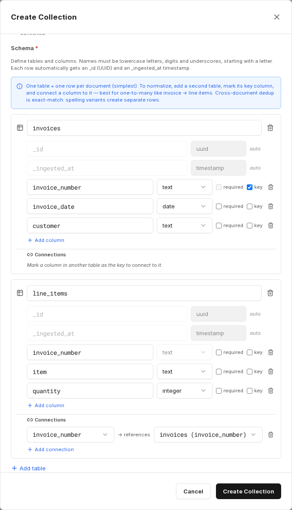

Čisté vyhledávání RAG najde textové pasáže, ale nedokáže počítat součty, množství nebo pořadí. U opakujících se typů dokumentů – faktur, smluv, protokolů z kontrol – proto companyRAG umí z dokumentů extrahovat také **strukturovaná data**: jazykový model vyplní tabulkové schéma, které definujete, a na to se pak lze dotazovat pomocí SQL.

Pro stejnou sbírku tak získáte dvě přístupové cesty, které lze kombinovat: sémantické vyhledávání v textu a strukturované dotazy nad extrahovanými poli.

Při [vytváření sbírky](/cs/company-gpt/addons/companyrag/sammlungen/#vytvoření-sbírky) typu **Documents** zapněte volbu **Extract structured data** *(Beta)*. Volbu lze zapnout pouze při vytvoření.

:::note
Tato funkce je ve fázi beta. U kritických analýz namátkově ověřte extrahované hodnoty oproti původním dokumentům.
:::

## Definice schématu

Nejjednodušším případem je tabulka s jedním řádkem na dokument. Pro každý sloupec definujete název a datový typ a volitelně označíte, zda je pole povinné nebo slouží jako **klíč**.

Dostupné datové typy: `text`, `integer`, `numeric`, `boolean`, `timestamp`, `date`.

Názvy se musí skládat z malých písmen, číslic a podtržítek a musí začínat písmenem. Každý řádek automaticky dostane pole `_id` (UUID) a `_ingested_at` (časové razítko).

Kromě toho můžete v části **Extraction instructions (optional)** popsat, které informace se mají extrahovat, a v části **Max pages to scan per document (optional)** omezit počet vyhodnocovaných stránek – například na prvních pět stránek, pokud se relevantní údaje vždy nacházejí na začátku. Tím se sníží náklady i doba zpracování.

Pokyny pro extrakci můžete později upravit v části **Edit collection**. Změna platí pro soubory indexované od té chvíle; již zpracované dokumenty si své extrahované údaje ponechají. Samotné schéma je po vytvoření pouze pro čtení.

## Více tabulek a vztahy

Pro vztahy 1:N – například fakturu s několika položkami – označte klíčový sloupec v první tabulce (například číslo faktury), přidejte druhou tabulku pro položky a propojte její odpovídající sloupec s tímto klíčem.

Propojení se v dotazech používá jako nápověda pro JOIN. Jeden dokument pak vytvoří několik řádků v tabulce položek, zatímco údaje záhlaví se uloží jednou v první tabulce.

:::note
Deduplikace napříč dokumenty je založena na přesné shodě: různé zápisy téže hodnoty vytvoří samostatné řádky. Hodnoty cizích klíčů se ukládají přesně tak, jak byly extrahovány – automatické dohledávání neprobíhá.
:::

## Stav extrakce

Pokud extrakce u některého dokumentu selže, dokument se přesto indexuje pro sémantické vyhledávání. V části [Soubory](/cs/company-gpt/addons/companyrag/dateien/) má pak stav **Indexed (warning)**.

## Dotazování

Na extrahované tabulky se dotazujete pomocí nástrojů SQL serveru MCP `ai-search`, stejně jako u [sbírek datových sad](/cs/company-gpt/addons/companyrag/datensaetze/). Které nástroje k tomu agent potřebuje, je popsáno v části [Použití companyRAG v CompanyGPT](/cs/company-gpt/addons/companyrag/in-companygpt/).
