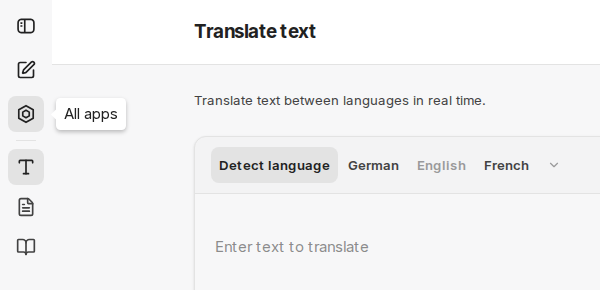
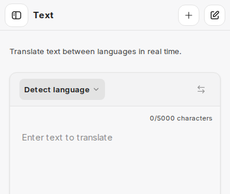
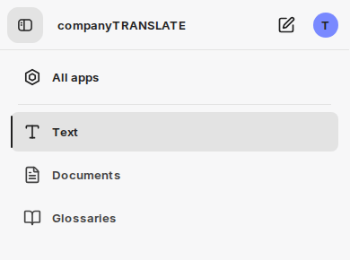
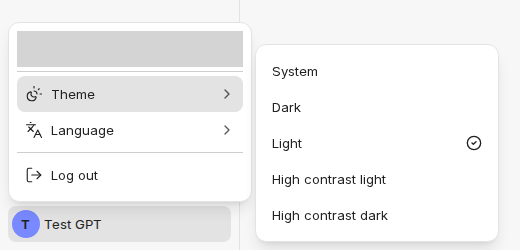
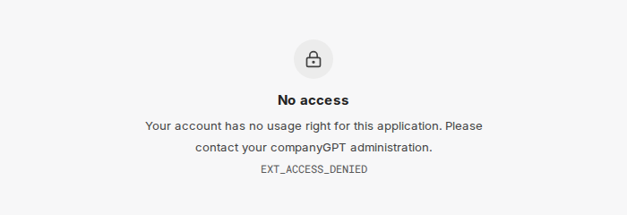
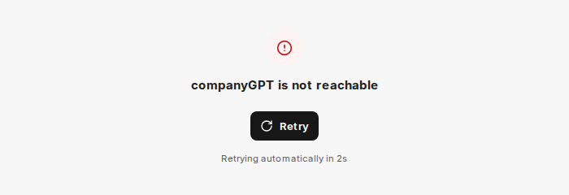

Doplňky CompanyGPT, jako jsou companyRAG, companyFILES, companyTRANSLATE, companyTRANSCRIBE, companyLEARN, companyADMIN, [administrace companyM365](/cs/company-gpt/addons/companym365/administration/) a [Všechny aplikace](/cs/company-gpt/addons/alle-apps/), používají společné rozhraní. Vychází z chatu: postranní panel, barvy a písma odpovídají chatu a mezi chatem a doplňky přepínáte bez opětovného přihlášení.

Tato stránka popisuje, co je ve všech doplňcích stejné. Stránky jednotlivých doplňků popisují pouze jejich vlastní oblasti.

## Postranní panel

Na širokých obrazovkách se postranní panel nachází vlevo. Shora dolů obsahuje:

| Prvek | Funkce |
|---|---|
| **Open sidebar** / **Close sidebar** | Rozbalí nebo sbalí postranní panel. Ve sbaleném stavu zobrazuje pouze ikony a název se objeví, když na ikonu najedete myší. V rozbaleném stavu se názvy zobrazují vedle ikon. |
| **New chat** | Vrátí vás do chatu a zahájí nový chat. |
| **All apps** | Otevře přehled všech aplikací, které máte povolené. Viz [Všechny aplikace](/cs/company-gpt/addons/alle-apps/). |
| Nabídka doplňku | Oblasti příslušného doplňku. Oddělovače nabídku podle potřeby seskupují. Aktuální oblast je zvýrazněna. |
| Účet | Úplně dole: váš profilový obrázek, v rozbaleném postranním panelu s vaším jménem. Kliknutím otevřete [nabídku účtu](#nabídka-účtu). |

Pokud má oblast podstránky, například v companyADMIN, zobrazuje rozbalený postranní panel podstránky aktuální oblasti odsazené pod ní.

Váš prohlížeč si pamatuje, zda je postranní panel rozbalený, nebo sbalený, a to pro všechny doplňky společně.

## Na chytrém telefonu

V úzkých oknech, například na chytrém telefonu, nahrazuje postranní panel záhlaví:

- vlevo **Open sidebar**,
- uprostřed název aktuální stránky,
- vpravo akce stránky (více akcí je seskupeno pod **More options**) a **New chat**.

**Open sidebar** vysune nabídku přes celou šířku. Nahoře jsou **Close sidebar**, název doplňku, **New chat** a váš účet, pod nimi **All apps** a nabídka doplňku. Klepnutím na položku otevřete stránku a nabídka se zavře.

## Nabídka účtu

Kliknutím na svůj profilový obrázek otevřete nabídku účtu:

- **Vaše e-mailová adresa.** Některé doplňky pod ní zobrazují další řádek; companyADMIN například zobrazuje vaši roli (**Superadmin** nebo **Admin (no superadmin)**).
- **Theme**: **System**, **Dark**, **Light**, **High contrast light** nebo **High contrast dark**. **System** se řídí nastavením vašeho operačního systému.
- **Language**: například **Deutsch** nebo **English**, pokud doplněk nabízí více jazyků. Volba platí pro doplněk.
- **Log out** vás odhlásí z CompanyGPT, včetně chatu.

V závislosti na doplňku mohou jednotlivé položky chybět, například **Language**, pokud doplněk nabízí pouze jeden jazyk.

### Stejný motiv jako v chatu

Motiv je propojen s chatem. Doplněk převezme motiv, který jste zvolili v chatu. Pokud v doplňku zvolíte jiný motiv, platí i v chatu. Pouhé otevření doplňku v chatu nic nemění.

## Přihlášení

Doplňky používají relaci CompanyGPT. Pokud jste přihlášeni do chatu, jste přihlášeni i do doplňků; samostatné přihlášení pro jednotlivé doplňky neexistuje. Relace se na pozadí obnovuje, dokud zůstáváte přihlášeni.

## Stavové stránky

Pokud doplněk nemůže zobrazit svůj obsah, zobrazí se v oblasti obsahu místo prázdné stránky stavová stránka. Postranní panel pak zobrazuje pouze **New chat** a **All apps**. U stavu **No access** se může zobrazit i váš účet; tam se pak můžete odhlásit a přihlásit jiným účtem.

| Stavová stránka | Význam | Co můžete udělat |
|---|---|---|
| **Sign-in required** | Nejste (nebo už nejste) přihlášeni. | **Sign in** vás přesměruje na přihlášení do CompanyGPT. Pokud poté skončíte v chatu, otevřete doplněk znovu. |
| **No access** | Jste přihlášeni, ale váš účet není pro tento doplněk povolen. Text uvádí důvod, například: *Your account has no usage right for this application. Please contact your companyGPT administration.* Pod ním je kód, například `EXT_ACCESS_DENIED`. | Kontaktujte svého administrátora a uveďte kód. |
| **companyGPT is not reachable** | CompanyGPT momentálně neodpovídá. Doplněk to automaticky zkouší znovu a zobrazuje čekací dobu (**Retrying automatically in …s**). | **Retry** okamžitě spustí nový pokus. Po posledním automatickém pokusu se navíc zobrazí **Reload the page**. |
| **Logout failed** | Odhlášení se nezdařilo. Upozornění: **Your session may still be active** (vaše relace může být stále aktivní). | **Retry** spustí odhlášení znovu. |

## Vložené zobrazení v chatu

Některé doplňky zobrazují části svého rozhraní přímo v chatu, například seznam v oblasti **Apps** postranního panelu chatu nebo zobrazení, která v odpovědi otevírají nástroje doplňku. Tato vložená zobrazení ukazují pouze obsah, bez postranního panelu, záhlaví a nabídky účtu. Přihlášení a motiv přebírají z chatu.
