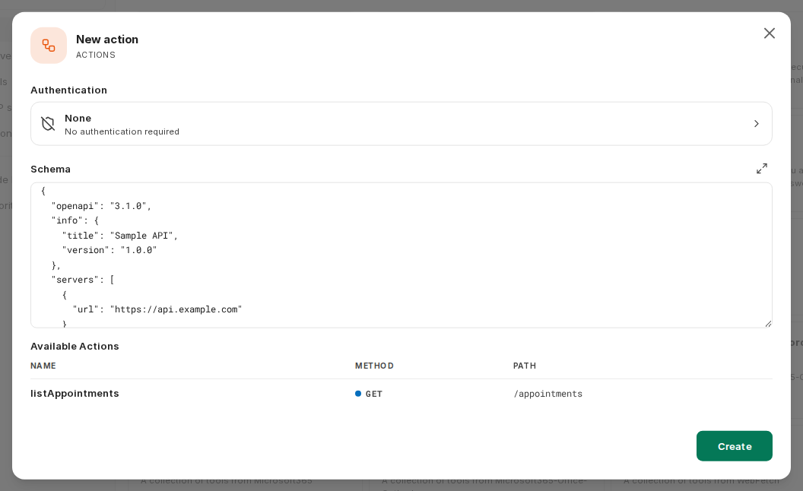
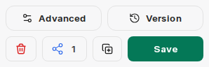
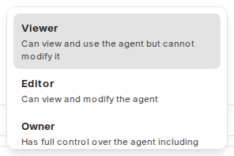
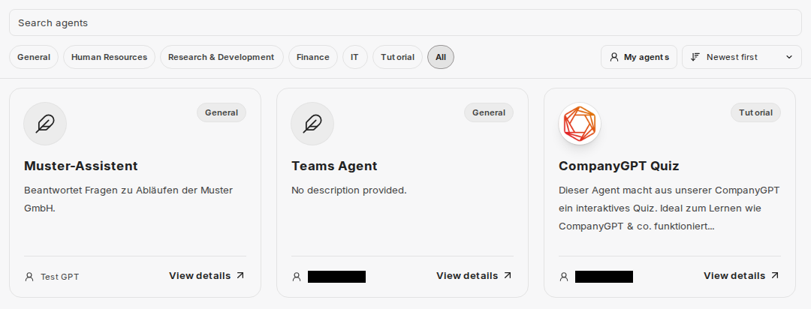

:::note[Nové rozhraní chatu]
Snímky obrazovky a popisky na této stránce ukazují [nové rozhraní chatu](/cs/company-gpt/neue-chat-oberflaeche/). To je v současné době k dispozici v demo přístupu a v pilotních prostředích; v ostatních prostředích se popisky a kroky mohou ještě lišit.
:::

Agenti v CompanyGPT jsou pokročilé systémy, které umí víc než jen generovat text. Analyzují požadavek uživatele, vytvoří plán jeho splnění, používají nástroje k získání informací a na požadavek odpovídají.

Schopnosti:

- **Uvažování**: Umí rozložit složité problémy na menší celky a zpracovat je
- **Používání nástrojů**: Umí rozhodnout, které nástroje použít pro které úkoly
- **Jednání**: Umí spouštět nástroje k získání informací

Agenty vytváříte a upravujete pomocí **Agent Builder** v levém postranním panelu. Položka se zobrazí pouze tehdy, pokud vaše role smí vytvářet agenty (viz [Oprávnění](#oprávnění)).

## Součásti agentů

### Název a popis

Agenti by vždy měli mít název, protože je lze vybrat podle názvu ve výběru modelu. Navíc lze uložit popis, který poskytuje doplňující informace.

### Kategorie

Každého agenta lze přiřadit do kategorie. Pokud jsou agenti sdíleni mezi uživateli v rámci společnosti a používá se Agent Marketplace, lze je tam filtrovat podle kategorie.

### Pokyny

Pokyny jsou vlastním promptem agenta. Popisují, co má agent dělat, jak se má chovat atd. Informace o efektivním promptování pro agenty najdete zde: [Prompt Engineering](/cs/prompt-engineering/uebersicht). Zejména u agentů se doporučuje používat strukturované a čistě formátované prompty.

V části **Instructions source** určíte, odkud pokyny pocházejí: s volbou **Inline** je píšete přímo do pole **Instructions**; s volbou **Prompt** vyberete uložený [prompt](/cs/company-gpt/prompts/) a jeho **Version**.

Předávat lze také proměnné, jako je aktuální datum, čas nebo aktuální uživatel.

### Model AI

Model AI je mozkem každého agenta, protože analyzuje požadavky, vybírá nástroje a vyhodnocuje, shrnuje a vrací výsledky. Autor si zde může vybrat ze všech dostupných modelů.

Kromě modelu lze upravit i parametry AI. Podrobný popis najdete zde: [Nastavení AI](/cs/company-gpt/ki-einstellungen)

### Nástroje

V oddílu **Tools** určíte, co smí agent kromě modelu AI používat. **Add** otevře **Tool Library** (knihovnu nástrojů). Ta je rozdělena na **Native** (vestavěné funkce), **Tools**, **MCP servers** a **Actions**. V části **Favorites** a **Made by you** najdete položky, které jste si označili nebo sami vytvořili.

Kliknutím na přidanou položku otevřete její nastavení. Pomocí **Remove from agent** ji opět odeberete.

Které položky jsou k dispozici, závisí na konfiguraci vašeho prostředí a na oprávněních vaší role. Vaše organizace může jednotlivé schopnosti pro každou roli povolit nebo zablokovat (viz [Schopnosti agentů v companyADMIN](/cs/company-gpt/addons/companyadmin/agent-capabilities/)).

#### Webové vyhledávání

:::note
Položka **Web Search** v Tool Library v CompanyGPT momentálně nefunguje. Místo ní používejte webové vyhledávání modelu AI, jak je popsáno níže.
:::

Webové vyhledávání se aktivuje prostřednictvím parametrů vybraného modelu AI. Klikněte na model AI a otevřete jeho nastavení. Tam najdete přepínač **„Web Search“**. U modelů Google Gemini se nazývá **„Grounding with Google Search“**.

Navíc můžete přes **MCP server** přidat nástroj **WebFetch**. Ten pomocí headless prohlížeče prochází konkrétní adresy URL – podobně jako když webovou stránku přímo navštívíte ve svém prohlížeči.

Další informace o webovém vyhledávání najdete zde: [Webové vyhledávání](/cs/company-gpt/integrationen/websuche).

#### Kontext souborů

**File Context** není položkou v Tool Library, ale samostatným oddílem pod **Tools** ve formuláři agenta. Soubory, které tam přidáte, se převedou na text. Celý text je součástí kontextu agenta s každou zprávou. To se hodí pro několik klíčových dokumentů, na které by se agent měl vždy odkazovat. Soubory pro File Context můžete nahrát až poté, co byl agent vytvořen.

:::tip
Kontextové dokumenty jsou v kontextu agenta/konverzace vždy celé. Omezte se zde na to podstatné, např. pokyny k tónu nebo dřívější příklady. U velmi dlouhých dokumentů může být vhodnější **vyhledávání v souborech**.
:::

#### Run Code

S **Run Code** může agent psát a spouštět kód v izolovaném prostředí, například pro výpočty, analýzu dat nebo zpracování souborů. Soubory, které přidáte v nastavení této položky, má agent k dispozici.

Další informace najdete zde: [Code Interpreter](/cs/company-gpt/code-interpreter/).

#### Artefakty

S **Artifacts** vykresluje agent React, HTML, SVG, Markdown a Mermaid jako interaktivní artefakty v samostatné oblasti vedle chatu místo prostých bloků kódu. V části **Mode** zvolíte:

- **Normal**: Agent obdrží standardní pokyny pro artefakty.
- **shadcn/ui**: Navíc se přidají pokyny pro knihovnu komponent shadcn/ui.
- **Custom**: Artefakty se stále vykreslují, ale nepřidávají se žádné vestavěné pokyny. Napište vlastní do pokynů agenta.

Další informace o artefaktech najdete zde: [Artefakty](/cs/company-gpt/integrationen/artefakte).

#### Vyhledávání v souborech

Soubory přidané v části **File Search** se stanou prohledávatelnou znalostní bází. Agent podle potřeby vyhledá nejrelevantnější pasáže. Vyhledávání funguje jako **RAG (Retrieval Augmented Generation)** pomocí vyhledávání podobnosti mezi dotazy a obsahem. Používají se pouze relevantní textové pasáže. To je rozdíl oproti **kontextu souborů**, kde je v kontextu vždy celý obsah.

Další informace najdete v části [Prompt Engineering / RAG](/cs/prompt-engineering/prompt-techniken/rag)

#### Ask User

S **Ask User** může agent přerušit svůj běh, položit vám upřesňující otázku a počkat na vaši odpověď. Otázka se v chatu zobrazí jako karta; pokud agent klade více otázek, provede vás jimi krok za krokem formulář. Jakmile odpovíte, agent pokračuje s vaším vstupem.

#### Paměť

S **Memory** může agent během konverzace ukládat, aktualizovat a mazat vzpomínky o vás. Karta v chatu ukazuje, kdy agent vzpomínku uložil nebo smazal.

Pokud je zapnuto **Keep memories separate for this agent**, používá agent vlastní vzpomínky. Ty jsou oddělené od vašich sdílených vzpomínek i od vzpomínek ostatních agentů; agent pak nevidí existující sdílené vzpomínky.

Tato položka je k dispozici pouze tehdy, pokud máte vzpomínky povolené. Další informace najdete v části [Vzpomínky](/cs/company-gpt/erinnerungen/).

#### Subagenti

Se **Subagents** může agent delegovat dílčí úkoly na pomocné agenty. Subagenti běží ve vlastním izolovaném kontextovém okně: rozsáhlé výstupy nástrojů zůstávají u subagenta a k agentovi se vrací pouze shrnutí. V nastavení položky zapněte **Enable subagents** a pomocí **Add subagent** vyberte až 50 agentů. S **Allow self-spawn** může agent delegovat dílčí úkoly i na svou kopii; to funguje i tehdy, když nejsou vybráni žádní jiní agenti.

#### Předávání

V části **Handoffs** určíte agenty, kterým může agent předat konverzaci, když je potřeba specifická odbornost. Každé předání vytvoří nástroj pro předání, pomocí kterého agent přesměruje konverzaci včetně jejího kontextu na specializovaného agenta. V **Handoff description** uvedete, kdy se má předávat. **Add handoff agent** umožňuje až 10 předání.

#### MCP server

MCP servery přidáváte přes Tool Library v oblasti **MCP servers**. V nastavení serveru v části **Tools in this server** vyberete, které nástroje smí agent používat, jednotlivě nebo pomocí **Select all**.

S **Defer loading** se nástroj načte až ve chvíli, kdy ho agent potřebuje, místo aby byl aktivní po celou dobu. To je užitečné zejména u serverů s mnoha nástroji. Ve výchozím nastavení je **Defer loading** zapnuto pro všechny nástroje. **Undefer all tools** nebo **Defer all tools** změní nastavení pro všechny nástroje serveru najednou.

Nové MCP servery mohou vytvářet pouze osoby, jejichž role to umožňuje. Další informace najdete v části [MCP server](/cs/company-gpt/integrationen/mcp-server/).

#### Nástroje

V oblasti **Tools** v Tool Library najdete vestavěné nástroje, které lze kombinovat s nástroji MCP:

- **OpenAI Image Tools**: generování a úprava obrázků
- **Gemini Image Tools**: generování obrázků pomocí obrazových modelů Google Gemini
- **Calculator**: jednoduché i složité výpočty

Zda lze obrazové nástroje používat, závisí na tom, které obrazové modely jsou ve vašem prostředí nastaveny.

#### Akce

Akce jsou externí rozhraní API, která lze připojit přímo pomocí [schémat kompatibilních s OpenAPI](https://spec.openapis.org/oas/latest.html). Novou akci vytvoříte v Tool Library přes **Create new…** → **Actions**. To je možné až poté, co byl agent vytvořen. V dialogu **New action** zvolíte **Authentication** (**None**, **API Key** nebo **OAuth**) a vložíte **Schema**. Pod ním CompanyGPT zobrazí **Available Actions** ze schématu.

:::tip
Tato funkce je velmi pokročilá, ale také zastaralá; koncové body API je lepší připojovat přes vlastní MCP servery.
:::

#### Skills

V oddílu **Skills** určíte, zda a které skills smí agent používat. Podrobnosti najdete v části [Přidávání skills k agentům](/cs/company-gpt/skills/#přidání-skills-k-agentům).

#### Úvodní podněty

V části **Conversation Starters** přidáte ukázkové požadavky, kterými mohou uživatelé zahájit konverzaci s agentem. V [Agent Marketplace](#agent-marketplace) se zobrazují v detailním zobrazení agenta.

#### Kontaktní údaje

V části **Support Contact** lze ke každému agentovi přiřadit kontaktní údaje autora, což je užitečné pro zpětnou vazbu ke sdíleným agentům.

### Pokročilá nastavení

**Advanced** otevře **Advanced Settings** agenta. V části **Essentials** nastavíte maximální počet kroků agenta.

#### Max Agent Steps

Omezuje, kolik kroků může agent v jednom běhu provést, než dá konečnou odpověď. Bez vlastní hodnoty používá CompanyGPT výchozí hodnotu 150 kroků. Pokud zadáte vlastní hodnotu, platí místo 150 kroků, i když je vyšší. Krokem je buď požadavek na API AI, nebo kolo použití nástroje. Například jednoduchá interakce s nástrojem zahrnuje 3 kroky: počáteční požadavek, použití nástroje a navazující požadavek.

### Verze

Při každém uložení změn agenta se vytvoří verze. **Version** otevře **Version History**. Tam si můžete tyto verze prohlédnout a pomocí **Restore** obnovit dřívější verzi. To se hodí, pokud chcete změny vrátit zpět.

## Oprávnění

Kdo smí agenty používat, vytvářet a sdílet, nastavují administrátoři v [companyADMIN](/cs/company-gpt/addons/companyadmin/rollen-und-rechte/): v **Access** → **Roles** → otevřít roli → karta **companyGPT**, funkce **Agents** s oprávněními **Use**, **Create**, **Share** a **Share publicly**.

Ve výchozím nastavení smí uživatelé agenty používat a vytvářet, ale ne sdílet. Vaše organizace to může nastavit jinak. S dotazy se obraťte na svého administrátora.

## Sdílení agentů

Pokud vaše role umožňuje sdílení agentů, můžete je sdílet. Klikněte na tlačítko Share v dolní části formuláře agenta.

Můžete zvolit, zda má být agent sdílen globálně, s konkrétními uživateli nebo se skupinami uživatelů.

Můžete vybrat, s jakými právy mohou ostatní uživatelé k agentovi přistupovat.

### Agents API

K agentům lze přistupovat i externě přes [Agents API](/cs/api/agents-api/). To vyžaduje, aby vaše role v companyADMIN měla oprávnění **Remote agents**. Vaši vlastní agenti jsou vám pak přes API automaticky k dispozici. Tlačítkem **Remote Access** můžete sdílet přístup k agentovi přes API s ostatními, pokud to vaše role umožňuje.

## Naši agenti

V části [**Agenti**](/cs/tutorials) najdete výběr agentů, které jsme vyvinuli pro různé případy použití. Můžete je používat přímo nebo jako šablonu pro vlastní agenty.

## Agent Marketplace

Sdílené agenty i vlastní agenty si můžete prohlédnout v Agent Marketplace. Otevřete ho přes **Agent Marketplace** v levém postranním panelu.

Pomocí **Sort by** seřadíte agenty podle oblíbenosti (**Popular**), podle data vytvoření (**Newest first**, **Oldest first**) nebo podle jména osoby, která je vytvořila (**By creator name**). **My agents** zobrazí pouze agenty, které jste sami vytvořili.

Kliknutím na agenta otevřete jeho detailní zobrazení. Tam **Start Chat** zahájí chat s agentem. Pokud má agent [úvodní podněty](#úvodní-podněty), uvidíte je v části **Try a conversation starter**: kliknutím na některý z nich otevřete nový chat s daným textem, který můžete před odesláním případně upravit.
