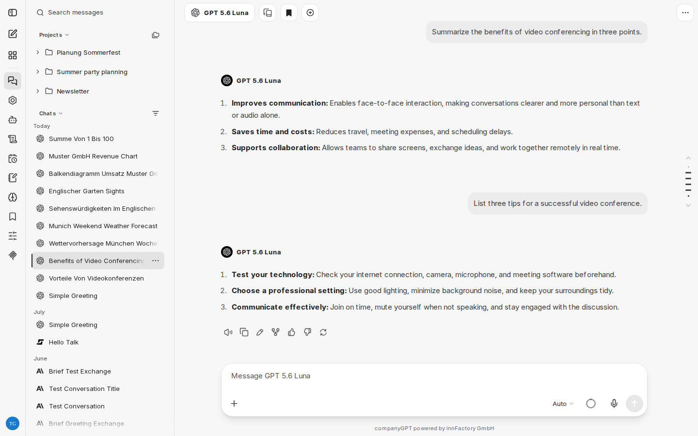
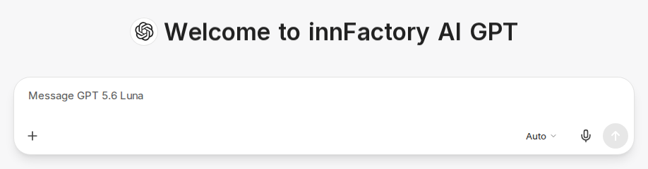
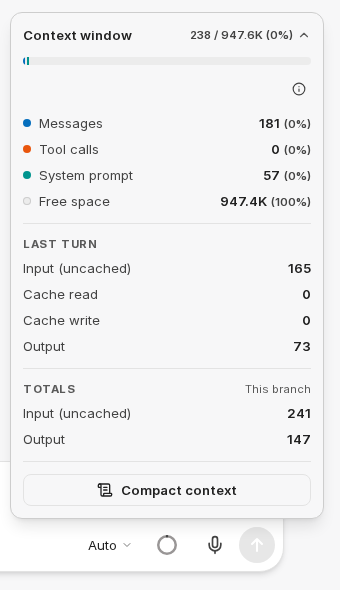
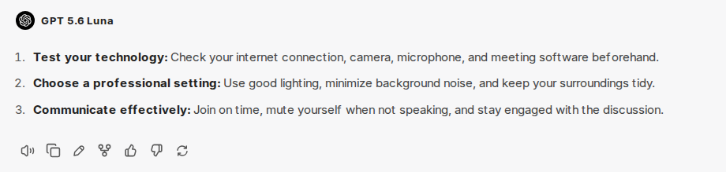
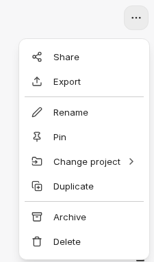
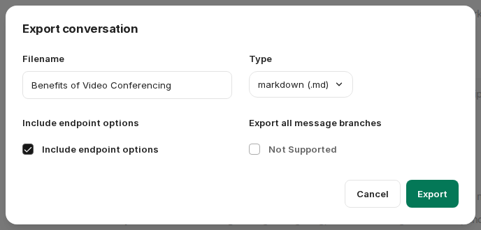

:::note[Nové rozhraní chatu]
Snímky obrazovky a popisky na této stránce ukazují [nové rozhraní chatu](/cs/company-gpt/neue-chat-oberflaeche/). To je v současné době k dispozici v demo přístupu a v pilotních prostředích; v ostatních prostředích se popisky a kroky mohou ještě lišit.
:::

Chat je hlavním rozhraním pro komunikaci s různými jazykovými modely a agenty.

:::caution[Vždy mějte na paměti]
Všechny zprávy a soubory v aktuálním chatu jsou vždy součástí kontextu. Proto je vhodné používat pro každé téma samostatný chat.
:::

## Zadávání promptů

Zprávy do chatu neboli prompty se zadávají do vstupního pole. Zprávu odešlete stisknutím `Ctrl` + `Enter` (macOS: `⌘` + `Enter`) nebo tlačítkem pro odeslání, klávesou `Enter` přidáte nový řádek. Toto chování můžete změnit v [Nastavení](/cs/company-gpt/einstellungen/#odesílání). Zpráva může obsahovat i pouze přílohy.

:::tip
Informace o prompt engineeringu a pokynech v promptech najdete zde: [Prompt Engineering](/cs/prompt-engineering/uebersicht/)
:::

Pomocí ikony plus vlevo ve vstupním panelu (**Attach and tools**) připojíte soubory a zapnete nástroje, viz [Integrace](#integrace). U modelů s uvažováním zvolíte míru uvažování tlačítkem vpravo ve vstupním panelu, které ukazuje aktuální úroveň (například **Auto**), viz [Nové rozhraní chatu](/cs/company-gpt/neue-chat-oberflaeche/#nový-vstupní-panel).

### Zprávy během probíhající odpovědi

Během generování odpovědi můžete dál psát. Při odeslání se nová zpráva zahrne do probíhající odpovědi (**Steer**), probíhající odpověď se okamžitě zastaví a pokračuje s vaší zprávou (**Interrupt**), nebo se zpráva zařadí do fronty na dobu po odpovědi (**Queue**). U **Interrupt** zůstane dosud vygenerovaná část odpovědi zachována. Co klávesa `Enter` ve výchozím stavu dělá, nastavíte v [Nastavení](/cs/company-gpt/einstellungen/#odesílání). Tlačítko pro odeslání umožňuje volbu i pro jednotlivé zprávy. Pokud probíhající odpověď nelze usměrnit, zpráva se zařadí do fronty.

### Indikátor kontextu

Ikona kruhu ve vstupním poli ukazuje, kolik z kontextového okna modelu aktuální chat využívá. Když místo dochází, indikátor změní barvu. Najeďte na něj myší nebo na něj klikněte, abyste viděli využití. Šipkou vedle čísel rozbalíte rozpis, například podle **Messages**, **Tool calls**, **System prompt** a **Free space**. Pod ním vidíte tokeny posledního kola (**Last turn**) a celkové součty (**Totals**). Pokud je to ve vašem prostředí k dispozici, rozpis ukazuje také náklady a již využitou část vašeho kreditu.

Ve stejném okně můžete kontext také sami zhustit pomocí **Compact context**: CompanyGPT nahradí dosavadní konverzaci shrnutím. Dřívější zprávy zůstanou v chatu viditelné, ale model je již nedostává.

## Integrace

Kromě samotného zadání promptu lze kontext dále rozšířit pomocí:

- [Vyhledávání v souborech](/cs/company-gpt/integrationen/dateisuche/)
- [Webové vyhledávání](/cs/company-gpt/integrationen/websuche/)
- [Skills](/cs/company-gpt/skills/)
- [Run Code](/cs/company-gpt/code-interpreter/)
- [Artefakty](/cs/company-gpt/integrationen/artefakte/)
- [MCP server](/cs/company-gpt/integrationen/mcp-server/)
- [Paměť](/cs/company-gpt/erinnerungen/#v-chatu), pokud je ve vašem prostředí k dispozici

Zapnete je v příslušném chatu pomocí ikony plus ve vstupním panelu (**Attach and tools**). Aktivní nástroje se ve vstupním panelu zobrazí jako štítky; křížkem ve štítku je opět vypnete. Další informace najdete v části [Uživatelské rozhraní](/cs/company-gpt/user-interface/#integrace).

## Zprávy

Historie zpráv se v průběhu konverzace mezi uživatelem a modelem (modely) AI postupně rozvíjí. Po každé zprávě může uživatel použít jiný model nebo agenta, který samozřejmě vždy dostane celý dosavadní kontext.

### Možnosti zpráv

Zprávy v chatu mají rychlé akce:

- **Regenerate** a **varianty zprávy**: Pomocí **Regenerate** lze vygenerovat více variant odpovědi, mezi kterými můžete přepínat.
- **Read aloud**: Pomocí [převodu textu na řeč](/cs/company-gpt/einstellungen/#převod-textu-na-řeč) se zpráva přečte nahlas vybraným modulem.
- **Copy to clipboard**: Zkopíruje celý obsah zprávy do schránky.
- **Edit**: Otevře editor ve zprávě, viz [Úprava zpráv](#úprava-zpráv).
- Ikona větvení: Vytvoří nový chat od konkrétní zprávy se všemi předchozími zprávami. To se hodí, pokud chcete například uvažovat různými směry. Zvolte, které zprávy se zahrnou: **Visible messages only**, **Include related branches** nebo **Include all to/from here**.
- **Feedback**: Ohodnoťte odpověď palcem nahoru nebo dolů a případně přidejte komentář.

### Úprava zpráv

**Edit** otevře editor přímo ve zprávě:

- **Vaše vlastní zprávy**: **Update & rerun** odešle změněnou zprávu a vygeneruje novou odpověď. **Save** změnu ponechá bez generování nové odpovědi. Pokud jste nic nezměnili, **Rerun** vygeneruje novou odpověď na nezměněnou zprávu, například po zrušené odpovědi.
- **Odpovědi AI**: **Save** ponechá vaši změnu v historii, například abyste opravili odpověď, než budete pokračovat. **Rerun** naopak vygeneruje novou odpověď a vaše změny zahodí.

**Cancel** zavře editor bez použití změn.

### Citování

Chcete-li citovat konkrétní obsah, označte ho ve zprávě a zvolte **Add to chat**. Označený text se připojí k vaší další zprávě jako citace. Můžete také postupně shromáždit více pasáží.

### Kód, diagramy a artefakty

- **Bloky kódu** lze zkopírovat pomocí **Copy code** nebo stáhnout jako soubor pomocí **Download code**.
- **Diagramy Mermaid** se vykreslují přímo jako diagramy. Pomocí **Export diagram** je uložíte přes **Export as SVG** nebo **Export as PNG**.
- [Artefakty](/cs/company-gpt/integrationen/artefakte/) se otevírají v samostatné oblasti vedle chatu. Pomocí **Enter full screen** zobrazíte artefakt na celou obrazovku.

### Volání nástrojů

Když model nebo agent používá nástroje, například webové vyhledávání nebo MCP server, CompanyGPT zobrazuje volání v odpovědi. Více po sobě jdoucích volání je seskupeno do jednoho řádku, který můžete rozbalit; neúspěšná volání se v něm počítají. Pokud chcete mít podrobnosti vždy rozbalené, zapněte **Auto-expand tool details** v [Nastavení](/cs/company-gpt/einstellungen/#zprávy).

Pokud agent dosáhne maximálního počtu kroků pro jednu odpověď, zastaví se a zobrazí upozornění **Reached the tool call limit for this turn**. Vše, co bylo do té doby provedeno, zůstane zachováno. Zvolte **Keep going**, aby agent pokračoval od místa, kde se zastavil, nebo **Answer now**, aby okamžitě odpověděl s tím, co už má.

## Porovnání dvou modelů

Tlačítkem **Add multi-conversation** v záhlaví necháte stejnou zprávu zodpovědět dvěma modely. Dříve vybraný model se pak zobrazí jako další řádek nad vstupním polem; ve výběru modelu zvolíte druhý model. Po odeslání se obě odpovědi zobrazí vedle sebe. Křížkem v dalším řádku porovnání ukončíte.

## Dočasný chat

Tlačítkem **Temporary Chat** v záhlaví zahájíte dočasný chat. Nezobrazuje se ve vaší historii chatů a automaticky se smaže. Dokud je dočasný chat aktivní, záhlaví zobrazuje odpovídající indikátor.

Pokud se mají nové chaty vždy spouštět jako dočasné, zapněte **Temporary Chat by default** v [Nastavení](/cs/company-gpt/einstellungen/#temporary-chat-by-default).

## Sdílení a export

Historie zpráv lze sdílet nebo exportovat do různých formátů souborů. V otevřeném chatu jsou obě možnosti k dispozici v nabídce **Chat options** (tři tečky vpravo nahoře v záhlaví) přes **Share** a **Export**.

### Sdílení

**Create a shared link** vygeneruje odkaz na chat. Vaše jméno zůstane soukromé. Obrázky a soubory v chatu jsou pro ostatní viditelné pouze tehdy, pokud zapnete **Share files in this conversation**. **Show QR Code** vám navíc poskytne QR kód.

Adresa odkazu zůstává stejná. Úpravy již sdílených zpráv se projeví okamžitě. Zprávy, které přidáte po sdílení, se zobrazí až po výběru **Update link**. Tím se pod stejnou adresou zveřejní aktuální stav chatu a vaše aktuální volba sdílení souborů.

**Manage Access** vám umožní zobrazit a změnit, kdo může odkaz otevřít. **Delete Link** sdílení odstraní. Chaty s aktivním odkazem jsou v historii chatů označeny. Přehled všech vašich sdílených chatů najdete v [Nastavení](/cs/company-gpt/einstellungen/#shared-chats) v části **Shared chats**.

:::caution
Sdílené odkazy mohou otevřít pouze osoby, které se přihlásí do stejného prostředí CompanyGPT, i když je odkaz sdílen veřejně. Bez veřejného sdílení navíc potřebují oprávnění ke čtení, které udělíte přes **Manage Access**. Pokud je vaše CompanyGPT dostupné pouze z firemní sítě, platí to i pro sdílené odkazy.
:::

### Export

Historie zpráv lze také exportovat. Výhodou je, že je lze uložit jako soubory v různých formátech. Historie ve formátu JSON lze také znovu [importovat](/cs/company-gpt/einstellungen/#import-conversations).

Pro export zvolte **Filename** a **Type**: Markdown, text, JSON, CSV nebo snímek obrazovky (PNG).

V závislosti na formátu souboru lze navíc provést tato nastavení:

- **Include endpoint options**: Do informací se uloží i názvy modelů (ne u CSV a snímku obrazovky).
- **Export all message branches**: Pokud existují větve, lze je také exportovat (pouze JSON a CSV).
- **Recursive or sequential?** (pouze JSON): Zobrazení zpráv v objektu JSON, buď jako plochý seznam zpráv, nebo jako rekurzivní seznam s vnořenými zprávami.
