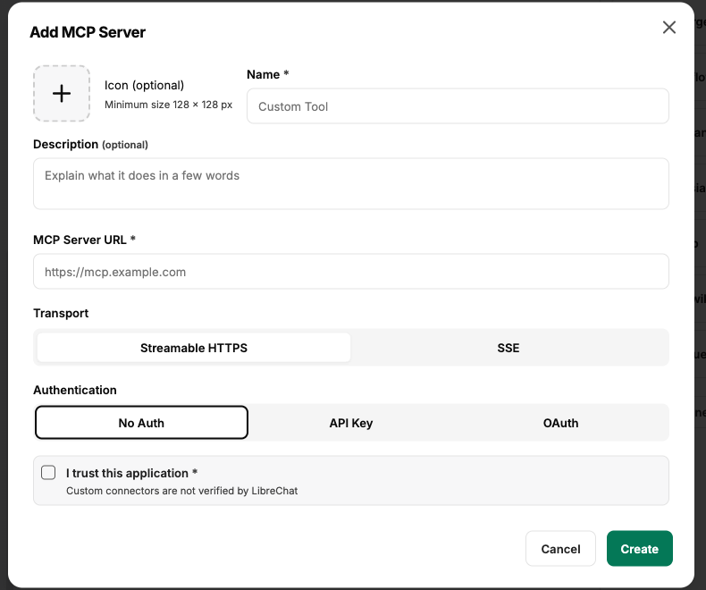
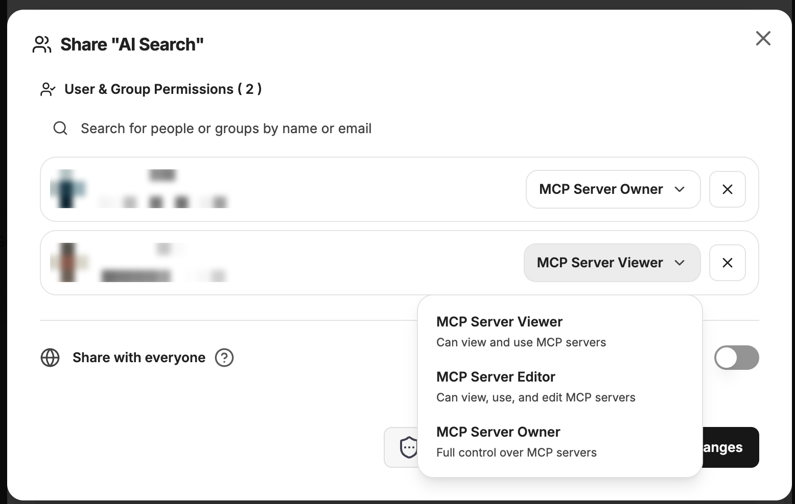

:::note[Nové rozhraní chatu]
Snímky obrazovky a popisky na této stránce ukazují [nové rozhraní chatu](/cs/company-gpt/neue-chat-oberflaeche/). Aktuálně je k dispozici v demo přístupu a v pilotních prostředích; v ostatních prostředích se popisky a kroky mohou ještě lišit.
:::

Model Context Protocol (MCP) je specializovaný protokol a rozhraní, které CompanyGPT umožňuje bezproblémově komunikovat s externími službami. Tyto služby běží na zákaznických serverech MCP, které často hostují složité backendové funkce nebo řídí konkrétní obchodní procesy. MCP, původně vyvinutý společností Anthropic, dnes podporují téměř všechny aplikace AI, takže CompanyGPT může využívat širokou škálu existujících serverů MCP. V případě potřeby lze vyvinout vlastní servery a připojit k CompanyGPT téměř jakoukoli aplikaci.

MCP vychází z architektury klient–server, v níž CompanyGPT jako klient využívá „nástroje“ (tools), které server poskytuje. Server MCP může obsahovat libovolný počet takových nástrojů, přičemž integrovaný LLM samostatně rozhoduje, který nástroj použije a jaké parametry předá. Po provedení LLM vyhodnotí výsledky a formuluje pro uživatele vhodnou odpověď.

Další informace o MCP najdete zde: [Prompt Engineering / MCP](/cs/prompt-engineering/prompt-techniken/tool-use#mcp-model-context-protocol-jako-nástroj)

## Používání serverů MCP

Servery MCP, které máte k dispozici, jsou uvedeny v levém postranním panelu v části **MCP Settings**. Tam vidíte stav každého serveru. Pokud server vyžaduje přihlášení nebo vlastní klíč, můžete se tam přihlásit pomocí **Connect** nebo server nakonfigurovat.

V [chatu](/cs/company-gpt/chat/#integrace) vybíráte servery MCP pomocí ikony plus ve vstupu chatu (**Attach and tools**) v sekci **MCP Servers**; **Show All** otevře úplný seznam. U každého serveru tam vidíte jeho stav: **Connected**, **Disconnected** nebo **Needs Auth** (server vyžaduje přihlášení). V [agentech](/cs/company-gpt/agenten/#mcp-server) přidáváte servery MCP prostřednictvím Tool Library.

V závislosti na vašem prostředí jsou servery MCP doplňků již nastaveny, například **Files** ([companyFILES](/cs/company-gpt/addons/companyfiles/agent/)), **ai-search** ([companyRAG](/cs/company-gpt/addons/companyrag/in-companygpt/)), **Microsoft365** ([companyM365](/cs/company-gpt/addons/companym365/werkzeuge/)), **companyTRANSLATE** ([companyTRANSLATE](/cs/company-gpt/addons/company-translate/im-chat/)), **companyTRANSCRIBE** ([companyTRANSCRIBE](/cs/company-gpt/addons/company-transcribe/mcp-integration/)), **Learn** ([companyLEARN](/cs/company-gpt/addons/companylearn/im-chat/)), **Knowledge** ([companyKNOWLEDGE](/cs/company-gpt/addons/companyknowledge/agent/)) a **WebFetch** ([Webové vyhledávání a WebFetch](/cs/company-gpt/integrationen/websuche/)).

## Přidání serveru MCP

Nové servery MCP mohou vytvářet pouze osoby, jejichž role to umožňuje. Ve výchozím nastavení běžní uživatelé servery MCP vytvářet nemohou. Oprávnění k používání, vytváření a sdílení serverů MCP přidělují administrátoři v [companyADMIN](/cs/company-gpt/addons/companyadmin/rollen-und-rechte/) v části **Access** → **Roles** → otevřít roli → karta **companyGPT**, funkce **MCP servers**. Které domény jsou pro servery MCP povoleny, nastavují administrátoři v companyADMIN v části **Configuration** → **MCP domains**.

S příslušným oprávněním otevře **+** v horní části **MCP Settings** (popisek **Add MCP**) dialog **Add MCP Server**.

### Vlastnosti serveru MCP

Lze nastavit následující vlastnosti:

- **Icon** `optional`: Ikona, která se zobrazuje v přehledu
- **Name**: Název serveru MCP, viditelný v přehledu a v každém výběru
- **Description** `optional`: Popis, který se zobrazuje v přehledu
- **MCP Server URL**: URL serveru MCP. Může jít o URL interních služeb (v rámci clusteru) nebo o URL serverů MCP dostupné přes internet.
- **Transport**: Streamable HTTPS nebo SSE (určuje server)
- **Authentication**:
  - **None (Auto-detect)**: Automatická detekce s OAuth `Dynamic Client Registration` nebo bez autentizace
  - **API Key**: Autentizace pomocí klíče API; lze zvolit, zda jeden klíč API platí pro všechny uživatele, nebo zda každý uživatel zadá vlastní klíč.
  - **OAuth**: Registrace klienta v souladu s OAuth 2.1 s ID klienta, tajným klíčem, URI přesměrování, autorizační URL a URL tokenu.
  - **On-Behalf-Of (OBO)**: Server MCP je volán jménem přihlášené osoby. V **OBO Scopes** zadejte rozsahy (scopes) požadované pro server MCP. To vyžaduje přihlášení přes OpenID Connect, např. Entra ID. Možnost se zobrazí pouze s oprávněním **Configure OBO** (viz [Role](/cs/company-gpt/addons/companyadmin/rollen-und-rechte/)), které má ve výchozím nastavení pouze role ADMIN.
- **I trust this application**: Zaškrtávací políčko pro potvrzení.

Po úspěšné inicializaci se server MCP zobrazí v části **MCP Settings** v levém postranním panelu a lze jej používat v [chatu](/cs/company-gpt/chat/#integrace) nebo v [agentech](/cs/company-gpt/agenten/).

## Sdílení serveru MCP

Jakmile je server MCP přidán, lze jej sdílet, pokud to vaše role umožňuje. Otevřete server v části **MCP Settings** v levém postranním panelu pomocí **Edit**. V dialogu **Edit MCP Server** pak můžete otevřít známou nabídku sdílení:

V detailní nabídce můžete zvolit, s kým a s jakými právy se má server MCP sdílet.

