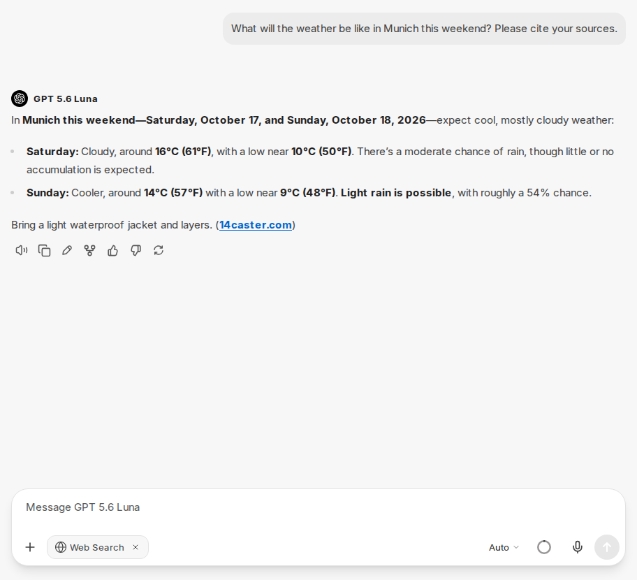
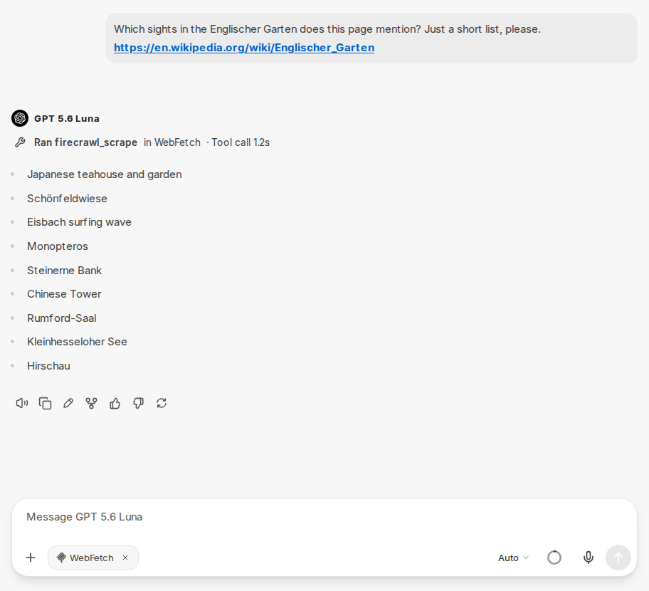

:::note[Nové rozhraní chatu]
Snímky obrazovky a popisky na této stránce ukazují [nové rozhraní chatu](/cs/company-gpt/neue-chat-oberflaeche/). Aktuálně je k dispozici v demo přístupu a v pilotních prostředích; v ostatních prostředích se popisky a kroky mohou ještě lišit.
:::

## Webové vyhledávání

Webové vyhledávání (Web Search) umožňuje CompanyGPT vyhledávat na internetu a zahrnout aktuální obsah do svých odpovědí. Vyhledávání zapnete pomocí ikony plus ve vstupu chatu (**Attach and tools**) volbou **Web Search** v části **Tools**. Web Search se pak zobrazí jako štítek (chip) ve vstupním řádku. Platí pro daný chat a zůstává zapnuté, dokud je znovu nevypnete pomocí **×** na štítku.

:::note[Není k dispozici ve všech prostředích]
O tom, zda je tato funkce ve vašem prostředí k dispozici, rozhoduje vaše organizace. S dotazy se obraťte na svého administrátora.
:::

Na požádání lze zdroje uvést přímo v odpovědi.

:::tip[Pozadí: Grounding]
Webové vyhledávání vychází z principu „groundingu“ – model AI zakládá své odpovědi na aktuálních, veřejně dostupných informacích z webu. To snižuje halucinace a zlepšuje přesnost odpovědí. Více se dozvíte na blogu Google Cloud: [Vertex AI Grounding with Google Search](https://cloud.google.com/blog/products/ai-machine-learning/using-vertex-ai-grounding-with-google-search?hl=en)
:::

## WebFetch

WebFetch slouží k načtení a zpracování obsahu konkrétní webové stránky. Na rozdíl od webového vyhledávání, které samostatně prohledává internet, přistupuje WebFetch k URL zadané uživatelem a extrahuje její obsah.

To se hodí zejména tehdy, když chcete obsah známé stránky shrnout, analyzovat nebo použít jako základ odpovědi.

WebFetch je k dispozici jako [server MCP](/cs/company-gpt/integrationen/mcp-server/). V chatu jej vyberete pomocí ikony plus ve vstupu chatu (**Attach and tools**) v sekci **MCP Servers**, nejrychleji pomocí vyhledávacího pole v horní části nabídky. V [agentech](/cs/company-gpt/agenten/#mcp-server) jej přidáte prostřednictvím Tool Library.

