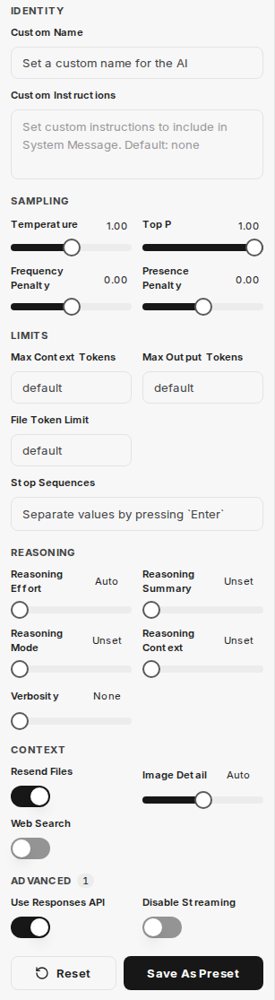

:::note[Nové rozhraní chatu]
Snímky obrazovky a popisky na této stránce ukazují [nové rozhraní chatu](/cs/company-gpt/neue-chat-oberflaeche/). V současnosti je k dispozici v demo přístupu a v pilotních prostředích; v ostatních prostředích se popisky a kroky mohou ještě lišit.
:::

V části **Parameters** v postranním panelu upravujete parametry aktuálně zvoleného modelu, například konkrétní instrukce pro AI nebo podrobné parametry AI. **Save As Preset** uloží tato nastavení pod zvoleným názvem. Uložené předvolby vyberete v záhlaví chatu přes **Presets** a můžete je flexibilně používat v konverzacích. **Reset** obnoví výchozí hodnoty. Na panelu jsou parametry seskupeny do sekcí **Identity**, **Sampling**, **Limits**, **Reasoning**, **Context** a **Advanced**.



**Parameters** je k dispozici pouze tehdy, když je zvolen model, nikoli agent. Které parametry se zobrazí, závisí na zvoleném modelu. Následující přehled popisuje parametry zobrazované u modelů GPT.

:::tip[Věděli jste?]{icon="rocket"}
Když najedete myší na některou možnost nastavení, zobrazí se další informace.
:::

## Custom Name

Nastavuje vlastní název AI, který se zobrazuje v chatu.

## Custom Instructions

Toto pole slouží k uložení konkrétních instrukcí, které řídí chování AI během konverzace. Slouží k přidělení role, stylu nebo konkrétních úkolů AI.

```text
Jsi nápomocný asistent, který odpovídá na otázky uživatelů a na konci vždy řekne vtip.
```

## Parametry AI

Následující parametry umožňují podrobné řízení chování AI a využití prostředků.

### Max Context Tokens

Určuje maximální počet tokenů, které lze modelu odeslat v kontextu jednoho požadavku. Tento parametr řídí množství dat, které má AI pro každý požadavek k dispozici. Pokud není zadána žádná hodnota, použijí se systémové výchozí hodnoty podle modelu. Vyšší hodnoty mohou vést ke zvýšeným nákladům a možným chybám.

### Max Output Tokens

Nastavuje maximální počet tokenů, které smí model vygenerovat v jedné odpovědi chatu. Celkový počet vstupních tokenů a vygenerovaných tokenů odpovědi je omezen maximální délkou kontextu modelu. Překročení maximálního počtu kontextových tokenů touto hodnotou může vést k chybám.

### Temperature

Tento parametr ovlivňuje kreativitu a náhodnost odpovědí AI.
*   **Vyšší hodnoty:** Vedou ke kreativnějším a náhodnějším výsledkům.
*   **Nižší hodnoty:** Vedou k determinističtějším a méně kreativním odpovědím.
Doporučuje se upravovat buď teplotu, *nebo* hodnotu top P, ne obojí současně. Hodnoty nad 1 se obecně nedoporučují.

### Top P

Parametr top P řídí výběr tokenů modelem na základě jejich kumulativní pravděpodobnosti. Model vybírá tokeny od nejpravděpodobnějšího směrem dolů, dokud součet jejich pravděpodobností nedosáhne zadané hodnoty Top P. To ovlivňuje rozmanitost možných tokenů odpovědi.

### Frequency Penalty

Hodnota mezi -2,0 a 2,0. Kladné hodnoty snižují pravděpodobnost, že model zopakuje tokeny, které již byly použity často. To podporuje vytváření nových a rozmanitějších formulací v textu.

### Presence Penalty

Hodnota mezi -2,0 a 2,0. Kladné hodnoty penalizují použití tokenů, které se v dosavadním textu již objevily. To zvyšuje sklon modelu věnovat se novým tématům nebo diverzifikovat informace.

### Stop Sequences

Až čtyři definovatelné řetězce znaků, při jejichž výskytu API přestane generovat další tokeny. To umožňuje přesné řízení zakončení odpovědí AI.

### Resend Files

Pokud je tato možnost zapnutá, odešlou se modelu s každou novou zprávou znovu všechny soubory dříve připojené k chatu.
**Poznámka:** To může kvůli většímu počtu tokenů výrazně zvýšit náklady na požadavek a při mnoha přílohách vést k chybám.

### Image Detail

Určuje rozlišení pro požadavky na rozpoznávání obrázků odesílané modelu:
*   **Low:** Levnější a rychlejší, ale nabízí méně detailů.
*   **High:** Podrobnější a přesnější, ale dražší.
*   **Auto:** Automaticky volí mezi „Low“ a „High“ podle rozlišení nahraného obrázku.

### Web Search

Zapíná integrovanou funkci webového vyhledávání modelu (např. přes OpenAI). AI tak může získávat aktuální informace z internetu a vytvářet přesnější a aktuálnější odpovědi.

### Reasoning Effort

Platí pouze pro modely, které provádějí interní uvažování. Tento parametr omezuje výpočetní úsilí potřebné pro logické závěry.
*   Snížení míry uvažování vede k rychlejším odpovědím a nižší spotřebě tokenů.
*   Nastavení **Minimal** generuje velmi málo tokenů uvažování, aby se dosáhlo maximální rychlosti odpovědi (time-to-first-token). To je užitečné zejména pro úlohy, jako je programování nebo striktní dodržování instrukcí.

Které úrovně jsou k dispozici, závisí na modelu. U modelů s uvažováním můžete míru uvažování nastavit také přímo ve vstupní liště, viz [Nové rozhraní chatu](/cs/company-gpt/neue-chat-oberflaeche/#nový-vstupní-panel).

### Use Responses API

Zapíná používání Responses API (místo Chat Completions), které poskytuje pokročilé funkce od OpenAI. Toto API je mimo jiné nutné pro zapnutí souhrnů uvažování.

### Reasoning Summary

K dispozici pouze při použití Responses API. Tato možnost vytváří souhrn interního myšlenkového procesu modelu. To může pomoci při řešení problémů a lepším pochopení rozhodnutí AI. Volitelné možnosti jsou **Unset**, **Auto**, **Concise** a **Detailed**.

### Reasoning Mode

K dispozici pouze při použití Responses API. Nastavuje režim uvažování: **Standard** nebo **Pro**. **Pro** zapíná rozšířené uvažování u podporovaných modelů.

### Reasoning Context

K dispozici pouze při použití Responses API. Určuje, kolik uvažování z předchozí konverzace model znovu použije: **Auto**, **Current turn** nebo **All turns**.

### Verbosity

Řídí délku a míru podrobnosti odpovědí modelu.
*   **Nižší hodnoty:** Vedou ke kratším, stručnějším odpovědím.
*   **Vyšší hodnoty:** Vedou k obsáhlejším a podrobnějším odpovědím.
K dispozici jsou možnosti **None**, **Low**, **Medium** a **High**.

### Disable Streaming

Vypíná průběžné streamování odpovědí po řádcích, takže se celá odpověď modelu přijme najednou. Tato možnost může být užitečná u některých modelů (např. o3), které pro streamování vyžadují ověření organizace.

### File Token Limit

Určuje maximální limit tokenů pro zpracování připojených souborů. Slouží ke kontrole nákladů a efektivní správě prostředků při analýze souborů pomocí AI.
