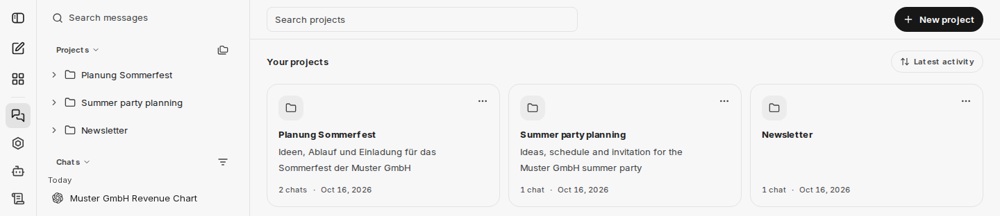
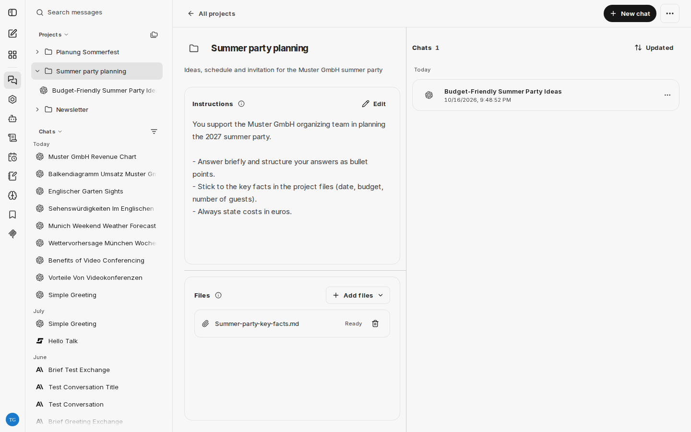
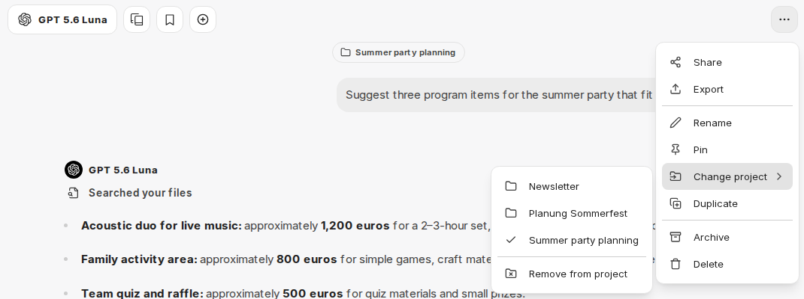

:::note[Nové rozhraní chatu]
Snímky obrazovky a popisky na této stránce ukazují [nové rozhraní chatu](/cs/company-gpt/neue-chat-oberflaeche/). V současnosti je k dispozici v demo přístupu a v pilotních prostředích; v ostatních prostředích se popisky a kroky mohou ještě lišit.
:::

Projekty Vám umožňují uspořádat související konverzace do pojmenovaných pracovních prostorů. Jsou užitečné pro dlouhodobé pracovní oblasti, týmy, klienty nebo jakékoli téma, u kterého chcete mít ucelenou sadu chatů a nespoléhat se jen na vyhledávání.

## Co projekty umožňují

- Seskupit konverzace pod projekt a přidat projektu popis
- Zahájit nový chat přímo uvnitř projektu
- Přidat instrukce a referenční soubory pro všechny chaty v projektu
- Přiřadit existující konverzaci k projektu, přesunout ji do jiného projektu nebo ji z něj opět odebrat
- Procházet a řadit chaty projektu v pracovním prostoru projektu
- Vyhledávat v seznamu projektů a řadit jej
- Upravovat nebo mazat projekty

Projekty jsou osobní a viditelné pouze pro osobu, která je vytvořila. Ostatní uživatelé Váš seznam projektů nevidí.

## Vytvoření projektu

V [historii chatů](/cs/company-gpt/user-interface/#historie-chatů) najdete oblast **Projects** nad připnutými chaty. Dokud ještě nemáte žádný projekt, vytvoříte jej tam pomocí **New project**. Jinak otevřete přehled projektů ikonou **All projects** vedle nadpisu a zvolte tam **New project**.

V dialogu **Create project** zadejte **Project name** a volitelně **Description**. CompanyGPT poté otevře pracovní prostor projektu.

V pracovním prostoru projektu zahájíte pomocí **New chat** konverzaci, která je automaticky přiřazena k danému projektu. Stejná funkce je v historii chatů k dispozici přes ikonu vedle každého projektu.

## Instrukce a soubory

V pracovním prostoru projektu přidáváte instrukce a referenční soubory pro všechny chaty v projektu. To je v současnosti k dispozici pouze v novém rozhraní chatu.

- **Instructions**: Pomocí **Edit** nastavíte tón, cíle nebo souvislosti pro všechny chaty v projektu. Instrukce platí pro nové zprávy v projektu; dřívější zprávy se nemění. Pravidla Vašeho prostředí nadále platí.
- **Files**: Pomocí **Add files** nahrajete soubory (**Upload from device**) nebo vyberete z již nahraných souborů (**Choose from your files**). Pokud je aktivní [vyhledávání v souborech](/cs/company-gpt/integrationen/dateisuche/), používají chaty v projektu místo celých souborů odpovídající výňatky. Odebrání souboru ovlivní pouze budoucí zprávy.

## Přiřazení existujících chatů

V záhlaví chatu otevřete nabídku **Chat options** a najeďte na **Change project**. V podnabídce vyberte projekt. Pomocí **Remove from project** chat z jeho projektu opět odeberete. Stejné položky jsou k dispozici v nabídce chatu v pracovním prostoru projektu. Případně můžete chat v historii chatů přetáhnout na projekt.

Ve výchozím stavu se chaty přiřazené k projektu zobrazují pouze v tomto projektu a již ne v seznamu **Chats** v historii chatů. Chcete-li je tam opět zobrazit, použijte volbu **Show project chats** v nabídce filtru seznamu chatů.

## Správa projektů

V historii chatů lze každý projekt rozbalit a zobrazit jeho nejnovější chaty. **Show All** otevře pracovní prostor projektu. Pomocí nabídky projektu můžete:

- Otevřít pracovní prostor projektu (**Open project**)
- Upravit název a popis projektu (**Edit project**)
- Projekt smazat (**Delete**)

V pracovním prostoru projektu můžete název a popis upravit také přímo kliknutím na ně. Nabídka vpravo nahoře v pracovním prostoru obsahuje **Delete project**.

Přehled projektů (**All projects**) zobrazuje všechny Vaše projekty s počtem jejich chatů. Tam můžete projekty vyhledávat pomocí **Search projects** a řadit je podle **Latest activity**, **Created** nebo **Name**.

Smazáním projektu se z jeho chatů odebere pouze přiřazení k projektu. Samotné konverzace se nesmažou.

## Poznámky

- Pracovní prostory projektů mají vlastní seznam chatů, který lze řadit podle **Updated** nebo **Created**.
- Chaty zahájené z projektu si přiřazení k danému projektu ponechávají.
- Pokud smažete projekt, zatímco je jeho pracovní prostor otevřený, CompanyGPT Vás vrátí do přehledu projektů.
