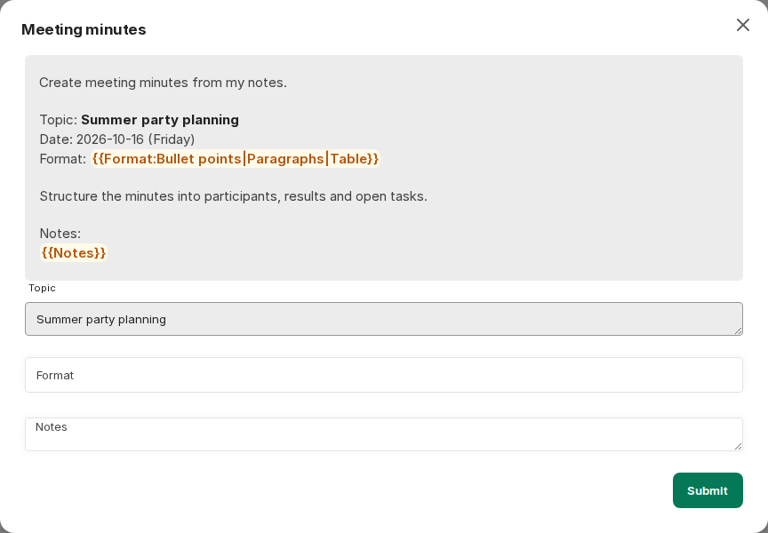

:::note[Nové rozhraní chatu]
Snímky obrazovky a popisky na této stránce ukazují [nové rozhraní chatu](/cs/company-gpt/neue-chat-oberflaeche/). V současnosti je k dispozici v demo přístupu a v pilotních prostředích; v ostatních prostředích se popisky a kroky mohou ještě lišit.
:::

Prompty v CompanyGPT jsou šablony promptů, které lze uložit a kdykoli použít. Šablony jsou nezávislé na modelu AI nebo agentovi a lze je používat s libovolným dostupným modelem nebo agentem.

Šablony promptů najdete v levém postranním panelu v části **Prompts**. Tam je můžete zobrazovat, vytvářet, upravovat a používat.


Oblast **Prompts** nabízí:

- filtr pro **All**, **My Prompts**, **Shared Prompts** nebo kategorii
- vyhledávací pole **Filter prompts by name**
- ikonu plus **Create Prompt**
- přepínač **Send prompts on select**

Když vyberete prompt, vloží se do vstupního pole, nebo se – je-li zapnuto odesílání při výběru – rovnou odešle. Pokud je zapnutý [příkaz `/`](/cs/company-gpt/einstellungen/#command--for-prompt-template), můžete prompty vyvolat přímo ve vstupním poli také pomocí `/`.

## Vytvoření promptu

**Create Prompt** otevře dialog. Tam zvolíte **Category**, zadáte **Prompt Name** a vložíte **Text**. Volitelně přidejte popis a vlastní příkaz pro vyvolání promptu přes `/`; bez vlastního příkazu se použije název promptu. Po vytvoření promptu se otevře jeho stránka s podrobnostmi, kde jej můžete dále upravovat.

## Části šablon promptů

- **Prompt Name**: Název promptu, který se zobrazuje také v rychlém výběru.
- **Category**: Kategorie, do které je prompt zařazen, například **Ideas**, **Learning**, **Writing**.
- **Text**: Vlastní obsah promptu.
- **Variables**: Proměnné v textu, které lze při spuštění vyplnit vhodným obsahem.
- **Description** (volitelné): Krátký text zobrazovaný u promptu.
- **Command** (volitelné): Příkaz, kterým se prompt vyvolá přes `/`.

### Proměnné

- **Speciální proměnné**: Jsou předdefinované a vyplňují se automaticky. Vložíte je přes nabídku speciálních proměnných v textovém poli: **Current Date** (`{{current_date}}`), **Current User** (`{{current_user}}`), **UTC ISO Datetime** (`{{iso_datetime}}`) a **Current Date & Time** (`{{current_datetime}}`).
- **Vlastní proměnné**: V textu lze nastavit vlastní proměnné. Označují se dvojitými složenými závorkami, např. `{{ COLOR }}` => vytvoří proměnnou `COLOR`


Jakmile se prompt spustí, otevře se okno pro zadání proměnných. **Submit** použije prompt s Vašimi zadanými hodnotami.



Pro proměnné lze jako výběrovou nabídku použít také rozbalovací seznamy. K tomu je potřeba následující syntaxe:

```
{{variable_name:option1|option2|option3}}

# Example
{{ color:red|green|blue}}
```


V takovém rozbalovacím seznamu můžete kromě předdefinovaných možností zadat také vlastní hodnotu.

Šablony promptů lze velmi efektivně využít pro opakující se úlohy, pro [řetězení promptů](/cs/prompt-engineering/prompt-techniken/prompt-chaining/) nebo ve spojení s [agenty](/cs/company-gpt/agenten/).
