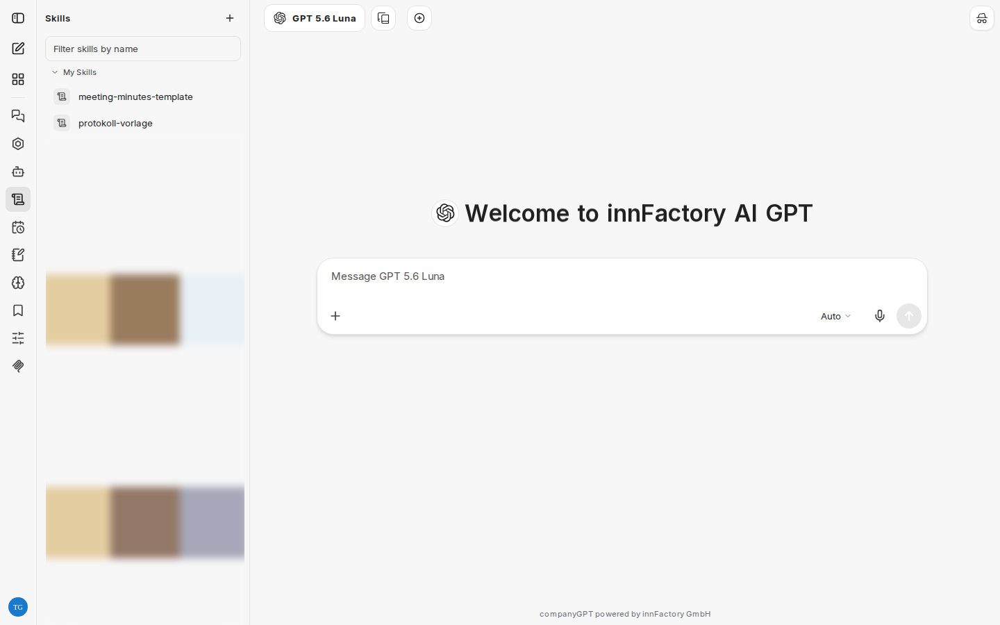
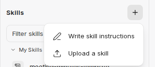
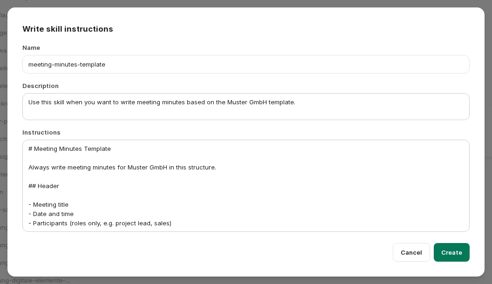
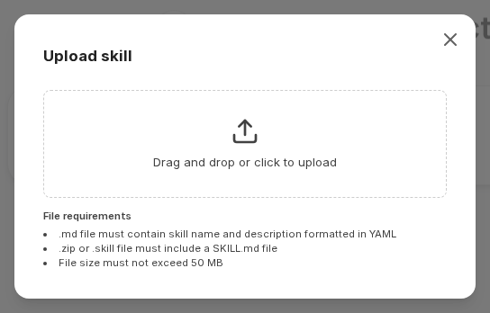
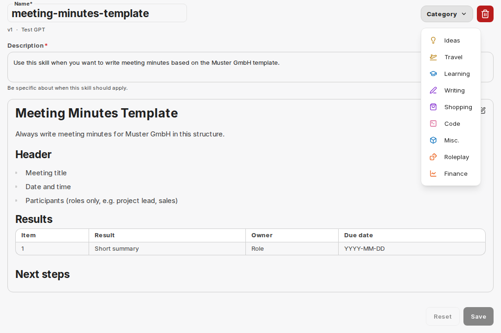

:::note[Nové rozhraní chatu]
Snímky obrazovky a popisky na této stránce zobrazují [nové rozhraní chatu](/cs/company-gpt/neue-chat-oberflaeche/). V současnosti je k dispozici v ukázkovém přístupu a v pilotních prostředích; v ostatních prostředích se popisky a postupy mohou ještě lišit.
:::

Skills jsou opakovaně použitelné pokyny, které specializují AI asistenta na konkrétní úlohy. Rozšiřují schopnosti asistenta, aniž byste museli pokaždé znovu psát složité prompty.

## Přehled skills

Skills se spravují v levém postranním panelu v části **Skills**. V části **My Skills** vidíte všechny své skills na první pohled.

## Vytvoření skillu

Kliknutím na tlačítko **+** v horní části postranního panelu Skills vytvoříte nový skill. Zobrazí se rozbalovací nabídka se dvěma možnostmi.

### Napsání pokynů skillu

Zvolte **Write skill instructions**, chcete-li skill vytvořit sami. Je třeba vyplnit tato pole:

- **Name** – jedinečný název skillu
- **Description** – krátké vysvětlení, kdy a k čemu se skill používá
- **Instructions** – samotné pokyny ve formátu Markdown

### Nahrání skillu

Zvolte **Upload a skill**, chcete-li nahrát existující soubor skillu přetažením nebo kliknutím.

Podporovány jsou tyto formáty souborů:

| Formát            | Požadavky                                         |
| ----------------- | ------------------------------------------------- |
| `.md`             | Musí obsahovat název a popis skillu v YAML        |
| `.zip` / `.skill` | Musí obsahovat soubor `SKILL.md`                  |

Soubor nesmí přesáhnout 50 MB.

Soubor `.zip` obsahuje složku se souborem `SKILL.md` a volitelně dalšími soubory, například podrobnými návody v `references/` nebo skripty v `scripts/`. Asistent tyto soubory čte podle potřeby. Je-li aktivní [Run Code](/cs/company-gpt/code-interpreter/), jsou v sandboxu k dispozici také jen pro čtení v cestě `/mnt/data/skills/<skill-name>/`, takže lze spouštět přibalené skripty.

:::tip
Hotové skills k vyzkoušení a stažení najdete v části [Návody ke skills](/cs/tutorials/skills/). Skills s přibalenými soubory se tam nabízejí jako balíček `.zip`. Administrátoři mohou také přidat všechny hotové skills pro celou organizaci pomocí [Library Sync](/cs/company-gpt/addons/companyadmin/library-sync/#přidání-hotových-skills-od-innfactory).
:::

## Zobrazení skillu

Podrobné zobrazení skillu ukazuje vykreslený obsah s popisem a obsahem v Markdownu, například tabulkami nástrojů nebo rozhodovacími návody.

Odtud můžete:

- **Zpřístupnit agentům, nebo ne** – pomocí přepínače **Available to agent** v pravém horním rohu. Je-li zapnutý, může agent skill používat v nových zprávách. Nastavení platí pouze pro vás.
- **Upravit** (**Edit**) – změnit pokyny, název nebo kategorii
- **Smazat** (**Delete**) – trvale odstranit skill

## Úprava skillu

Otevřete skill a kliknutím na **Edit** upravte název, popis, pokyny a kategorii.

:::note
**Description** určuje, kdy se skill automaticky aktivuje. Napište jej tak, aby asistent dokázal rozpoznat správný případ použití.
:::

## Přidání skills k agentům

Skills lze také přiřadit přímo [agentovi](/cs/company-gpt/agenten/). Otevřete agenta a v sekci **Skills** zvolte jeden ze tří režimů:

| Režim | Účinek |
| ---- | ------ |
| **Off** | Agent nepoužívá žádné skills. |
| **All** | Agent má přístup ke všem skills, které jsou vám k dispozici a jsou zpřístupněny agentům. Seznam dostupných skills lze rozbalit. |
| **Selected** | Agent používá pouze skills, které jste vybrali. |

V režimu **Selected** přidáváte skills pomocí **Add skill**. Otevře se dialog, ve kterém můžete procházet dostupné skills a přidávat je k agentovi. Křížkem vedle skillu jej z výběru opět odeberete. Můžete tak přesně řídit schopnosti agenta.
