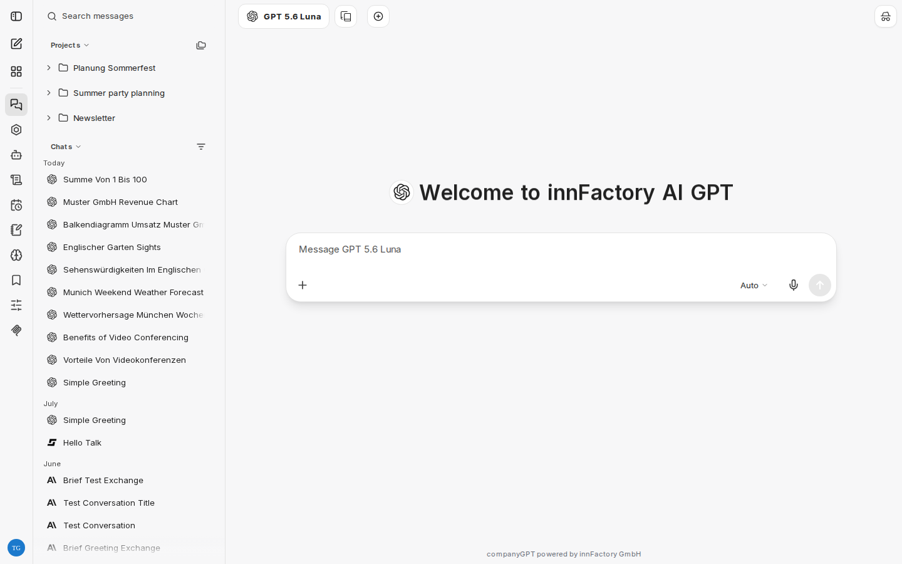
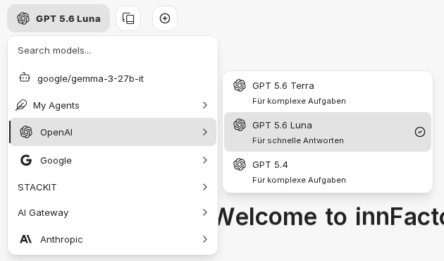
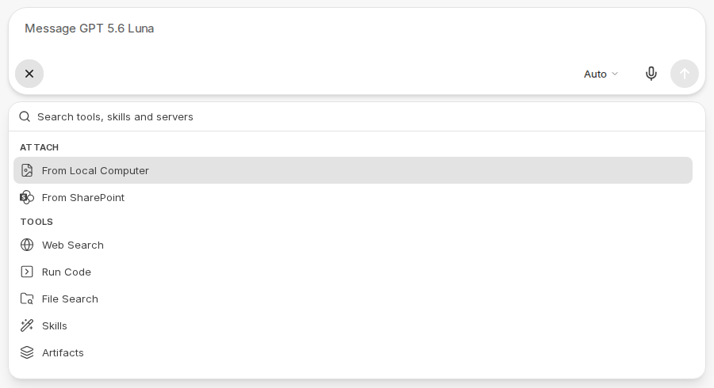

import sidebarImg from "./ui-sidebar-en.png";
import chatVerlaufImg from "./pinned-chat-en.png";

:::note[Nové rozhraní chatu]
Snímky obrazovky a popisky na této stránce zobrazují [nové rozhraní chatu](/cs/company-gpt/neue-chat-oberflaeche/). Aktuálně je k dispozici v demo přístupu a v pilotních prostředích; v ostatních prostředích se popisky a kroky mohou ještě lišit.
:::

Uživatelské rozhraní CompanyGPT vám umožňuje komunikovat s různými modely AI, vytvářet agenty, spravovat šablony promptů a mnoho dalšího.

## Výběr modelu

Seznam aktuálně dostupných modelů najdete v části [Výběr modelu](/cs/company-gpt/modellauswahl/).

## Zadávání do chatu

Prompty lze zadávat pomocí klávesnice nebo mikrofonu.

### Připojování souborů

Použijte ikonu plus ve vstupním poli (**Attach and tools**) a zvolte **From Local Computer**, chcete-li soubory nahrát přímo. Soubory můžete do chatu také přetáhnout. Cíl nahrání nevybíráte: CompanyGPT rozhoduje o způsobu zpracování souboru podle jeho typu.

Pokud je ve vašem prostředí připojen SharePoint, nabízí stejná nabídka také **From SharePoint**.

Jak se jednotlivé typy souborů zpracovávají, popisuje stránka [Zpracování souborů](/cs/company-gpt/dateiverarbeitung/).

### Integrace

Ikona plus ve vstupním poli otevírá nabídku **Attach and tools**. Tam zapínáte integrace pro aktuální chat:

- [Vyhledávání v souborech](/cs/company-gpt/integrationen/dateisuche/)
- [Webové vyhledávání](/cs/company-gpt/integrationen/websuche/)
- [Skills](/cs/company-gpt/skills/)
- [Spouštění kódu](/cs/company-gpt/code-interpreter/)
- [Artefakty](/cs/company-gpt/integrationen/artefakte/)
- [Servery MCP](/cs/company-gpt/integrationen/mcp-server/)
- [Paměť](/cs/company-gpt/erinnerungen/#v-chatu), je-li ve vašem prostředí k dispozici

Aktivní nástroje a servery MCP se zobrazují jako čipy ve vstupní liště. Křížkem v čipu je opět vypnete. Často používané položky označte jako oblíbené pomocí **Add to favorites** nebo `Ctrl` + `D` (macOS: `⌘` + `D`). Vyhledávacím polem v horní části nabídky (**Search tools, skills and servers**) najdete nástroje, skills a servery přímo.

## Historie chatů

Oblast **Chat History** zobrazuje všechny vaše dosavadní chaty. Shora dolů obsahuje:

- **Vyhledávací pole**: **Search messages** prohledává názvy a obsah zpráv vašich chatů. Během vyhledávání seznam zobrazuje pouze výsledky.
- **Projects**: vaše [projekty](/cs/company-gpt/projekte/) s přiřazenými chaty.
- **Pinned**: připnuté chaty a také připnuté modely a agenty. Pořadí změníte přetažením nebo pomocí `Alt` + šipka nahoru nebo dolů. Přetažením chatu do této oblasti jej připnete.
- **Chats**: všechny ostatní chaty seskupené podle data. Chaty z projektů se zde zobrazí pouze tehdy, pokud v nabídce filtru zapnete **Show project chats**. Při výchozím řazení (**Updated**, **Newest first**) se chaty, ve kterých se právě generuje odpověď, zobrazují v samostatné skupině **Running** na začátku seznamu. Chaty s aktivním sdíleným odkazem jsou označeny ikonou. Označeny jsou také chaty s novými, nepřečtenými odpověďmi.

### Nabídka chatu

Tři tečky u chatu nabízejí tyto akce: **Pin**, **Mark as unread** (označí chat znovu jako nepřečtený), **Rename**, **Archive** a **Delete**. Další akce jako **Share**, **Export**, **Change project** a **Duplicate** jsou v otevřeném chatu k dispozici v nabídce **Chat options** vpravo nahoře. Jak sdílení funguje, popisuje stránka [Chat](/cs/company-gpt/chat/#sdílení).

### Filtrování a řazení

Ikona **Filter and sort chats** vedle nadpisu **Chats** otevírá nabídku **Chat list** pro zúžení a uspořádání seznamu chatů:

- **Show**: **Active chats** nebo **Archived chats**. V zobrazení archivovaných chatů obnovíte chat pomocí **Unarchive**.
- **Sort**: V části **Sort chats by** zvolte **Updated**, **Created** nebo **Title**, u archivovaných chatů také **Date Archived**. Pod tím zvolte **Order** (**Newest first** nebo **Oldest first**, případně **A to Z** nebo **Z to A**).
- **Filter**: zužuje seznam podle [záložek](/cs/company-gpt/lesezeichen/) (**Bookmarks**), podle toho, kdy byly chaty naposledy změněny (**Updated**) nebo vytvořeny (**Created**), podle **Endpoint** a na chaty s přílohami (**Has attachments**) nebo sdílené chaty (**Shared only**). Pokud vyberete více záložek, zobrazí se všechny chaty, které mají alespoň jednu z nich. Pomocí **Search filters** najdete filtr přímo; **Clear filters** filtry opět odstraní.
- **Show project chats**: v seznamu **Chats** navíc zobrazí chaty z projektů.

Jsou-li filtry aktivní, ikona filtru je zvýrazněna. Za aktivní filtr se považuje i změněné řazení. Pomocí **Reset** v horní části nabídky obnovíte všechny filtry a řazení. CompanyGPT si zvolené řazení pamatuje; filtry platí do opětovného načtení stránky.

## Postranní panel

  
  

1. **Open/Close sidebar** (otevření/zavření postranního panelu)
2. **New chat** (nový chat)
3. **[Agent Marketplace](/cs/company-gpt/agenten/#agent-marketplace)** (tržiště agentů)
4. **[Chat History](/cs/company-gpt/user-interface/#historie-chatů)** (historie chatů)
5. **[Apps](/cs/company-gpt/addons/alle-apps/)** (aplikace)
6. **[Agent Builder](/cs/company-gpt/agenten/)** (tvorba agentů)
7. **[Skills](/cs/company-gpt/skills/)**
8. **[Scheduled chats](/cs/company-gpt/neue-chat-oberflaeche/#plánované-chaty)** (naplánované chaty)
9. **[Prompts](/cs/company-gpt/prompts/)** (prompty)
10. **[Memories](/cs/company-gpt/erinnerungen/)** (paměť)
11. **[Bookmarks](/cs/company-gpt/lesezeichen/)** (záložky)
12. **[Parameters](/cs/company-gpt/ki-einstellungen/)** (parametry)
13. **[MCP Settings](/cs/company-gpt/integrationen/mcp-server/)** (nastavení MCP)

  

Které položky vidíte, závisí na vašich oprávněních a konfiguraci vašeho prostředí:

- **Apps** se zobrazí pouze tehdy, je-li ve vašem prostředí nastavena stránka [All Apps](/cs/company-gpt/addons/alle-apps/).
- **Agent Marketplace** se zobrazí pouze s odpovídajícím oprávněním.
- **Parameters** se zobrazí pouze tehdy, je-li vybrán model, nikoli agent, a vaše prostředí parametry povoluje.

### Nabídka účtu

Vlevo dole klikněte na svůj profilový obrázek a otevřete nabídku účtu. Obsahuje **Help** (s položkou **Help & FAQ**, která ve výchozím nastavení otevře tuto dokumentaci na nové kartě, a **Keyboard Shortcuts**), **Archived chats**, **My Files** (přehled vašich nahraných souborů, kde je můžete filtrovat a mazat), [Nastavení](/cs/company-gpt/einstellungen/) a **Log out**. Je-li ve vašem prostředí nastaven kredit, zobrazuje nabídka také váš **Balance**.

## Klávesové zkratky

Seznam všech klávesových zkratek otevřete přes nabídku účtu vlevo dole v části **Help** > **Keyboard Shortcuts** nebo stiskněte `Ctrl` + `Shift` + `/` (macOS: `⌘` + `⇧` + `/`).

Chcete-li příkazu přiřadit vlastní zkratku, klikněte na zkratku vpravo v jeho řádku, nebo u příkazů bez přiřazení na **Set shortcut**. Jakmile nastavíte alespoň jednu vlastní zkratku, zobrazí se **Reset all to defaults**; obnoví původní přiřazení kláves. Přepínač **Keyboard Shortcuts** v horní části dialogu vypne všechny zkratky; vaše vlastní přiřazení kláves zůstanou zachována.
