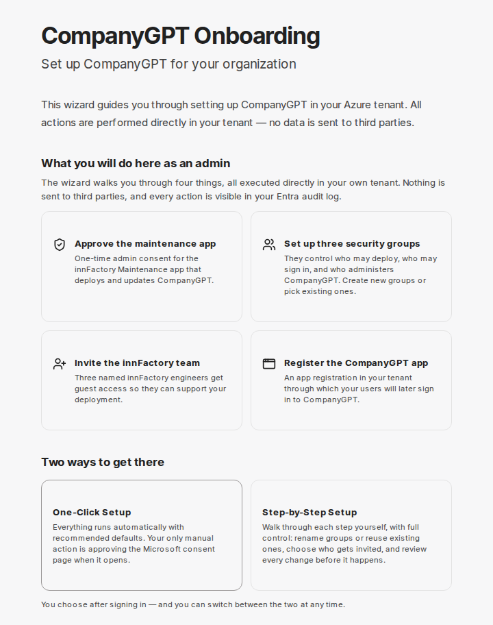

import { Steps } from '@astrojs/starlight/components';

Než innFactory nainstaluje CompanyGPT pro vaši organizaci, připraví se váš tenant Microsoft Entra: bezpečnostní skupiny, souhlas pro údržbovou aplikaci innFactory, přístup hostů pro tým innFactory a registrace aplikace, přes kterou se budou vaši zaměstnanci později přihlašovat. Tuto přípravu provedete sami v **onboardingovém portálu** na adrese [onboarding.company-gpt.com](https://onboarding.company-gpt.com).

Tato stránka je určena IT administrátorům vaší organizace. Uživatelé CompanyGPT nemusejí nic dělat. Portál je v angličtině – s výjimkou seznamu oprávnění v kroku **CompanyGPT App**, který se zobrazuje v němčině; názvy tlačítek a kroků jsou zde uvedeny přesně tak, jak je portál zobrazuje.

## K čemu portál slouží

Portál vás provede všemi přípravami ve vašem tenantovi. Jádrem jsou čtyři úkoly:

- **Schválení údržbové aplikace:** jednorázový souhlas správce pro údržbovou aplikaci innFactory, pomocí které innFactory CompanyGPT nasazuje a aktualizuje.
- **Nastavení tří bezpečnostních skupin:** určují, kdo smí nasazovat, kdo se smí přihlásit a kdo CompanyGPT spravuje. Můžete vytvořit nové skupiny nebo použít stávající.
- **Pozvání týmu innFactory:** pracovníci innFactory dostanou přístup hosta, aby mohli nasazení podpořit.
- **Registrace aplikace CompanyGPT:** registrace aplikace ve vašem tenantovi, přes kterou se vaši uživatelé budou později přihlašovat do CompanyGPT.

Všechny akce probíhají přímo ve vašem tenantovi a s vaším administrátorským účtem. U každého kroku portál vysvětluje, co se stane a která oprávnění se použijí.

## Předpoklady

- **Administrátorská práva v Microsoft Entra ID:** Přihlásíte se administrátorským účtem tenanta, ve kterém se má CompanyGPT nastavit. Doporučuje se role **Global Administrator**, protože několik kroků uděluje souhlas správce. Pokud vašemu účtu chybějí práva, dotčený krok ohlásí chybu.
- **Pouze pro hosting v Microsoft Azure:** přístup k předplatnému Azure, ve kterém má CompanyGPT běžet. Pro hosting na STACKIT není předplatné Azure potřeba.
- **Partnerský vztah:** Portál uvádí jako předpoklad, že innFactory je ve vašem tenantovi registrována jako partner (vztah nepřímého prodejce). To vám nebrání v zahájení nastavení. Případné dotazy k tomu prosím vyjasněte se svou kontaktní osobou v innFactory.
- **Povolení vyskakovacích oken:** Portál otevírá vyskakovací okna nebo nové karty pro stránky souhlasu společnosti Microsoft. Povolte je pro `onboarding.company-gpt.com`.

## Postup

### Přihlášení a výběr hostingu

Pokud vám innFactory poslala osobní odkaz na portál, použijte ho: již obsahuje údaje o vašem prostředí.

<Steps>

1. Otevřete [onboarding.company-gpt.com](https://onboarding.company-gpt.com) a klikněte na **Sign in with Microsoft**. Přihlaste se svým administrátorským účtem.

2. V části **Where will CompanyGPT be hosted?** zvolte hosting:
   - **Microsoft Azure:** CompanyGPT běží ve vašem vlastním předplatném Azure.
   - **STACKIT:** CompanyGPT běží na infrastruktuře STACKIT provozované společností innFactory. Přihlašování a správa uživatelů nadále využívají váš tenant Entra. Více informací najdete na stránce [CompanyGPT Sovereign](/cs/company-gpt/sovereign/).

3. V části **Azure Tenant** vyberte svého tenanta. Zobrazí se domovský tenant vašeho účtu. Pro hosting v Azure vyberte také předplatné v části **Azure Subscription**.

4. Klikněte na **Start Onboarding**. Microsoft vás v tomto okamžiku může požádat o souhlas s oprávněními portálu.

</Steps>

Na úvodní stránce si v části **Which permissions does this onboarding app use — and why?** můžete předem přečíst, která oprávnění portál používá a k čemu.

### One-Click nebo krok za krokem

Při prvním spuštění se portál zeptá **How would you like to set up CompanyGPT?**. Obě cesty nastaví totéž a mezi nimi můžete kdykoli přepnout.

- **One-Click Setup** (označeno **Recommended**): Všechny kroky proběhnou automaticky s doporučenými výchozími hodnotami; každý provedený krok se zobrazuje živě. Jediný ruční úkon: když se v nové kartě otevře stránka souhlasu Microsoftu pro údržbovou aplikaci, přihlaste se tam jako Global Administrator a souhlas přijměte. Nastavení pak pokračuje samo. Spusťte ho tlačítkem **Start One-Click Setup**. Pokud některý krok selže, zvolte **Retry** nebo **Continue in Advanced Setup**.
- **Step-by-Step Setup:** Každým krokem projdete sami. Můžete přejmenovat skupiny nebo použít stávající, rozhodnout, kdo bude pozván, a každou změnu před provedením zkontrolovat. V části **What happens in this step?** ukazuje každý krok, co se stane, co můžete upravit a která oprávnění používá.

Pokud portál později otevřete znovu, naváže na uložený postup.

### Fáze 1: Předpoklady

Tyto kroky provedete ve svém tenantovi vy (nebo asistent One-Click). Názvy odpovídají seznamu kroků v portálu.

| Krok | Co se stane | Použité oprávnění |
|---|---|---|
| **Check Sign-in Policies** | Portál načte zásady podmíněného přístupu a vypíše ty, které by mohly blokovat účty hostů nebo nasazení. Nic se nemění. Pokud zásady omezují externí přístup, portál vám sdělí, co je třeba povolit – například doménu `innfactory.ai`. | `Policy.Read.All` (pouze pro čtení) |
| **Security Groups** | Vytvoří se tři bezpečnostní skupiny nebo se propojí stávající: **Infrastructure Admins** (nasazení), **Users** (smějí se přihlásit do CompanyGPT) a **App Admins** (správa CompanyGPT). Výchozí názvy: `COMPANYGPT_INFRASTRUCTURE_ADMINS`, `COMPANYGPT_USERS`, `COMPANYGPT_APP_ADMINS`. | `Group.ReadWrite.All` |
| **Approve Maintenance Access** | Nejprve udělíte portálu oprávnění Graph pro následující kroky. Poté Microsoft otevře stránku souhlasu pro údržbovou aplikaci innFactory. Souhlas vytvoří ve vašem tenantovi její instanční objekt (service principal); skutečný přístup aplikace získá až členstvím ve skupině v dalším kroku. | Souhlas správce na stránce Microsoftu; poté portál pouze ke čtení ověří, že instanční objekt existuje |
| **Maintenance → Admin Group** | Údržbová aplikace se stane členem skupiny Infrastructure Admins. Teprve toto členství umožňuje innFactory provádět nasazení. Obvykle k tomu došlo automaticky již v předchozím kroku. | `GroupMember.ReadWrite.All` |
| **Subscription Permissions** (pouze Azure) | Skupině Infrastructure Admins se přiřadí role **Owner** na vybraném předplatném Azure – pro celé předplatné. Nasazení tak může vytvořit prostředky CompanyGPT. | Azure Service Management (`user_impersonation`) |
| **Invite innFactory Team** | Pracovníci innFactory jsou pozváni jako hosté a přidáni do doporučených skupin; portál zobrazí jejich jména a adresy. V režimu Step-by-Step volíte skupiny pro každou osobu zvlášť nebo jednotlivé pozvánky přeskočíte. | `User.Invite.All`, `GroupMember.ReadWrite.All` |
| **CompanyGPT App** | Vytvoří se registrace aplikace s názvem `companyGPT` a názvem vaší společnosti – předkonfigurovaná s nastavením přihlašování, potřebnými oprávněními Microsoft Graph a souhlasem správce, aby vaši uživatelé nebyli dotazováni jednotlivě. Alternativně použijete stávající registraci aplikace. | `Application.ReadWrite.All`, `DelegatedPermissionGrant.ReadWrite.All`, `Directory.ReadWrite.All`, `AppRoleAssignment.ReadWrite.All` |
| **App Ownership** | Údržbová aplikace se stane spoluvlastníkem aplikace CompanyGPT, aby aktualizace mohly udržovat její konfiguraci (adresy URL přesměrování, oprávnění) aktuální. Obvykle k tomu došlo již v předchozím kroku a zde se to pouze ověří. | `Application.ReadWrite.All` |
| **Finish & Notify** | Portál zobrazí souhrn (ID skupin a aplikace, název společnosti, kontaktní e-mail). **Save & Notify** ho uloží a upozorní tým innFactory, že je váš tenant připraven. V tomto kroku se ve vašem tenantovi nic nemění. | Žádné oprávnění Microsoft Graph |

Při hostingu na STACKIT se krok **Subscription Permissions** přeskočí; fáze 1 má pak osm kroků místo devíti.

#### Oprávnění aplikace CompanyGPT

Ve výchozím nastavení dostane aplikace CompanyGPT úplnou sadu oprávnění, pro kterou jsou CompanyGPT a doplněk Microsoft 365 navrženy. V režimu Step-by-Step můžete v kroku **CompanyGPT App** seznam rozbalit a jednotlivá oprávnění zrušit. Je rozdělen do skupin **Anmeldung (erforderlich)** (přihlášení, povinné), **companyGPT Kern** (jádro CompanyGPT), **Microsoft 365 Add-in** a **Anwendungsberechtigungen** (oprávnění aplikace). Oprávnění pro přihlášení zrušit nelze. Pokud zrušíte jiná, portál upozorní, které funkce pak nebudou plně fungovat.

Doménu, pod kterou bude CompanyGPT dostupné (například `COMPANY.company-gpt.com`), portál určí automaticky. Zobrazovaný název a doménu aplikace můžete upravit v režimu Step-by-Step.

### Fáze 2: Zavedení

V kroku **Deployment (innFactory)** nasadí innFactory CompanyGPT. Nemusíte nic dělat. Krok zůstává uzamčen, dokud ho innFactory pro nasazení neodemkne; na konci ho innFactory označí jako dokončený. Záhlaví portálu ukazuje aktuální stav (**Locked**, **In Progress**, **Live** nebo **Change Required**). Jakmile jsou všechny kroky hotové, portál zobrazí **Onboarding Complete**.

## Co následuje

- **Nasazení:** Po **Finish & Notify** je tým innFactory upozorněn a nastaví CompanyGPT – při hostingu v Azure ve vašem předplatném, při hostingu na STACKIT v prostředí provozovaném společností innFactory.
- **Poznámky od innFactory:** Pokud vám innFactory chce něco sdělit, zobrazí se to v portálu v poli **Notes from innFactory**.
- **Přístup pro vaše uživatele:** Kdo se smí přihlásit do CompanyGPT, řídíte členstvím ve skupině Users (ve výchozím nastavení `COMPANYGPT_USERS`).
- **Nová oprávnění po aktualizacích:** Pokud CompanyGPT po aktualizaci potřebuje další oprávnění Microsoftu, pošle vám innFactory odkaz na stránku **Renew Admin Consent** (viz [Řešení problémů](#řešení-problémů)).
- **Přístup pro podporu:** Pokud innFactory potřebuje pro případ podpory přístup hosta, obdržíte odkaz na stránku **Support Access Invitation**. Tam uvidíte, kdo má být pozván a do kterých skupin, a pozvánku sami potvrdíte.

## Zabezpečení a ochrana dat

- **Delegovaná oprávnění:** Portál jedná s vaším administrátorským účtem. Nikdy nemůže udělat víc než vy, a to jen během vašeho přihlášení.
- **Přímo ve vašem tenantovi:** Portál provádí všechny změny přímo ve vašem tenantovi. Lze je dohledat v protokolech auditu Microsoft Entra ID, přiřazení role na předplatném Azure pak v protokolu aktivit Azure.
- **Kde je to možné, pouze pro čtení:** Zásady podmíněného přístupu se pouze čtou, nikdy nemění. Portál nepřistupuje k e-mailům ani souborům ve vašem tenantovi.
- **Co se ukládá:** innFactory ukládá pouze průběh nastavení a údaje potřebné pro zavedení – například ID a názvy skupin a aplikace, pozvané hosty, nalezené zásady přihlašování, vaše kontaktní údaje a jméno a e-mailovou adresu administrátorů, kteří portál pro váš tenant používají. Co se přenáší, ukazuje souhrn v **Finish & Notify**.
- **Kdykoli odvolatelné:** Souhlasy odvoláte v Microsoft Entra ID v části **Enterprise applications**; členství ve skupinách, hosty a přiřazení role na předplatném můžete kdykoli odebrat. Pokud odeberete údržbovou aplikaci ze skupiny Infrastructure Admins, skončí její práva Owner na předplatném; již vydané tokeny mohou zůstat platné až do vypršení. Jako vlastník aplikace CompanyGPT zůstává údržbová aplikace uvedena, dokud ji neodeberete v Microsoft Entra ID v části **App registrations** → **Owners**.

## Řešení problémů

### „Please complete Step … first“

Předchozí krok ještě není hotový. Rozhodující je název kroku v závorce – například *Please complete Step 1 (Create Groups) first.* znamená, že chybí krok **Security Groups**. Číslo ve zprávě se může lišit od číslování v seznamu kroků. Přejděte pomocí seznamu kroků na uvedený krok a dokončete ho.

### Stránka souhlasu Microsoftu se neotevře

Povolte vyskakovací okna pro `onboarding.company-gpt.com`. Krok **Approve Maintenance Access** nabízí také odkaz pro ruční udělení souhlasu. V One-Click Setup otevřete stránku znovu pomocí **Re-open consent page**. Pokud asistent čeká na souhlas příliš dlouho, zastaví se s časovým limitem; udělte souhlas v otevřené kartě a poté zvolte **Retry**.

### Souhlas chybí nebo je neúplný

Otevřete odkaz pro souhlas, který jste obdrželi od innFactory. Má tvar `https://onboarding.company-gpt.com/consent?tenantId=…`. Přihlaste se jako Global Administrator příslušného tenanta. Stránka **Renew Admin Consent** uvádí u každého oprávnění aplikace CompanyGPT stav **Granted** nebo **Missing**; nově přidaná jsou označena **new**. Klikněte na **Grant Admin Consent**. Pokud jednotlivá oprávnění nelze udělit automaticky, dokončete souhlas pomocí **Open Microsoft consent page**.

### Oprávnění k předplatnému nelze přiřadit (pouze Azure)

Pokud je vaše předplatné spravováno přes nepřímého poskytovatele CSP, portál zobrazí **Azure Resource Access Required**. Jako Global Administrator pak musíte jednou zapnout „Access management for Azure resources“ – tlačítkem **Enable Access Management** přímo v portálu nebo ručně ve vlastnostech Microsoft Entra ID.

### Krok je již nastaven

Pokud portál zjistí, že krok je ve vašem tenantovi již hotový, zobrazí **Already configured**. Aktuální stav převezmete tlačítkem **Mark as Complete**.

### Požadovaný tenant se nezobrazuje

Portál zobrazuje domovský tenant přihlášeného účtu. Přihlaste se administrátorským účtem tenanta, ve kterém se má CompanyGPT nastavit.

### Další dotazy

Obraťte se na svou kontaktní osobu v innFactory. Mějte připravené ID svého tenanta a případně chybovou zprávu z portálu.
