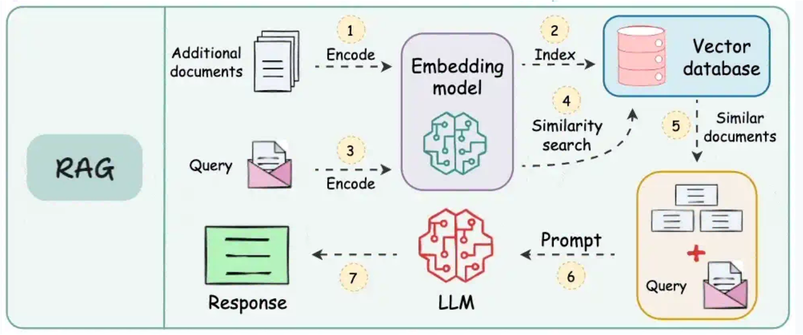

## Porozumění RAG: Retrieval Augmented Generation

Ve světě velkých jazykových modelů (LLM) je **RAG (Retrieval Augmented Generation)** účinná technika, jejímž cílem je zlepšit schopnosti a přesnost generativní AI. RAG v podstatě umožňuje modelům AI v CompanyGPT přistupovat k aktuálním, specifickým a často proprietárním informacím z externích i interních zdrojů a využívat je nad rámec znalostí z původního trénování.

### Co je RAG?

V jádru je RAG metoda, která kombinuje systém pro vyhledávání informací s generativním LLM. Místo toho, aby se spoléhala pouze na interní znalosti LLM (které mohou být zastaralé nebo postrádat oborově specifické podrobnosti), RAG nejprve vyhledá relevantní informace v konkrétní znalostní bázi a poté jimi doplní prompt pro LLM. LLM pak tento obohacený kontext použije k *vygenerování* informovanější, přesnější a podloženější odpovědi.

RAG si můžete představit tak, že LLM dostane „otevřenou knihu“, do které může před odpovědí nahlédnout, místo aby se spoléhal pouze na svou paměť.

### RAG jako specializovaný nástroj

Jak bylo vysvětleno výše, lze RAG považovat za specializovaný druh „nástroje“ v rámci širšího [rámce pro používání nástrojů](/cs/prompt-engineering/prompt-techniken/tool-use). Zatímco obecné nástroje mohou provádět akce (například odeslat e-mail nebo aktualizovat databázi) nebo načítat data v reálném čase, primární funkcí RAG je **shromažďovat informace pro kontextové generování textu**. Je speciálně navržen k tomu, aby:

*   **Zakládal odpovědi na faktech.** Aby LLM „nehalucinoval“ a negeneroval nesprávné informace.
*   **Zpřístupnil proprietární znalosti.** CompanyGPT může odpovídat na otázky na základě vašich interních dokumentů, směrnic nebo dat.
*   **Poskytoval aktuální informace.** Aby odpovědi odrážely nejnovější informace ve vaší znalostní bázi, i když nebyly součástí původních trénovacích dat LLM.
*   **Rozšiřoval kontext.** Aby LLM dostal bohaté a relevantní podrobnosti pro ucelenější a užitečnější odpovědi.

### Proč používat RAG s CompanyGPT?

Integrace schopností RAG do CompanyGPT přináší významné výhody:

*   **Přesnost a spolehlivost:** Odpovědi jsou přímo podloženy ověřitelnými externími daty.
*   **Oborová specifičnost:** CompanyGPT se může stát odborníkem na konkrétní provoz, produkty a interní dokumenty vaší společnosti.
*   **Aktuální informace:** CompanyGPT už není omezen datem uzávěrky trénovacích dat a může odpovídat na otázky na základě nejnovějších interních zpráv, zápisů ze schůzek nebo aktualizací směrnic.
*   **Omezení halucinací:** Díky výslovně poskytnutému kontextu se výrazně snižuje pravděpodobnost, že LLM sebejistě vygeneruje nesprávné informace.
*   **Lepší uživatelský zážitek:** Uživatelé dostávají relevantnější, přesnější a důvěryhodnější odpovědi.

## Pracovní postup RAG při zpracování souborů

Způsob, jakým CompanyGPT používá RAG při zpracování souborů, např. při prohledávání vašich nahraných dokumentů, se řídí jasným a efektivním pracovním postupem. Systém tak dokáže inteligentně najít a využít nejrelevantnější části vaší interní znalostní báze.

(Zdroj: [https://blog.dailydoseofds.com/p/9-rag-llm-and-ai-agent-cheat-sheets](https://blog.dailydoseofds.com/p/9-rag-llm-and-ai-agent-cheat-sheets))

Zde je rozpis typického pracovního postupu RAG při vyhledávání v dokumentech:

1.  **Nahrání dokumentů a jejich zakódování pomocí embeddingového modelu:**
    Když nahrajete dokumenty (např. soubory PDF, Word, interní zprávy), nejprve se zpracují. Rozdělí se přitom na menší, zvládnutelné části (např. odstavce nebo oddíly). Každá část se poté pomocí specializovaného modelu AI (embeddingového modelu) převede na číselnou reprezentaci, tzv. „embedding“. Tyto embeddingy zachycují sémantický význam textu.

2.  **Indexace embeddingů ve vektorové databázi:**
    Vygenerované embeddingy všech částí vašich dokumentů se uloží do vysoce efektivní databáze, tzv. vektorové databáze. Ta je optimalizována pro ukládání a rychlé vyhledávání těchto číselných vektorů na základě jejich podobnosti.

3.  **Zakódování vyhledávacího dotazu stejným embeddingovým modelem:**
    Když uživatel odešle dotaz do CompanyGPT (např. „Jaká jsou naše pravidla pro práci na dálku?“), převede se i tento dotaz na embedding pomocí *přesně stejného* embeddingového modelu, který byl použit pro vaše dokumenty. Tím je zajištěna konzistence v reprezentaci sémantického významu.
    
4.  **Vyhledávání podobnosti mezi zakódovanými daty ve vektorové databázi:**
    Zakódovaný dotaz uživatele (jeho embedding) se poté porovná se všemi uloženými embeddingy částí dokumentů ve vektorové databázi. Systém provede „vyhledávání podobnosti“, aby našel části dokumentů, jejichž embeddingy jsou číselně nejblíže embeddingu dotazu. To naznačuje sémantickou relevanci.

5.  **Použití podobných dokumentů a rozšíření původního dotazu:**
    Nejrelevantnější části dokumentů (často označované jako „kontext“ nebo „vyhledané pasáže“) se poté vyberou. Tyto vyhledané části, které obsahují faktické informace relevantní pro otázku uživatele, se pak zkombinují s původním dotazem uživatele.

6.  **Předání dokumentů, dotazu a systémových pokynů LLM:**
    Nakonec se tento rozšířený prompt – který obsahuje původní dotaz, vyhledané relevantní části dokumentů a případné interní systémové pokyny (např. „Odpovídej stručně“, „Odkazuj na poskytnuté dokumenty“) – odešle velkému jazykovému modelu v CompanyGPT.

7.  **Vrácení odpovědi uživateli:**
    LLM zpracuje tento ucelený prompt a přímo z poskytnutého kontextu dokumentů vytvoří přesnou, informovanou a užitečnou odpověď, která se poté vrátí uživateli.

Tento plynulý proces zajišťuje, že CompanyGPT poskytuje odpovědi, které jsou nejen konverzační, ale také věcně správné a přímo relevantní pro jedinečné informační prostředí vaší společnosti.
