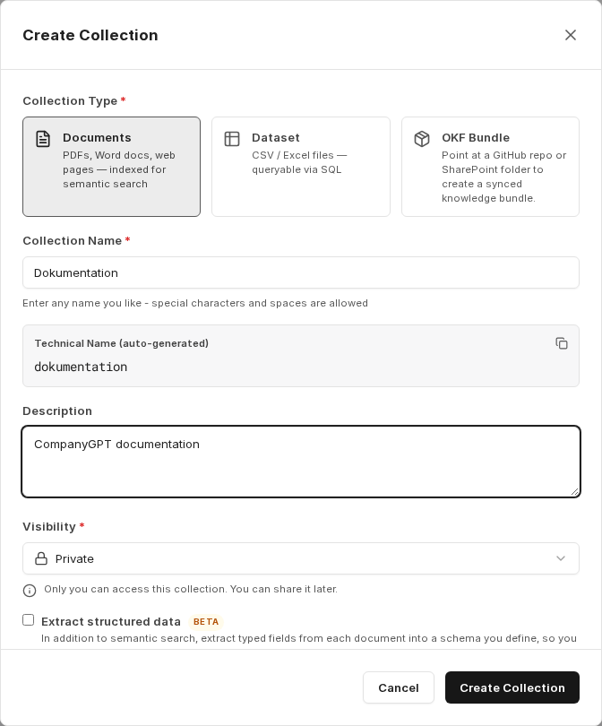
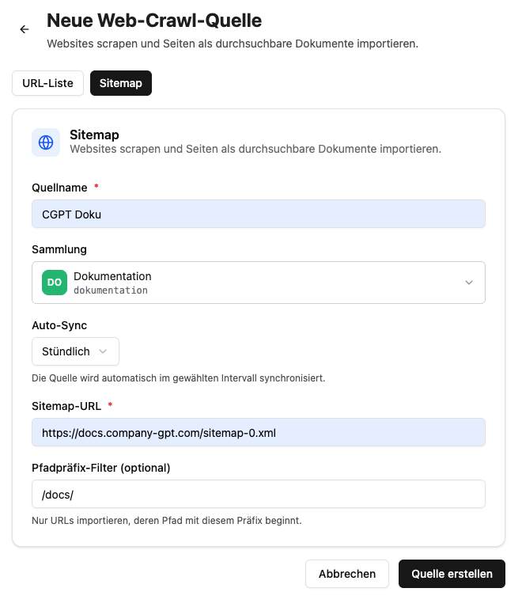
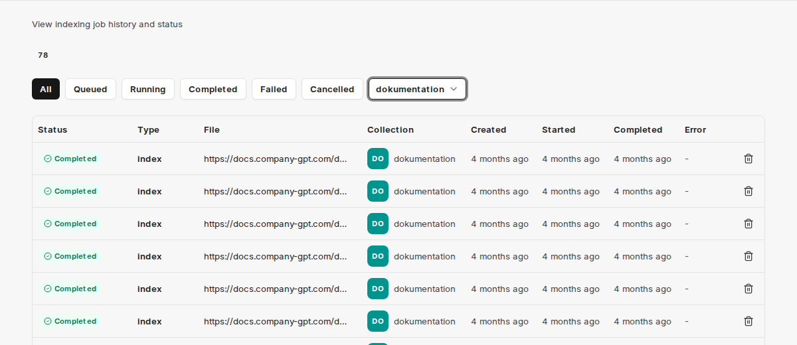
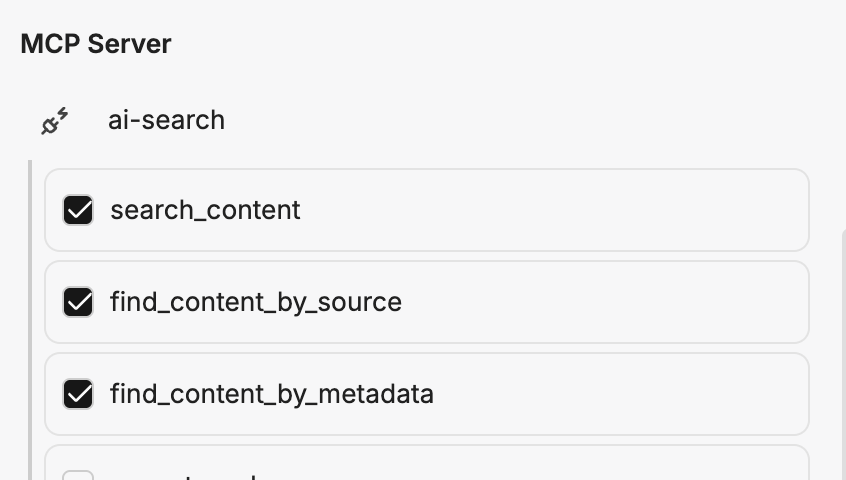

import CollectionPromptBuilderEN from '../../../../../components/CollectionPromptBuilderEN.astro'

V tomto návodu nastavíme **agenta nápovědy**, který odpovídá na otázky k dokumentačnímu webu. K tomu necháme [zdroj typu web crawl](/cs/company-gpt/addons/companyrag/quellen/#procházení-webu) v [companyRAG](/cs/company-gpt/addons/companyrag/) pravidelně procházet sitemapu webu, indexovat všechny stránky ve sbírce a tu pak zpřístupníme [agentovi](/cs/company-gpt/agenten/) přes server MCP `ai-search`.

Jako příklad použijeme veřejnou dokumentaci CompanyGPT se sitemapou `https://docs.company-gpt.com/sitemap-0.xml`. Nahraďte ji sitemapou svého vlastního webu.

Předpoklad: Máte přístup ke companyRAG – přes [All apps](/cs/company-gpt/addons/alle-apps/) pomocí dlaždice **Knowledge** nebo na adrese `https://COMPANY.company-gpt.com/companygpt/rag` (u vlastní domény stačí připojit `/companygpt/rag`) – a oprávnění vytvářet agenty.

## 1. Vytvoření sbírky

Nejprve vytvoříme sbírku, do které se budou procházené stránky indexovat. V companyRAG přejděte do části **Collections** a zvolte **Create Collection**. Jako **Collection Type** vyberte **Documents**, zadejte název a popis a zvolte viditelnost.

Poznamenejte si **technický název** (v příkladu `dokumentation`) – budete jej později potřebovat v promptu agenta.

U viditelnosti můžete volit mezi **Private** a **Public**. Pro agenta nápovědy, který má být k dispozici všem zaměstnancům, je obvykle vhodná **veřejná** sbírka. Sbírku lze později kdykoli sdílet pomocí **Share Collection** – přepínačem **Share with everyone** i se všemi uživateli.

### Rozšířená nastavení

V rozšířených nastaveních můžete – v závislosti na prostředí – upravit model embeddingů, jazyk vyhledávání, strategii dělení na části (chunking), velikost části a překryv. Pro začátek můžete ponechat výchozí hodnoty.

:::tip
Jazyk vyhledávání by měl ideálně odpovídat jazyku webu. Kromě sémantického vyhledávání se provádí i fulltextové vyhledávání, které při správném nastavení jazyka poskytuje lepší výsledky.
:::

## 2. Vytvoření zdroje typu web crawl

Aby se stránky indexovaly automaticky a opakovaně, vytvoříme zdroj typu web crawl. Přejděte do části **Sources**.

Na kartě **Webcrawl** klikněte na **Add Web Source** a vytvořte nový zdroj. Na stránce **New Web Crawl Source** vyberte kartu **Sitemap** a vyplňte pole:

- **Source name**: Libovolný název pro snadné rozpoznání, např. `CGPT Doku`.
- **Collection**: Sbírka vytvořená v kroku 1 (`dokumentation`).
- **Auto-sync**: Interval, ve kterém se sitemapa znovu prochází: **Hourly**, **Daily** nebo **Weekly**. Zdroj se pak ve zvoleném intervalu synchronizuje automaticky. Při volbě **Manual only** companyRAG prochází web pouze tehdy, když to spustíte.
- **Sitemap URL**: `https://docs.company-gpt.com/sitemap-0.xml`
- **Path prefix filter (optional)**: Omezuje, které stránky se indexují. Například `/docs/` by importoval pouze URL, jejichž cesta začíná na `/docs/`. Ponechte prázdné, chcete-li procházet celou sitemapu.

Potvrďte tlačítkem **Create source**.

:::note
Při procházení sitemapy se při prvním běhu indexuje celá sitemapa. Při každém dalším běhu se zohledňuje pouze **rozdíl** na základě posledního procházení a data změny stránek – znovu se tedy indexují jen nové nebo změněné stránky.
:::

:::tip
Místo sitemapy můžete přes kartu **URL list** procházet také jednotlivé stránky nebo seznam URL importovaný z CSV. Jednotlivé stránky se načítají při každém běhu znovu a znovu se indexují pouze tehdy, pokud se jejich obsah změnil.

:::

## 3. Spuštění procházení a kontrola stavu

Po vytvoření můžete první procházení spustit přímo pomocí **Sync now**. Pokud jste zvolili interval automatické synchronizace, companyRAG spustí první běh krátce po vytvoření také sám. Zdroj se zobrazí jako **Active** v části **All Sources**; nalezené stránky se zařadí do fronty jako indexovací úlohy.

Průběh můžete sledovat v části **Jobs**. Tam vidíte stav každé stránky (**Queued**, **Running**, **Completed**, **Failed** nebo **Cancelled**). Jakmile jsou všechny úlohy ve stavu **Completed**, lze sbírku prohledávat.

Přes nabídku **…** zdroje jej můžete kdykoli pozastavit (**Pause**), obnovit (**Resume**), upravit (**Edit**) nebo smazat (**Delete**). Smazání trvale odstraní všechny stránky tohoto zdroje ze sbírky.

## 4. Vytvoření agenta nápovědy

Aby bylo možné indexované stránky dotazovat přes chat, vytvoříme [agenta](/cs/company-gpt/agenten/). Ten potřebuje [server MCP](/cs/company-gpt/integrationen/mcp-server/) `ai-search` se zapnutými nástroji `search_content`, `find_content_by_metadata` a `find_content_by_source`.

Obvykle postačí menší model AI, např. **Claude Haiku** nebo **Gemini Flash** – funguje však jakýkoli dostupný model.

### Systémový pokyn

Jako systémový pokyn můžete použít naši níže uvedenou šablonu. Obsahuje všechny potřebné pokyny, aby odpovědi byly jednotně strukturované, vždy se provedlo vyhledávání a odpovědi vycházely pouze z indexovaného obsahu (bez halucinací).

:::tip
Předejte celý prompt modelu LLM a nechte jej upravit podle svých potřeb – např. o název vaší firmy nebo konkrétní styl odpovědí.
:::

Zadejte **technický název** své sbírky (v příkladu `dokumentation`) – prompty se vyplní automaticky:

<CollectionPromptBuilderEN />

## 5. Používání agenta

Agenta uložte. Poté jej v chatu vyberte ve výběru modelu a položte otázku k dokumentaci. Agent provede vyhledávání ve sbírce a odpoví nalezeným obsahem včetně odkazů na zdroje.

Protože zdroj typu web crawl automaticky znovu prochází web ve zvoleném intervalu, agent zůstává bez dalšího zásahu vždy aktuální vzhledem k obsahu webu.
