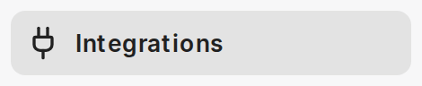
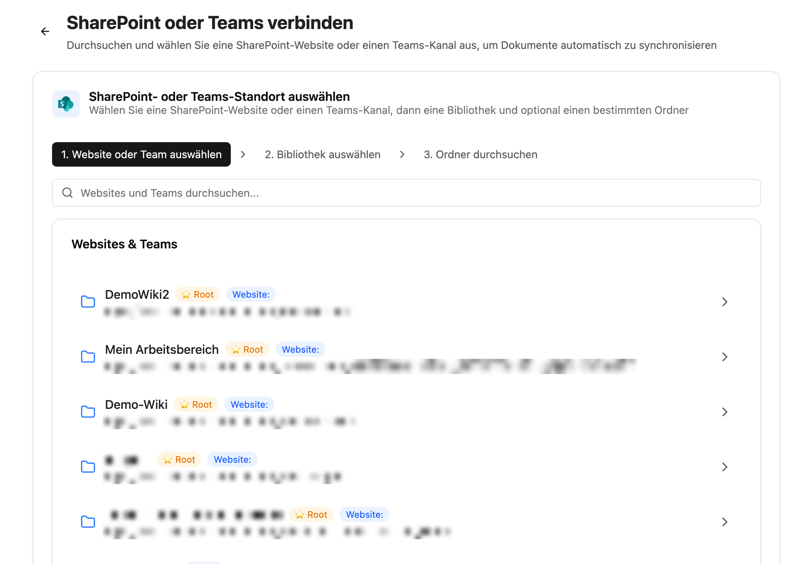
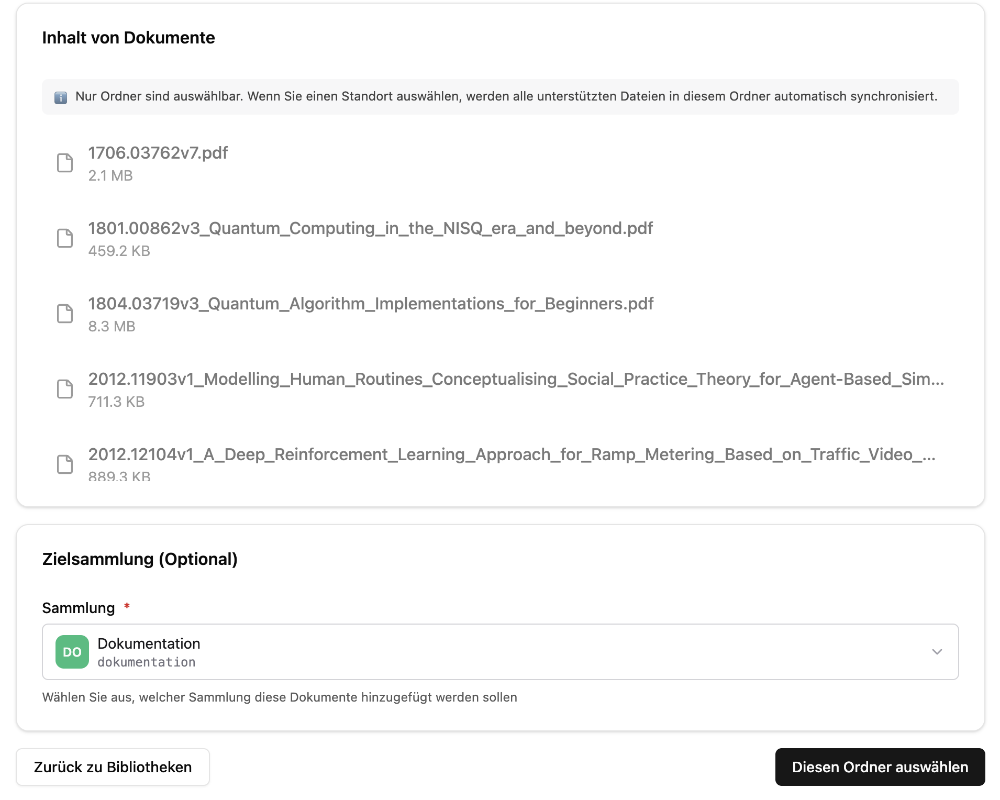
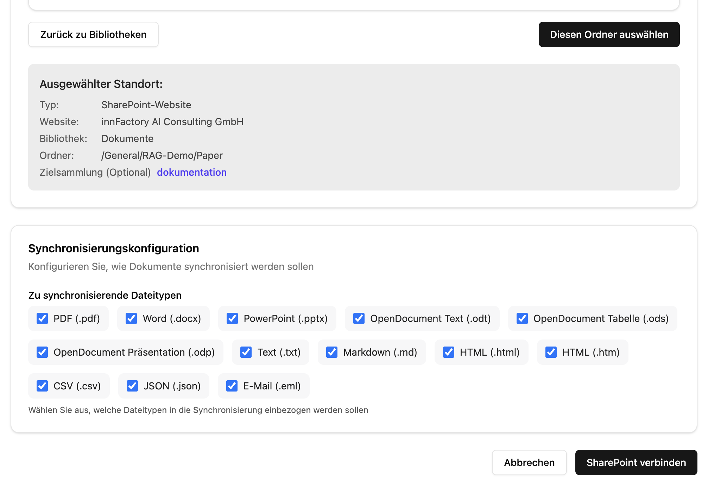

import CollectionPromptBuilderEN from '../../../../../components/CollectionPromptBuilderEN.astro'

Abychom mohli companyRAG v CompanyGPT používat, musíme nejprve vytvořit sbírku dokumentů. Otevřete companyRAG přes [Všechny aplikace](/cs/company-gpt/addons/alle-apps/) pomocí dlaždice **Knowledge** nebo přejděte přímo na `https://COMPANY.company-gpt.com/companygpt/rag` (pokud používáte vlastní doménu, stačí připojit `/companygpt/rag`).

## Vytvoření sbírky

V postranním panelu přejděte na **Collections** a vyberte **Create Collection**. Jako **Collection Type** zvolte **Documents**, zadejte název a popis a vyberte viditelnost.

**Technický název** bude později důležitý pro prompt.

U viditelnosti můžete volit mezi **Private** a **Public**. Sbírky **Public** jsou k dispozici všem uživatelům; sbírky **Private** jsou přístupné pouze vlastníkovi, ale lze je kdykoli sdílet s ostatními. Později lze sbírku sdílet s osobami a skupinami přes **Share Collection** nebo se všemi pomocí přepínače **Share with everyone**.

### Pokročilá nastavení

V pokročilých nastaveních můžete – v závislosti na prostředí – upravit embeddingový model, jazyk vyhledávání, strategii dělení na bloky, velikost bloku a překryv. Výchozí hodnoty lze pro většinu případů použití ponechat.

:::tip
Jazyk vyhledávání by v ideálním případě měl odpovídat jazyku dokumentů ve sbírce. Provádí se sémantické i fulltextové vyhledávání a fulltextové vyhledávání funguje lépe se správně nastaveným jazykem.
:::

## Indexace dokumentů

Jakmile je sbírka vytvořena, můžete přidávat dokumenty.

### Ruční nahrání

V části **Upload** jednoduše vyberte sbírku a dokumenty a nahrajte je. Ručně nahrané soubory nemají oprávnění na úrovni souborů ani další metadata kromě názvu souboru.

### SharePoint, Nextcloud a další zdroje

V části **Sources** lze vytvořit nové připojení – kromě SharePointu také k Nextcloudu, Google Drive, GitHubu, WebDAV, FTP nebo pomocí procházení webu (web crawl). Níže ukazujeme postup pro SharePoint.

:::tip
Pokud ještě nebyla připojena žádná integrace, přihlaste se nejprve v části **Integrations** k **Microsoft SharePoint** pomocí **Connect**.

:::

V části **Sources** pak výběr spustí tlačítko **Connect SharePoint** na kartě **SharePoint**. V **Content to Sync** zvolíme, zda se mají synchronizovat soubory, Pages & News nebo obojí. Poté vybereme web nebo tým, knihovnu a složku SharePointu, která se má použít – všechny podsložky vybrané složky jsou vždy zahrnuty.

Jakmile je požadovaná složka vybrána, zvolte sbírku a klikněte na **Select This Folder**.

Poté vyberte typy souborů k indexaci a klikněte na **Connect SharePoint**. První synchronizace se pak spustí automaticky a budoucí změny ve složce se načtou samy.

:::note
Dokumenty indexované přes SharePoint mají oprávnění na úrovni dokumentů. Při dotazování přes CompanyGPT se oprávnění kontrolují vždy, bez ohledu na to, jak je sbírka sdílena.
:::

## Agent CompanyGPT

Prostřednictvím [MCP serveru](/cs/company-gpt/integrationen/mcp-server/) `ai-search` lze službu RAG připojit k CompanyGPT a prohledávat indexované dokumenty ve všech sbírkách, které má uživatel k dispozici
(viz [Vyhledávání podobnosti](/cs/prompt-engineering/prompt-techniken/rag/)).

### Prompt agenta

Pro používání vyhledávání RAG je nutné vytvořit [agenta](/cs/company-gpt/agenten/). Ten potřebuje MCP server `ai-search` s povolenými nástroji `search_content`, `find_content_by_metadata` a `find_content_by_source`.

Pokud složka obsahuje tabulky (CSV, Excel, Parquet), povolte také `execute_sql` a `describe_table`. Nové sbírky mají zapnutou možnost [Tabular files as datasets](/cs/company-gpt/addons/companyrag/sammlungen/#tabulkové-soubory-jako-datové-sady): vyhledávání pak z takových souborů vrací pouze ukázku a skutečné hodnoty agent zjišťuje pomocí nástrojů SQL.

Pro agenta obvykle stačí menší model AI, např. **Claude Haiku** nebo **Gemini Flash**, ale funguje i jakýkoli jiný model.

Jako systémový pokyn můžete použít naši šablonu níže. Obsahuje všechny potřebné pokyny pro konzistentně strukturované odpovědi.

:::tip
Celý prompt můžete předat LLM a nechat si ho upravit podle svých konkrétních potřeb.
:::

Zadejte **technický název** své sbírky – prompty se vyplní automaticky:

<CollectionPromptBuilderEN />
