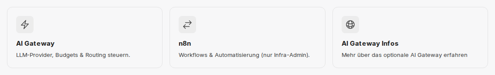

:::note[Nicht in allen Umgebungen verfügbar]
Ob diese Funktion in Ihrer Umgebung zur Verfügung steht, legt Ihr Unternehmen fest. Wenden Sie sich bei Fragen an Ihren Administrator.
:::

Das AI Gateway ist eine optionale Erweiterung von CompanyGPT. Es steht als zentrale Schnittstelle zwischen CompanyGPT und den KI-Anbietern, in CompanyGPT-Umgebungen etwa Microsoft Azure und Google Cloud. Ist das Gateway in Ihrer Umgebung eingerichtet, spricht CompanyGPT die KI-Modelle nicht mehr direkt an, sondern über das Gateway. Dort wird jede Anfrage einer Person zugeordnet, gegen die Freigaben und Budgets geprüft, mit ihren Kosten erfasst und an den passenden Anbieter weitergeleitet.

## Was das AI Gateway Ihrem Unternehmen bringt

- **Modelle und Freigaben an einer Stelle:** Das Gateway bindet die KI-Anbieter Ihrer Umgebung an und stellt deren Modelle bereit. Bei jeder Anfrage prüft es, ob die Person das Modell nutzen darf.
- **Budgets und Limits:** Ihr Unternehmen kann Budgets für das ganze Unternehmen, pro Person und pro Kostenstelle festlegen, etwa pro Monat, Woche oder Tag sowie je Anbieter oder Modell. Ist ein Budget aufgebraucht, lehnt das Gateway weitere Anfragen ab. Alternativ kann Ihr Unternehmen ein günstigeres Ersatzmodell bestimmen, das dann antwortet. Zusätzlich sind Rate Limits möglich.
- **Ausweichen bei Engpässen:** Gibt es für ein Modell mehrere Bereitstellungen, weicht das Gateway auf eine andere aus, wenn der Anbieter eine Bereitstellung drosselt oder deren Kontingent erschöpft ist. Wird ein Modell überall gedrosselt, pausiert das Gateway es kurz und nennt die Wartezeit.
- **Transparenz über Nutzung und Kosten:** Jede Anfrage wird mit ihren Kosten erfasst, auch die aus dem Chat. Administratoren werten die Nutzung im Dashboard des Gateways nach Modell, Person und Kostenstelle aus. Jede Person sieht dort ihre eigene Nutzung und ihre Kosten.
- **API-Zugang für eigene Anwendungen:** Über die [AI Gateway API](/de/api/ai-gateway/) sprechen Sie die freigegebenen Modelle auch aus eigenen Anwendungen, Skripten und Werkzeugen an – kompatibel zu OpenAI, Anthropic und Gemini und mit persönlichem API-Schlüssel. Dafür gelten dieselben Freigaben und Budgets wie im Chat.

## Was Sie im Chat merken

Die Bedienung von CompanyGPT ändert sich nicht. Sie wählen Ihr Modell wie gewohnt in der [Modellauswahl](/de/company-gpt/modellauswahl/). Einige Unterschiede gibt es trotzdem:

- **Größere Anfragen, mehr Zeit:** Das Gateway nimmt Anfragen bis 128 MiB an, etwa mit vielen oder großen Anhängen. Bis eine Antwort beginnt, zum Beispiel bei Denkmodellen, dürfen bis zu zehn Minuten vergehen. Die Grenzen der KI-Anbieter gelten weiterhin, siehe [Anfragegröße](/de/api/ai-gateway/#anfragegröße-413).
- **Budget aufgebraucht:** Ist ein Budget aufgebraucht, etwa Ihr persönliches oder das Ihrer Kostenstelle, erhalten Sie statt einer Antwort eine Fehlermeldung. Neue Anfragen sind erst wieder möglich, wenn der nächste Zeitraum beginnt oder Ihr Administrator das Limit erhöht. Hat Ihr Unternehmen ein Ersatzmodell festgelegt, antwortet stattdessen dieses Modell.
- **Modell kurz pausiert:** Drosselt der Anbieter ein Modell vorübergehend, kann eine Anfrage ebenfalls mit einer Fehlermeldung enden. Versuchen Sie es nach kurzer Wartezeit erneut oder wählen Sie ein anderes Modell.

Was die einzelnen Fehler bedeuten und ob eine Wiederholung hilft, steht unter [Fehlermeldungen](/de/api/ai-gateway/#fehlermeldungen) der AI Gateway API.

## Das Gateway öffnen

In Umgebungen mit AI Gateway gibt es unter [Alle Apps](/de/company-gpt/addons/alle-apps/) die Kachel **AI Gateway** mit dem Text **LLM-Provider, Budgets & Routing steuern.** Sie öffnet das Dashboard des Gateways. Ob Sie die Kachel sehen, legt Ihr Unternehmen fest.

Im [Demo-Zugang](/de/demo-zugang/) gibt es zusätzlich die Kachel **AI Gateway Infos** (**Mehr über das optionale AI Gateway erfahren**). Sie ist eine eigene Kachel des Demo-Zugangs und führt zur [Produktseite des AI Gateways](https://innfactory.ai/de/leistungen/ai-gateway/) auf innfactory.ai.

Im Dashboard melden Sie sich mit **Mit Firmenkonto fortfahren** per Single Sign-on an. Was Sie danach sehen, hängt von Ihrer Rolle im Gateway ab:

- Unter **Übersicht** → **Meine Nutzung** sehen Sie Ihre eigene Nutzung und dort unter **Kosten** Ihre Ausgaben und die geltenden Limits (Seite **Meine Kosten**).
- Dürfen Sie eigene API-Schlüssel anlegen, finden Sie sie unter **Übersicht** → **Meine Einstellungen** → **API-Keys**. Wie das geht, beschreibt die [AI Gateway API](/de/api/ai-gateway/#api-schlüssel).
- Ist das Dashboard für Ihre Rolle nicht freigeschaltet, erscheint **Dashboard nicht verfügbar**. Wenden Sie sich dann an Ihren Administrator.

## Für Administratoren

### Wer das Gateway verwaltet

Die Anbindung an die KI-Anbieter und die Modelle Ihrer Umgebung richtet innFactory im Gateway ein. Änderungen daran, etwa ein weiteres Modell, fragen Sie bei innFactory an.

Wer im Gateway welche Rolle hat, ergibt sich aus Gruppen Ihres Verzeichnisses; die Zuordnung richtet innFactory für Ihre Umgebung ein. Die Kachel unter Alle Apps ist nur ein Link: Den Zugriff auf das Dashboard regelt das Gateway selbst. In companyADMIN zeigt oder versteckt der Schalter **In companyTOOLS anzeigen** unter **Konfiguration → [Tools](/de/company-gpt/addons/companyadmin/tools/)** nur die Kachel.

### Was das Dashboard Administratoren zeigt

Je nach Rolle sehen Administratoren im Dashboard unter anderem diese Bereiche:

| Bereich | Inhalt |
|---|---|
| **Nutzung** | Wer und was das Gateway nutzt, nach Modell, Benutzer und Kostenstelle |
| **Kosten und Budgets** | **Kostenstellen** mit Mitgliedern und Limits sowie **Modelllimits** pro Modell |
| **Provider und Modelle** | Die angebundenen Anbieter und Modelle mit Preisen, Limits und Zustand |
| **Zugriff** | **Benutzer** mit Rollen und Budgets, **Zugriffsgruppen** und **API-Keys** |
| **Ereignisse** | Ablehnungen, Fehler und Admin-Aktionen |

### Zusammenspiel mit companyADMIN

- **Modelle im Chat:** Provider, Modelle und Budgets verwaltet das Gateway. Welche Rolle welche Modelle im Chat sieht, legen Sie weiterhin in companyADMIN fest, siehe [Modelle](/de/company-gpt/addons/companyadmin/modelle/#ai-gateway). Dort führt **Gateway öffnen** zum Gateway.
- **Betriebszustand:** Unter [Status](/de/company-gpt/addons/companyadmin/status/) zeigt companyADMIN, ob das Gateway betriebsbereit ist.

## Verfügbarkeit

Das AI Gateway ist optional und nicht in jeder CompanyGPT-Umgebung eingerichtet. innFactory richtet es auf Anfrage für Ihre Umgebung ein – sprechen Sie uns an, wenn Sie es nutzen möchten.

In [CompanyGPT Sovereign](/de/company-gpt/sovereign/) stehen die Budgets und Kostenfunktionen des AI Gateways derzeit nicht zur Verfügung.

## Verwandte Dokumentation

- [AI Gateway API](/de/api/ai-gateway/) — Modelle aus eigenen Anwendungen ansprechen, Budgets, Limits und Fehlercodes
- [Agents API](/de/api/agents-api/#budgets-im-ai-gateway) — Budgets des Gateways bei Anfragen an Agenten
- [Alle Apps](/de/company-gpt/addons/alle-apps/) — Kacheln und wer sie sieht
- [Modelle in companyADMIN](/de/company-gpt/addons/companyadmin/modelle/) — welche Rolle welche Modelle im Chat sieht
- [Modellauswahl](/de/company-gpt/modellauswahl/) — Überblick über die Modelle in CompanyGPT
