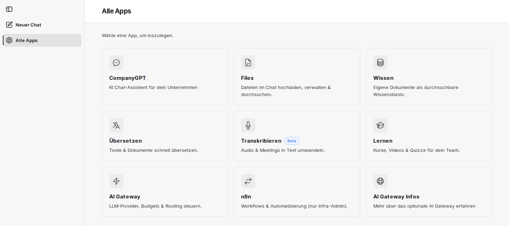
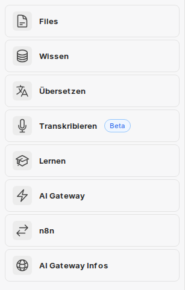

**Alle Apps** ist der Einstieg in alle Anwendungen rund um CompanyGPT. Die Übersicht zeigt als Kacheln die Addons und Links, die für Ihr Konto freigeschaltet sind. Welche Kacheln Sie sehen, legt Ihr Unternehmen fest.

## Alle Apps öffnen

Sie erreichen die Übersicht auf zwei Wegen.

**Als Seite.** In jedem Addon führt **Alle Apps** in der Seitenleiste zur Übersicht (siehe [Gemeinsame Oberfläche](/de/company-gpt/addons/gemeinsame-oberflaeche/)). Die Adresse lautet `https://FIRMA.company-gpt.com/companygpt`. Die Seite heißt **Alle Apps** und zeigt den Hinweis **Wähle eine App, um loszulegen.** Die erste Kachel ist immer **CompanyGPT** und führt zurück in den Chat. Ein Klick auf eine Kachel öffnet die App im selben Tab.

**Im Chat.** In der Seitenleiste des Chats öffnet **Apps** eine kompakte Liste derselben Apps, ohne die Kachel CompanyGPT. Ein Klick öffnet die App in einem neuen Tab, der Chat bleibt geöffnet.

:::note[Nicht in allen Umgebungen verfügbar]
Ob diese Funktion in Ihrer Umgebung zur Verfügung steht, legt Ihr Unternehmen fest. Wenden Sie sich bei Fragen an Ihren Administrator.
:::

## Kacheln

Jede Kachel zeigt den Namen der App und eine kurze Beschreibung. Diese Kacheln kann es geben:

| Kachel | Text auf der Kachel | Mehr dazu |
|---|---|---|
| **CompanyGPT** | KI Chat-Assistent für dein Unternehmen | [Benutzeroberfläche](/de/company-gpt/user-interface/) |
| **Files** | Dateien im Chat hochladen, verwalten & durchsuchen. | [companyFILES](/de/company-gpt/addons/companyfiles/) |
| **Wissen** | Eigene Dokumente als durchsuchbare Wissensbasis. | [companyRAG](/de/company-gpt/addons/companyrag/) |
| **Übersetzen** | Texte & Dokumente schnell übersetzen. | [companyTRANSLATE](/de/company-gpt/addons/company-translate/) |
| **Transkribieren** | Audio & Meetings in Text umwandeln. | [companyTRANSCRIBE](/de/company-gpt/addons/company-transcribe/) |
| **Lernen** | Kurse, Videos & Quizze für dein Team. | [companyLEARN](/de/company-gpt/addons/companylearn/) |
| **Admin** | Nutzer, Gruppen & Einstellungen verwalten. | [companyADMIN](/de/company-gpt/addons/companyadmin/) |
| **Insights** | Nutzung und Kosten von companyGPT. | [Insights](/de/company-gpt/addons/companyadmin/insights/) |
| **AI Gateway** | LLM-Provider, Budgets & Routing steuern. | – |
| **n8n** | Workflows & Automatisierung (nur Infra-Admin). | – |

Die Kachel **Wissen** öffnet companyRAG, nicht [companyKNOWLEDGE](/de/company-gpt/addons/companyknowledge/).

In einzelnen Umgebungen gibt es noch die Kachel **Dashboard** für das frühere companyDASHBOARD. Nutzung und Kosten werten Sie heute mit [Insights](/de/company-gpt/addons/companyadmin/insights/) aus.

Weitere Wissensbereiche kann Ihr Unternehmen als **Eigene Kacheln** ergänzen.

### Alpha und Beta

Manche Kacheln tragen das Kennzeichen **Alpha** oder **Beta**. Es markiert Apps, die noch nicht in der endgültigen Fassung vorliegen: **Alpha** für einen frühen, **Beta** für einen fortgeschrittenen Stand. Funktionen dieser Apps können sich noch ändern.

### Eigene Links Ihres Unternehmens

Neben den Addons kann **Alle Apps** Links zeigen, die Ihr Unternehmen ergänzt hat, etwa zum Intranet. Sie stehen hinter den Kacheln der Addons. Eine solche Kachel ist nur ein Link: Ob Sie das Ziel nutzen können, entscheidet das Ziel selbst.

## Wenn keine Apps erscheinen

- Während die Kacheln laden, stehen an ihrer Stelle graue Platzhalter.
- Ist für Ihr Konto keine App freigeschaltet, zeigt die Liste im Chat: **Aktuell stehen keine Apps für dein Konto zur Verfügung. Kontaktiere deinen Administrator.** Die Seite **Alle Apps** zeigt in diesem Fall nur die Kachel **CompanyGPT**.
- Sind Sie nicht mehr angemeldet, erscheint **Anmeldung erforderlich** mit der Schaltfläche **Anmelden**. Aus dem Bereich **Apps** im Chat öffnet sich die Anmeldung im Hauptfenster.

## Für Administratoren

### Wer welche Kacheln sieht

Je nach Umgebung kommen die Kacheln aus companyADMIN oder aus der Konfiguration, die innFactory für Ihre Umgebung pflegt.

- **Aus companyADMIN:** Die Kachel eines Addons sieht, wer das zugehörige Recht hat (Ausnahmen: n8n und AI Gateway, siehe unten). Unter **Konfiguration → [Tools](/de/company-gpt/addons/companyadmin/tools/)** verwalten Sie die **Kacheln der Erweiterungen** und legen mit **Kachel anlegen** **Eigene Kacheln** an: mit **Name**, **Adresse**, optional **Beschreibung** und **Symbol** sowie der **Sichtbarkeit** (**Alle angemeldeten Nutzer**, **Bestimmte Rollen** oder **Bestimmte Gruppen**). Die Seite zeigt auch, ob Alle Apps in Ihrer Umgebung die Kacheln aus companyADMIN liest.
- **Aus der Konfiguration:** Andernfalls steuert innFactory die Sichtbarkeit über Gruppen Ihres Verzeichnisses. Änderungen fragen Sie bei innFactory an.

Die Kennzeichen **Alpha** und **Beta** richtet innFactory auf Anfrage ein. Eigene Links ergänzen Sie über **Eigene Kacheln** in companyADMIN.

Änderungen an den Kacheln erscheinen spätestens, wenn Alle Apps neu geladen wird.

### Eine Kachel ist keine Berechtigung

:::caution
Eine Kachel ist nur ein Link. Ob jemand ein Addon nutzen darf, prüft das Addon selbst anhand der Rechte. Wer eine Kachel sieht, aber kein Recht hat, erhält beim Öffnen die Seite **Kein Zugriff**. Umgekehrt entzieht das Ausblenden einer Kachel allein kein Recht.
:::

Rechte für Addons vergeben Sie in companyADMIN, siehe [Erweiterungen](/de/company-gpt/addons/companyadmin/erweiterungen/). Eine Ausnahme bildet der Schalter einer Erweiterung unter **Konfiguration → Tools**: Bei Addons, deren Rechte companyADMIN verwaltet, schaltet er Kachel und Rechte gemeinsam (**Aktiv (Kachel und Rechte)**). Bei Anwendungen, die den Zugriff selbst regeln, wie n8n und AI Gateway, heißt der Schalter **In companyTOOLS anzeigen** und zeigt oder versteckt nur die Kachel – für alle angemeldeten Nutzer gleich, Admins eingeschlossen.
