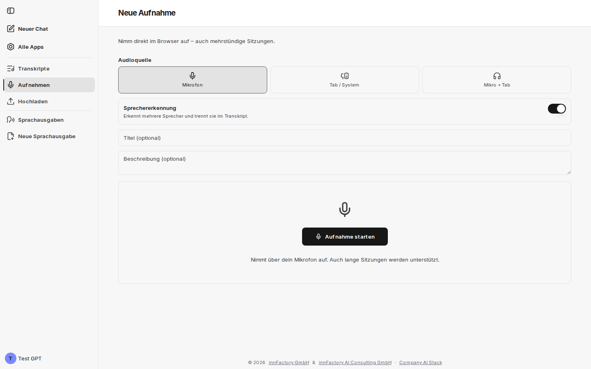
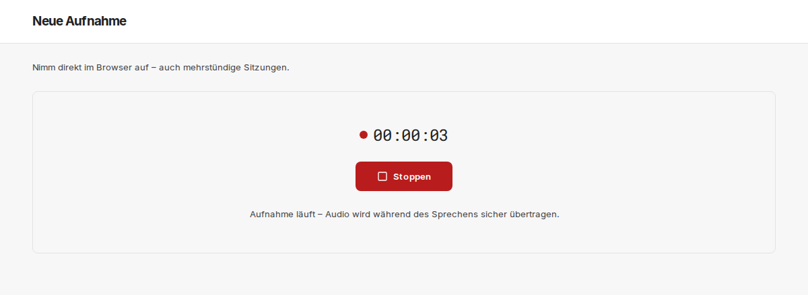

Ein Transkript entsteht in companyTRANSCRIBE auf zwei Wegen: Sie laden eine vorhandene Datei hoch oder nehmen direkt im Browser auf. Beide Wege erreichen Sie über die Menüpunkte **Aufnehmen** und **Hochladen** oder über die gleichnamigen Schaltflächen im Seitenkopf der Übersicht **Transkripte**.

## Aufnahme im Browser vorbereiten

Die Seite **Neue Aufnahme** trägt den Hinweis „Nimm direkt im Browser auf – auch mehrstündige Sitzungen.“ Vor dem Start legen Sie dort die folgenden Einstellungen fest.

### Audioquelle

| Option | Nimmt auf |
|---|---|
| **Mikrofon** | Nur das Mikrofon des Endgeräts |
| **Tab / System** | Nur den Ton des Browser-Tabs beziehungsweise des Systems |
| **Mikro + Tab** | Mikrofon und Systemton gemeinsam |

**Mikrofon** ist vorausgewählt. **Tab / System** und **Mikro + Tab** eignen sich für Online-Besprechungen, bei denen auch die Gegenseite aufgezeichnet werden soll.

:::note
Bei **Tab / System** und **Mikro + Tab** fragt der Browser nach der Quelle. Wählen Sie im Dialog einen Tab oder ein Fenster und aktivieren Sie „Audio teilen“. Das funktioniert in Chrome und Edge; unter macOS lässt sich nur der Ton von Browser-Tabs aufnehmen, nicht der von anderen Programmen.
:::

### Sprechererkennung

Der Schalter **Sprechererkennung** entscheidet, ob das Transkript nach Sprechern getrennt wird. Er ist standardmäßig eingeschaltet. Die Anwendung beschreibt beide Zustände selbst:

| Zustand | Hinweis in der Oberfläche | Geeignet für |
|---|---|---|
| Aus | „Fortlaufender Text ohne Sprecherzuordnung – passend für eigene Diktate.“ | Eigene Diktate und längere Aufnahmen, die nur für Sie selbst transkribiert werden |
| Ein | „Erkennt mehrere Sprecher und trennt sie im Transkript.“ | Besprechungen mit mehreren Teilnehmenden vor Ort oder online |

:::note
Die Sprechererkennung lässt sich nur vor dem Start der Aufnahme festlegen. Ob sie aktiv war, steht später in den Metadaten des Transkripts im Feld **Sprechererkennung** (`Aktiv` oder `Aus`).
:::

### Titel und Beschreibung

**Titel (optional)** und **Beschreibung (optional)** können vor der Aufnahme gesetzt werden; beide Felder lassen sich später in der Detailansicht des Transkripts noch ändern. Ohne Titel legt die Anwendung den Eintrag unter einer Standardbezeichnung ab.

## Aufnahme starten und beenden

Ein Klick auf **Aufnahme starten** beginnt die Aufzeichnung — der Hinweis unter der Schaltfläche lautet „Nimmt über dein Mikrofon auf. Auch lange Sitzungen werden unterstützt.“

Während der Aufnahme zeigt die Anwendung einen laufenden Timer und die Schaltfläche **Stoppen**. Der Hinweis „Aufnahme läuft – Audio wird während des Sprechens sicher übertragen.“ verweist darauf, dass das Audio fortlaufend in den Speicher des Tenants übertragen wird und nicht erst am Ende der Sitzung. Zusätzlich bleibt jedes Audiostück im Browser, bis die Aufnahme gespeichert ist. Solange die Aufnahme läuft, verhindert companyTRANSCRIBE, sofern der Browser es zulässt, dass der Bildschirm in den Ruhezustand wechselt.

Nach **Stoppen** schließt die Anwendung die Aufnahme ab („Aufnahme wird abgeschlossen...“), lädt bei Bedarf das restliche Audio hoch („Restliches Audio wird hochgeladen“) und startet die Transkription im Hintergrund. Sobald „Aufnahme gespeichert – Transkription gestartet“ erscheint, öffnet companyTRANSCRIBE das neue Transkript.

**Lassen Sie die Seite geöffnet, bis „Aufnahme gespeichert – Transkription gestartet“ erscheint.** Solange „Aufnahme wird abgeschlossen...“, „Restliches Audio wird hochgeladen“ oder „Warte auf Verbindung...“ angezeigt wird, ist die Aufnahme noch nicht vollständig gespeichert. Danach können Sie die Seite schließen; die Transkription läuft weiter.

:::note[Wie lang darf eine Aufnahme sein?]
Die Anwendung selbst begrenzt die Aufnahmedauer nicht. Mit aktiver Sprechererkennung lassen sich jedoch höchstens **240 Minuten (4 Stunden)** je Aufnahme transkribieren. Längere Aufnahmen werden zwar gespeichert, ihre Transkription schlägt aber fehl. Teilen Sie sehr lange Sitzungen daher in mehrere Aufnahmen auf.
:::

## Schutz der laufenden Aufnahme

companyTRANSCRIBE verhindert, dass eine laufende Aufnahme versehentlich verloren geht:

- **Seite verlassen:** Wählen Sie während der Aufnahme einen anderen Menüpunkt, **Neuer Chat**, **Alle Apps**, eine andere Sprache oder **Abmelden**, fragt die Anwendung: „Eine Aufnahme läuft. Aufnahme beenden und speichern, bevor du die Seite verlässt?“ Bestätigen Sie, wird die Aufnahme beendet und gespeichert und erst danach gewechselt. Lässt sie sich gerade nicht speichern, bleiben Sie auf der Aufnahmeseite, und der Upload wird weiter versucht.
- **Tab schließen oder neu laden:** Der Browser warnt, bevor er die Seite verlässt.
- **Abgelaufene Anmeldung:** Läuft Ihre CompanyGPT-Sitzung während der Aufnahme ab, nimmt companyTRANSCRIBE weiter auf und speichert die Aufnahme. Der Hinweis lautet „Deine Anmeldesitzung ist abgelaufen – die Aufnahme läuft weiter und wird gespeichert. Danach musst du dich eventuell neu anmelden.“
- **Kontowechsel im Chat:** Melden Sie sich in CompanyGPT mit einem anderen Konto an, lädt companyTRANSCRIBE die Seite erst neu, wenn die Aufnahme beendet ist.

## Verbindungsabbrüche

Bricht die Internetverbindung während der Aufnahme ab, läuft die Aufnahme weiter. Das Audio bleibt im Browser und wird automatisch hochgeladen, sobald die Verbindung zurück ist. Währenddessen erscheint der Hinweis „Keine Verbindung – … Audio warten auf den Upload. Die Aufnahme läuft weiter und wird automatisch hochgeladen, sobald du wieder online bist.“

Stoppen Sie die Aufnahme ohne Verbindung, zeigt companyTRANSCRIBE **Warte auf Verbindung...** und versucht den Upload alle 30 Sekunden erneut. Dazu stehen drei Schaltflächen bereit:

| Schaltfläche | Wirkung |
|---|---|
| **Jetzt erneut versuchen** | Startet den Upload sofort neu |
| **Audio herunterladen** | Speichert die Aufnahme als Audiodatei auf Ihrem Gerät |
| **Verwerfen** | Löscht das im Browser gespeicherte Audio nach einer Rückfrage |

Lassen Sie die Seite in diesem Zustand geöffnet oder laden Sie das Audio herunter.

Lehnt der Server den Upload ab, läuft die Aufnahme im Browser weiter, kann aber nicht gespeichert werden. Laden Sie das Audio nach dem Stoppen mit **Audio herunterladen** herunter und laden Sie die Datei anschließend über [**Hochladen**](#datei-hochladen) hoch.

### Noch nicht gespeicherte Aufnahmen

Wurde ein Tab während einer Aufnahme geschlossen oder neu geladen, ist der Browser abgestürzt oder ließ sich eine Aufnahme nicht speichern, bleibt das Audio im Browser erhalten. Beim nächsten Öffnen von **Aufnehmen** im selben Browser listet companyTRANSCRIBE solche Aufnahmen im Block **Noch nicht gespeicherte Aufnahmen** – mit Titel, Zeitpunkt und Größe:

- **Hochladen** – lädt die Aufnahme hoch und startet die Transkription
- **Audio herunterladen** – speichert das Audio als Datei
- Papierkorb (**Verwerfen**) – löscht das im Browser gespeicherte Audio

Kennt der Server eine Aufnahme nicht mehr, steht am Eintrag „existiert nicht mehr auf dem Server – lade das Audio herunter und die Datei neu hoch“.

## Datei hochladen

Über **Hochladen** transkribieren Sie eine bereits vorhandene Aufnahme — etwa eine Besprechung, die mit einem Raummikrofon, einem Aufnahmegerät oder dem Telefon mitgeschnitten wurde. Die Seite **Audio hochladen** trägt den Hinweis „Lade eine vorhandene Audio- oder Videodatei hoch und lass sie transkribieren.“

Tragen Sie zuerst optional **Titel (optional)** und **Beschreibung (optional)** ein. Ziehen Sie dann die Datei in die Ablagefläche **Audiodatei zum Transkribieren ablegen** oder wählen Sie sie per Klick aus; der Upload beginnt sofort. Die Ablagefläche nennt „MP3, WAV, M4A, WebM bis zu 200 MB und 240 Minuten“; angenommen werden alle gängigen Audio- und Videodateien bis **200 MB** und höchstens **240 Minuten** Länge. Längere Dateien lehnt der Upload direkt ab. Bei Videodateien wird die Tonspur automatisch extrahiert.

Hochgeladene Dateien werden immer mit Sprechererkennung transkribiert; einen Schalter dafür gibt es beim Upload nicht. Nach dem Upload meldet companyTRANSCRIBE „Upload abgeschlossen – Transkription gestartet“ und öffnet das neue Transkript.

## Wie geht es weiter?

Sobald die Transkription abgeschlossen ist, sehen Sie den Text in der Detailansicht. Wie Sie ihn korrigieren, Sprecher benennen und das Ergebnis exportieren, beschreibt [Transkripte bearbeiten](/de/company-gpt/addons/company-transcribe/transkripte/).
