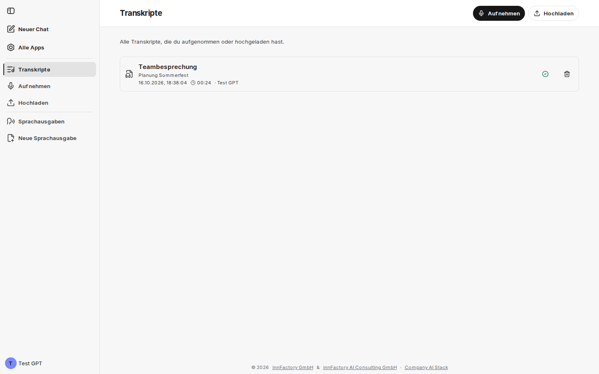

:::tip[Beta]
companyTRANSCRIBE befindet sich derzeit in der Beta-Phase. Einzelne Funktionen können sich noch ändern oder unter Umständen nicht wie erwartet funktionieren.
:::

companyTRANSCRIBE ist eine Transkriptionsanwendung, die wie CompanyGPT in der Cloud-Umgebung Ihres Unternehmens betrieben wird. Sie transkribiert Audio- und Videodateien sowie Aufnahmen direkt aus dem Browser und trennt dabei automatisch die einzelnen Sprecher. Umgekehrt lässt sich mit ihr aus Text auch wieder Audio erzeugen.

Die Transkription erfolgt über den Azure-Speech-Dienst in Ihrer Azure-Umgebung. Für [Sprachausgaben](/de/company-gpt/addons/company-transcribe/sprachausgaben/) können je nach Konfiguration zusätzlich Azure OpenAI oder Google (Chirp 3 HD) als Anbieter freigeschaltet sein – welche Anbieter verfügbar sind, legt Ihr Administrator fest.

:::caution[Transkription auf Deutsch]
companyTRANSCRIBE transkribiert derzeit immer mit deutschem Sprachmodell; eine Sprachauswahl gibt es nicht. Aufnahmen in anderen Sprachen werden deshalb nur unzuverlässig erkannt.
:::

## Aufrufen und anmelden

Sie öffnen companyTRANSCRIBE in CompanyGPT über [**Alle Apps**](/de/company-gpt/addons/alle-apps/) mit der Kachel **Transkribieren**.

companyTRANSCRIBE verwendet Ihre CompanyGPT-Sitzung. Sind Sie in CompanyGPT angemeldet, sind Sie es auch in companyTRANSCRIBE; eigene Zugangsdaten gibt es nicht.

Wer companyTRANSCRIBE nutzen darf, legt Ihr Administrator fest – je nach Umgebung in companyADMIN über das Recht **Transkribieren nutzen** (siehe [Erweiterungsrechte](/de/company-gpt/addons/companyadmin/erweiterungen/)) oder über Gruppen. Fehlt Ihnen der Zugriff, zeigt companyTRANSCRIBE die Seite **Kein Zugriff**.

## Aufbau der Anwendung

companyTRANSCRIBE nutzt die [gemeinsame Oberfläche der CompanyGPT-Erweiterungen](/de/company-gpt/addons/gemeinsame-oberflaeche/). In der Seitenleiste stehen **Neuer Chat** und **Alle Apps**, darunter das Menü der Anwendung in zwei Gruppen:

| Menügruppe | Einträge |
|---|---|
| Transkripte | **Transkripte** (Startseite), **Aufnehmen**, **Hochladen** |
| Sprachausgaben | **Sprachausgaben**, **Neue Sprachausgabe** |

Über das Kontomenü wählen Sie unter anderem **Design** und **Sprache**; die Oberfläche gibt es auf Deutsch und Englisch. Die Aktionen einer Seite stehen rechts im Seitenkopf: in der Übersicht **Transkripte** die Schaltflächen **Aufnehmen** und **Hochladen**, in der Übersicht **Sprachausgaben** die Schaltfläche **Neue Sprachausgabe**. Auf schmalen Bildschirmen öffnen Sie das Menü über die Kopfzeile, in der dann auch die Aktionen stehen.

Die Startseite **Transkripte** listet alle Aufnahmen, die Sie selbst aufgenommen oder hochgeladen haben („Alle Transkripte, die du aufgenommen oder hochgeladen hast.“).

Jede Zeile zeigt Titel, gegebenenfalls die Beschreibung, Erstellungszeitpunkt, Audiolänge und den Ersteller. Ein Klick auf die Zeile öffnet das Transkript. Rechts stehen ein Statussymbol (fertig, fehlgeschlagen oder in Arbeit) und der Papierkorb. Der Papierkorb fragt vor dem Löschen nach; gelöscht werden Audio und Transkript endgültig.

## Die Bereiche im Überblick

- **[Aufnehmen und transkribieren](/de/company-gpt/addons/company-transcribe/aufnehmen/)** — Audioquelle und Sprechererkennung wählen, im Browser aufnehmen oder eine Datei hochladen; was bei Verbindungsabbrüchen passiert.
- **[Transkripte bearbeiten](/de/company-gpt/addons/company-transcribe/transkripte/)** — Metadaten, Textkorrektur, Sprecherzuweisung und Export als Markdown.
- **[Sprachausgaben](/de/company-gpt/addons/company-transcribe/sprachausgaben/)** — Text mit einer KI-Stimme in Audio umwandeln.
- **[Zugriff über den CompanyGPT-Chat](/de/company-gpt/addons/company-transcribe/mcp-integration/)** — Transkripte und Sprachausgaben per MCP-Server im Chat nutzen.

## Unterstützte Formate und Grenzen

| Aspekt | Wert |
|---|---|
| Audio- und Videoformate beim Upload | gängige Audio- und Videodateien, z. B. `.mp3`, `.wav`, `.m4a`, `.mp4`, `.webm` |
| Maximale Dateigröße beim Upload | 200 MB |
| Maximale Länge | 240 Minuten (4 Stunden) beim Upload sowie bei Aufnahmen mit Sprechererkennung |
| Sprache | Deutsch |
| Sprechererkennung | bis zu 35 Stimmen je Aufnahme |
| Export | sprecherbeschriftete Markdown-Datei (`.md`) |

Bei Videodateien wird die Tonspur automatisch extrahiert. Die Transkription läuft als Auftrag im Hintergrund; der Fortschritt ist in der Anwendung sichtbar.

## Datenhaltung

Alle Transkriptionen werden in einer benutzerbezogenen Historie gespeichert und können dort eingesehen, bearbeitet oder gelöscht werden. Audio, Transkripte und Sprachausgaben liegen in der Cloud-Umgebung Ihres Unternehmens.

Für die Transkription wird das Audio an den Azure-Speech-Dienst übermittelt. Für eine Sprachausgabe geht der Text an den gewählten Anbieter – bei Google (Chirp 3 HD) an Google Cloud Text-to-Speech.
