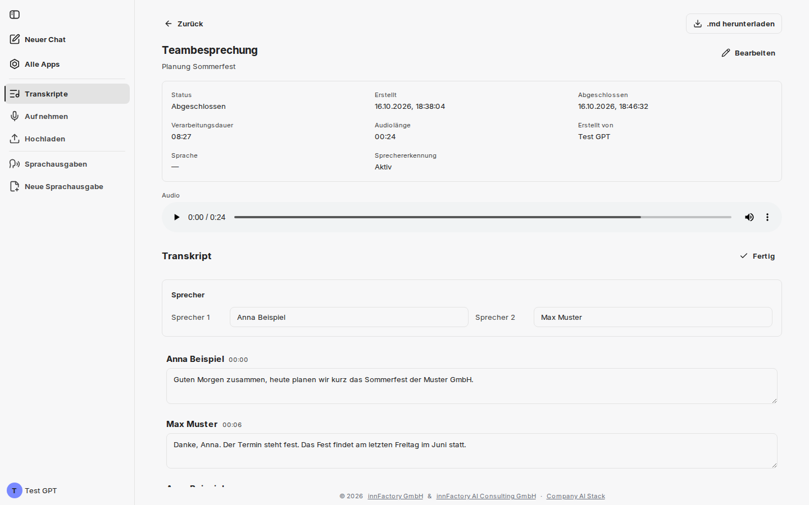
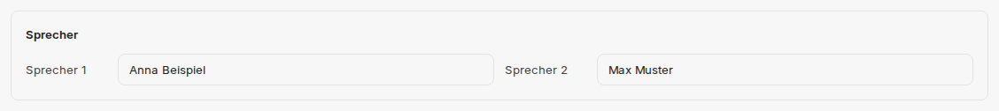

Ein Klick auf eine Zeile in der Übersicht **Transkripte** öffnet die Detailansicht; nach einer Aufnahme oder einem Upload öffnet companyTRANSCRIBE sie automatisch. Dort sehen Sie die Metadaten der Aufnahme, können das Audio abspielen, den erkannten Text korrigieren, Sprecher benennen und das Ergebnis exportieren. **Zurück** führt zur Übersicht.

## Metadaten der Aufnahme

Der Kopfbereich der Detailansicht führt die technischen Angaben zur Transkription auf.

| Feld | Inhalt |
|---|---|
| **Status** | `Ausstehend`, bis die Transkription beginnt, `In Bearbeitung`, solange transkribiert wird, danach `Abgeschlossen` – oder `Fehlgeschlagen`, wenn die Transkription nicht möglich war |
| **Erstellt** | Zeitpunkt, zu dem die Aufnahme angelegt wurde |
| **Abgeschlossen** | Zeitpunkt, zu dem das Transkript fertig war |
| **Verarbeitungsdauer** | Dauer des Transkriptionslaufs |
| **Audiolänge** | Länge der Aufnahme |
| **Erstellt von** | Benutzer, dem das Transkript gehört |
| **Sprache** | bleibt leer (`—`), da immer auf Deutsch transkribiert wird |
| **Sprechererkennung** | `Aktiv` oder `Aus`, je nach Einstellung bei der Aufnahme |

Solange die Transkription läuft, steht an der Stelle des Textes der Hinweis „Wird transkribiert... Je nach Länge der Aufnahme kann dies einige Minuten dauern.“ Ist sie fehlgeschlagen, erscheint „Transkription fehlgeschlagen“, wenn möglich mit dem Grund. Enthält die Aufnahme keine erkennbare Sprache, meldet die Detailansicht „In dieser Aufnahme wurde keine Sprache erkannt.“

Über **Bearbeiten** neben dem Titel ändern Sie Titel und Beschreibung des Eintrags; **Speichern** übernimmt die Änderung.

:::note
Das Feld **Sprache** zeigt einen Gedankenstrich. Das ist kein Fehler: companyTRANSCRIBE transkribiert immer auf Deutsch, eine Sprachauswahl gibt es weder bei der Aufnahme noch beim Upload.
:::

## Audio abspielen

Unter **Audio** steht ein Player, über den sich die Aufnahme jederzeit erneut anhören lässt — hilfreich, um eine unklare Stelle im Transkript gegen das Original zu prüfen. Ein Klick auf einen Zeitstempel im Transkript springt im Audio direkt an diese Stelle.

## Text korrigieren

Der Abschnitt **Transkript** bietet zwei Aktionen:

- **Bearbeiten** — schaltet den Text in bearbeitbare Felder, eines je Redebeitrag. Änderungen speichert companyTRANSCRIBE während der Eingabe; die Aktion wechselt auf **Fertig**, mit dem Sie die Bearbeitung beenden.
- **Synchronisieren** — Beim Abspielen läuft das Transkript automatisch mit. Scrollen Sie selbst im Text weg, erscheint **Synchronisieren** und schaltet das Mitlaufen wieder ein.

Typischerweise korrigieren Sie hier Eigennamen und Fachbegriffe, die die Erkennung falsch verstanden hat — etwa ein „App“, das eigentlich „API“ heißen sollte. Die Korrektur wirkt sich auch auf den Export aus.

## Sprecher benennen

Wurde die Aufnahme mit aktiver Sprechererkennung erstellt, erscheint über dem Text der Block **Sprecher** mit einem Eingabefeld je erkannter Stimme (`Sprecher 1`, `Sprecher 2`, `Sprecher 3`, …).

Tragen Sie dort die tatsächlichen Namen ein. Die Zuweisung zieht sich anschließend durch das gesamte Transkript: Jeder Redebeitrag ist mit dem vergebenen Namen und einem Zeitstempel überschrieben. Aus der anonymen Nummerierung wird so ein lesbares Gesprächsprotokoll — und die Namen stehen auch in der exportierten Datei. Sprecher ohne Namen erscheinen im Text und im Export derzeit als „Speaker 1“, „Speaker 2“ usw.

:::tip[Hinweis]
Die Sprechererkennung unterscheidet bis zu 35 Stimmen je Aufnahme. Benennen Sie die Sprecher einmal zentral in diesem Block, anstatt einzelne Abschnitte im Text zu überschreiben.
:::

## Als Markdown exportieren

Die Schaltfläche **.md herunterladen** oben rechts speichert das vollständige Transkript als Markdown-Datei; sie erscheint, sobald die Transkription abgeschlossen ist. Die Datei beginnt mit dem Titel und dem Erstelldatum; bei aktiver Sprechererkennung beginnt jeder Redebeitrag mit dem vergebenen Namen in Fettschrift und dem Zeitstempel. So lässt sie sich unmittelbar weiterverarbeiten lässt — etwa als Grundlage für ein Protokoll oder zur Ablage in einer Wissenssammlung.

## Wie geht es weiter?

Statt das Transkript manuell weiterzuverarbeiten, können Sie es direkt im Chat auswerten lassen: [Zugriff über den CompanyGPT](/de/company-gpt/addons/company-transcribe/mcp-integration/).
