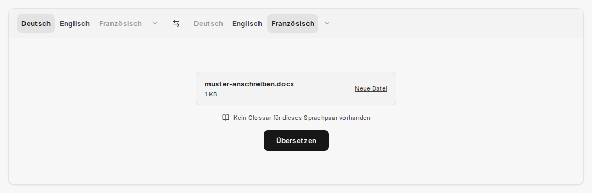
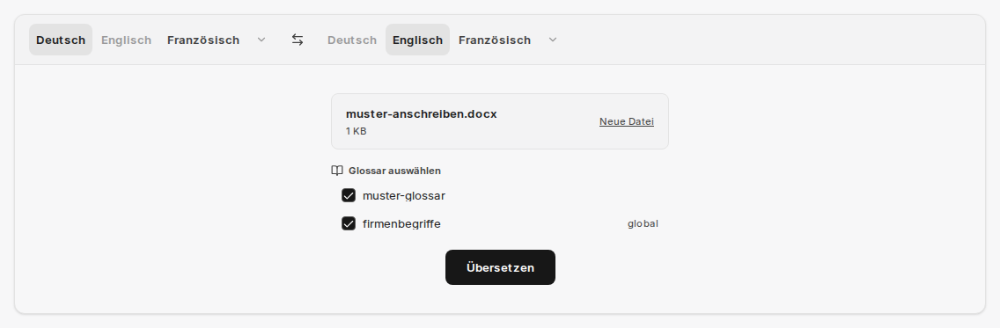
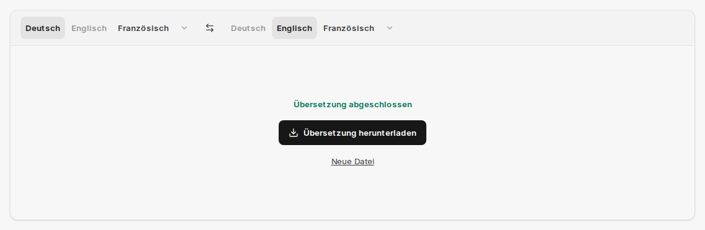

Der Bereich **Dokumente** übersetzt vollständige Dateien und gibt sie im Ausgangsformat zurück. Die Seite trägt den Titel **Dokument übersetzen** und den Hinweis „Lade ein Dokument hoch und erhalte mit einem Klick eine übersetzte Kopie.“

## Unterstützte Formate

Der Ablagebereich **Datei zum Übersetzen ablegen** nennt die zulässigen Formate: **PDF, Word, PowerPoint, Excel, TXT, Markdown, HTML bis 40 MB**. Sie legen eine Datei per Drag-and-drop ab oder wählen sie über **Datei auswählen** aus.

| Format | Dateiendung |
|---|---|
| PDF | `.pdf` |
| Word | `.docx` |
| PowerPoint | `.pptx` |
| Excel | `.xlsx` |
| Text | `.txt` |
| Markdown | `.md` |
| HTML | `.html` |

companyTRANSLATE prüft Format, Größe und Inhalt jeder Datei. Passt etwas nicht, bleibt der Ablagebereich stehen und nennt den Grund, zum Beispiel „Datei ist zu groß (max. 40 MB)“ oder „Der Inhalt der Datei passt nicht zu ihrem Dateityp.“ Textdateien (TXT, Markdown, HTML) müssen UTF-8-kodiert sein.

:::note
Anders als bei der [Textübersetzung](/de/company-gpt/addons/company-translate/text-uebersetzen/) gibt es hier keine automatische Spracherkennung. Wählen Sie vor der Übersetzung eine Ausgangssprache; ohne sie bleibt **Übersetzen** gesperrt und companyTRANSLATE weist mit „Bitte Quellsprache auswählen (kein Automatisch möglich bei Dateien)“ darauf hin.
:::

## Sprachen und Glossar wählen

Nach der Auswahl zeigt companyTRANSLATE die Datei mit Namen und Größe an. Über **Neue Datei** wählen Sie eine andere Datei. Darunter steht der Glossarstatus für das gewählte Sprachpaar: entweder **Kein Glossar für dieses Sprachpaar vorhanden** oder die Liste **Glossar auswählen** mit allen passenden Glossaren als Kontrollkästchen.

Alle passenden Glossare sind zunächst ausgewählt; globale Glossare tragen den Zusatz **global**. Entfernen Sie den Haken bei Glossaren, die nicht angewendet werden sollen. In der Dokumentübersetzung wirken Glossare in jeder Umgebung, auch ohne Google.

**Übersetzen** startet den Vorgang. companyTRANSLATE zeigt dabei zuerst **Wird hochgeladen...** und dann **Wird übersetzt...**.

## Ergebnis herunterladen

Nach Abschluss meldet companyTRANSLATE **Übersetzung abgeschlossen** und bietet **Übersetzung herunterladen** an. **Neue Datei** oder **Neue Übersetzung** im Seitenkopf setzen den Bereich für den nächsten Vorgang zurück.

Die übersetzte Kopie behält Aufbau und Formatierung der Ausgangsdatei: Überschriften, Absätze, Hervorhebungen und Seitenumbrüche bleiben erhalten, sodass sich Ausgangs- und Zieldokument nebeneinander vergleichen lassen.

Schlägt die Übersetzung fehl, erscheint **Übersetzung fehlgeschlagen**, wenn möglich mit dem Grund, etwa „Übersetzungslimit erreicht“.

## Letzte Übersetzungen

Unter dem Ablagebereich listet **Letzte Übersetzungen** Ihre bisherigen Dokumentübersetzungen, die neuesten zuerst. Die Liste enthält auch Übersetzungen, die ein Agent im [Chat](/de/company-gpt/addons/company-translate/im-chat/) für Sie erstellt hat. Jeder Eintrag zeigt Dateiname, Zielsprache, Dateigröße und Zeitpunkt.

| Markierung | Bedeutung |
|---|---|
| **In Bearbeitung** | Die Übersetzung läuft noch; es gibt noch keinen Download. |
| **Fehlgeschlagen** | Die Übersetzung ist gescheitert. |
| ohne Markierung | Die Übersetzung ist fertig; die Schaltfläche rechts lädt sie herunter. |

Das Menü am Eintrag bietet:

- **Original herunterladen** – die hochgeladene Ausgangsdatei
- **Neu übersetzen** – startet die Übersetzung erneut mit derselben Ausgangsdatei, Ausgangssprache und denselben Glossaren. Das Ergebnis erscheint als neuer Eintrag; der bisherige bleibt bestehen.
- **Löschen** – entfernt Übersetzung und Ausgangsdatei nach einer Rückfrage („Wirklich löschen?“)

Gibt es ein Glossar, das bei der ursprünglichen Übersetzung verwendet wurde, nicht mehr, bricht **Neu übersetzen** mit „Das gewählte Glossar wurde nicht gefunden.“ ab.

:::tip[Hinweis]
Größere Dokumente brauchen einen Moment. Sie müssen die Seite dafür nicht geöffnet lassen: Eine laufende Übersetzung finden Sie später in **Letzte Übersetzungen** wieder.
:::

Übersetzungen werden 30 Tage aufbewahrt. Danach verschwinden sie aus der Liste; ein späterer Versuch meldet „Diese Übersetzung ist abgelaufen und nicht mehr verfügbar“.

## Weiterführende Themen

- [Glossare](/de/company-gpt/addons/company-translate/glossare/) – einheitliche Terminologie für Dokumentübersetzungen
- [Text übersetzen](/de/company-gpt/addons/company-translate/text-uebersetzen/) – kurze Texte direkt in der Oberfläche übersetzen
- [Übersetzen im Chat](/de/company-gpt/addons/company-translate/im-chat/) – Dateien aus dem Chat per Agent übersetzen
