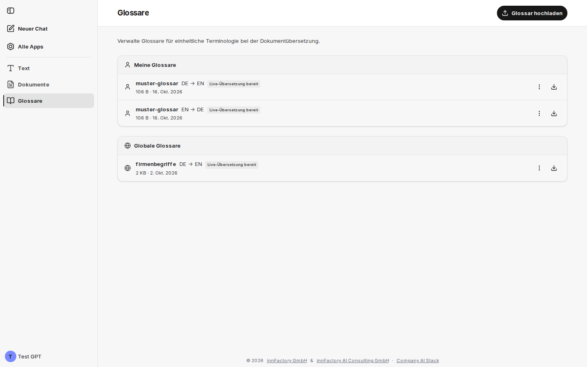
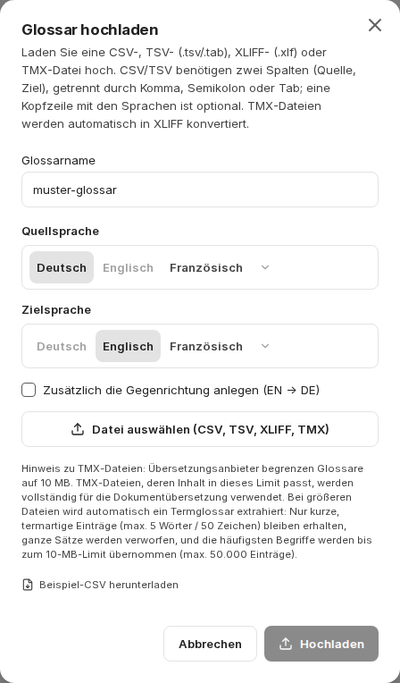

Glossare legen fest, wie einzelne Begriffe übersetzt werden. Sie sichern damit verbindliche Terminologie – etwa Produktnamen, Rollenbezeichnungen oder feststehende Formulierungen –, die sonst je nach Kontext unterschiedlich übersetzt würde. Glossare wirken bei der [Dokumentübersetzung](/de/company-gpt/addons/company-translate/dokument-uebersetzen/), bei der [Übersetzung im Chat](/de/company-gpt/addons/company-translate/im-chat/) und – wenn in Ihrer Umgebung Google Cloud Translation aktiviert ist – auch bei der [Textübersetzung](/de/company-gpt/addons/company-translate/text-uebersetzen/).

Die Glossare verwalten Sie im Bereich **Glossare** („Verwalte Glossare für einheitliche Terminologie bei der Dokumentübersetzung.“). Auf Smartphones steht dieser Bereich nicht zur Verfügung.

## Meine Glossare und Globale Glossare

Die Übersicht trennt zwei Ebenen:

- **Meine Glossare** – Ihre eigenen Glossare. Jeder, der companyTRANSLATE nutzen darf, kann eigene Glossare anlegen: über **Glossar hochladen** rechts im Seitenkopf.
- **Globale Glossare** – unternehmensweit gültige Glossare, die allen zur Verfügung stehen. Anlegen, ersetzen und löschen können sie nur Administratoren, in companyADMIN also Personen mit dem Recht **Glossare verwalten** (siehe [Zugriff und Rechte](/de/company-gpt/addons/company-translate/#zugriff-und-rechte)). Nur sie sehen im Seitenkopf zusätzlich **Globales Glossar hochladen**.

Gibt es noch keine globalen Glossare, erscheint **Keine globalen Glossare verfügbar**; wer kein Administrator ist, sieht darunter „Nur Administratoren können globale Glossare verwalten.“

Jeder Eintrag zeigt Name, Sprachrichtung (etwa `DE → EN`), bei TSV- und XLIFF-Glossaren das Format, gegebenenfalls den [Live-Status](#live-status-bei-google), Dateigröße und Datum. Rechts lädt eine Schaltfläche das Glossar herunter. Das Menü am Eintrag bietet:

- **Neue Version hochladen** – öffnet den Upload-Dialog mit Name und Sprachen des Glossars; die neue Datei ersetzt das bisherige Glossar
- **Löschen** – entfernt das Glossar nach einer Bestätigung

Globale Glossare können nur Administratoren ersetzen oder löschen.

## Live-Status bei Google

Ist in Ihrer Umgebung Google Cloud Translation aktiviert, hinterlegt companyTRANSLATE hochgeladene Glossare zusätzlich bei Google, damit sie in der Textübersetzung („Live-Übersetzung“) wirken. Der Status steht am Eintrag:

| Status | Bedeutung |
|---|---|
| **Live-Übersetzung bereit** | Das Glossar wirkt in der Textübersetzung. |
| **Live-Übersetzung wird vorbereitet** | Google richtet das Glossar noch ein; das dauert in der Regel einige Minuten. In der Textübersetzung ist es so lange ausgegraut. |
| **Für Live-Übersetzung noch nicht registriert** | Das Glossar ist noch nicht bei Google hinterlegt. Über **Neue Version hochladen** registrieren Sie es erneut. |
| **Nicht für Live-Übersetzung nutzbar** | Google kann das Glossar nicht verwenden, etwa weil es eine XLIFF-Datei ist. |

Für die Dokumentübersetzung spielt der Live-Status keine Rolle: Dort lässt sich jedes Glossar verwenden. Ohne Google zeigt die Übersicht keinen Live-Status.

## Aufbau einer Glossardatei

Eine CSV- oder TSV-Datei enthält zwei Spalten – Quelle und Ziel. Jede Zeile bildet ein Begriffspaar:

| de | en |
|---|---|
| Umsatz | Money Explosion |
| Geschäftsjahr | Year of the Potato |
| Vorstand | Council of Wizards |
| Besprechung | Nap Time |

:::note
Die Beispielwerte stammen aus einem Schulungsglossar und sind bewusst überzeichnet, damit die Wirkung des Glossars in der Übersetzung sofort sichtbar wird.
:::

Beim Hochladen gilt:

- **Trennzeichen:** Komma, Semikolon oder Tabulator. companyTRANSLATE erkennt das Trennzeichen selbst, sodass auch Exporte aus Tabellenprogrammen mit Semikolon funktionieren.
- **Kopfzeile:** optional. Eine erste Zeile gilt als Kopfzeile, wenn sie die beiden Sprachen nennt – als Kürzel (`de;en`), als Namen (`Deutsch;Englisch` oder `German;English`) oder als Name mit Kürzel (`Deutsch;Englisch (en)`) – oder allgemeine Bezeichnungen wie `Quelle;Ziel` bzw. `source,target` enthält. Jede andere erste Zeile wird als Begriffspaar übernommen.
- **Leere Felder:** Zeilen, in denen ein Begriff fehlt, werden übergangen. Enthält die Datei kein einziges Begriffspaar, lehnt companyTRANSLATE sie ab („Keine Begriffspaare gefunden – erwartet werden zwei Spalten (Quelle, Ziel), getrennt durch Komma, Semikolon oder Tab.“).

Über **Beispiel-CSV herunterladen** stellt der Upload-Dialog eine Vorlage bereit.

## Glossar hochladen

**Glossar hochladen** im Seitenkopf öffnet einen Dialog mit allen Angaben zum neuen Glossar.

| Feld | Bedeutung |
|---|---|
| **Glossarname** | Name, unter dem das Glossar zur Auswahl steht. Erlaubt sind nur Kleinbuchstaben, Ziffern und Bindestriche, 1–40 Zeichen. Großbuchstaben wandelt das Feld bei der Eingabe in Kleinbuchstaben um, Leerzeichen und Unterstriche in Bindestriche; andere Zeichen entfallen. |
| **Quellsprache** | Sprache der linken Spalte |
| **Zielsprache** | Sprache der rechten Spalte; sie muss sich von der Quellsprache unterscheiden |
| **Zusätzlich die Gegenrichtung anlegen** | Legt aus derselben Datei ein zweites Glossar für die umgekehrte Richtung an. Das Feld erscheint nur, wenn diese Funktion in Ihrer Umgebung aktiviert ist; für XLIFF-Dateien gilt es nicht. |
| **Datei auswählen (CSV, TSV, XLIFF, TMX)** | Auswahl der Glossardatei |

Zulässig sind **CSV-, TSV- (`.tsv`/`.tab`), XLIFF- (`.xlf`) und TMX-Dateien**. TMX-Dateien werden automatisch in XLIFF konvertiert. **Hochladen** speichert das Glossar.

Laden Sie ein Glossar mit demselben Namen und derselben Sprachrichtung erneut hoch, ersetzt es das bisherige („Glossar ersetzt“).

:::note
Glossare gelten immer nur in eine Richtung. Ein Glossar Deutsch → Englisch greift nicht bei einer Übersetzung Englisch → Deutsch. Mit **Zusätzlich die Gegenrichtung anlegen** entstehen beide Richtungen in einem Schritt; in der Übersicht erscheinen sie als zwei Einträge mit gleichem Namen und unterschiedlicher Sprachrichtung.
:::

Ist Google aktiviert, meldet companyTRANSLATE nach dem Upload, wenn ein Glossar nur für Dokumente gilt – etwa „XLIFF-Glossare gelten nur für Dokumente. Für die Live-Übersetzung CSV, TSV oder TMX hochladen.“

### Grenzen bei TMX-Dateien

Der Dialog weist auf eine Größenbeschränkung hin: Übersetzungsanbieter begrenzen Glossare auf 10 MB. TMX-Dateien, deren Inhalt in dieses Limit passt, werden vollständig für die Dokumentübersetzung verwendet. Bei größeren Dateien wird automatisch ein Termglossar extrahiert – nur kurze, termartige Einträge mit höchstens 5 Wörtern beziehungsweise 50 Zeichen bleiben erhalten, ganze Sätze werden verworfen, und die häufigsten Begriffe werden bis zum 10-MB-Limit übernommen, maximal 50.000 Einträge.

## Glossare anwenden

Ein Glossar steht zur Verfügung, sobald die gewählte Sprachkombination zu seiner Sprachrichtung passt:

- **Textübersetzung** (nur mit Google): über die durchsuchbare Glossarauswahl unter dem Eingabefeld oder automatisch über **Glossar automatisch anwenden**; pro Übersetzung wirkt ein Glossar. Siehe [Text übersetzen](/de/company-gpt/addons/company-translate/text-uebersetzen/#glossar-anwenden).
- **Dokumentübersetzung:** über **Glossar auswählen** vor dem Start; alle passenden Glossare sind vorausgewählt. Siehe [Dokument übersetzen](/de/company-gpt/addons/company-translate/dokument-uebersetzen/#sprachen-und-glossar-wählen).
- **Im Chat:** Der Agent wendet gespeicherte Glossare auf Wunsch an und kann neue Glossare speichern. Siehe [Übersetzen im Chat](/de/company-gpt/addons/company-translate/im-chat/#glossare-im-chat).

Passt kein Glossar zur Sprachkombination, meldet die Oberfläche **Kein Glossar für dieses Sprachpaar**. Die Anwendung eines Glossars ist optional: Auch bei vorhandenem Glossar lässt sich ohne übersetzen.

:::danger
Glossare berücksichtigen Groß- und Kleinschreibung. Ein Eintrag greift nur bei identischer Schreibweise. Begriffe, die in mehreren Schreibweisen vorkommen sollen, müssen als separate Einträge im Glossar stehen.
:::

## Weiterführende Themen

- [Text übersetzen](/de/company-gpt/addons/company-translate/text-uebersetzen/) – Glossare in der Echtzeitübersetzung
- [Dokument übersetzen](/de/company-gpt/addons/company-translate/dokument-uebersetzen/) – Glossare bei Dateiübersetzungen
- [Übersetzen im Chat](/de/company-gpt/addons/company-translate/im-chat/) – Glossare im Chat nutzen und speichern
